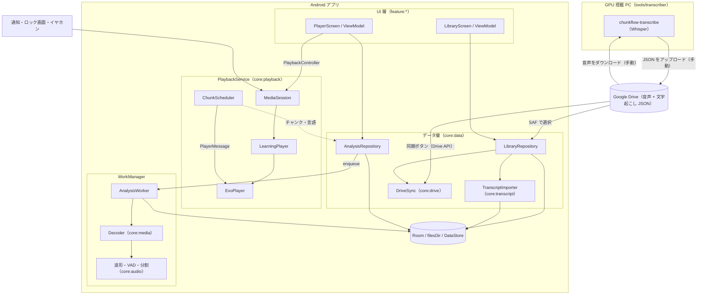
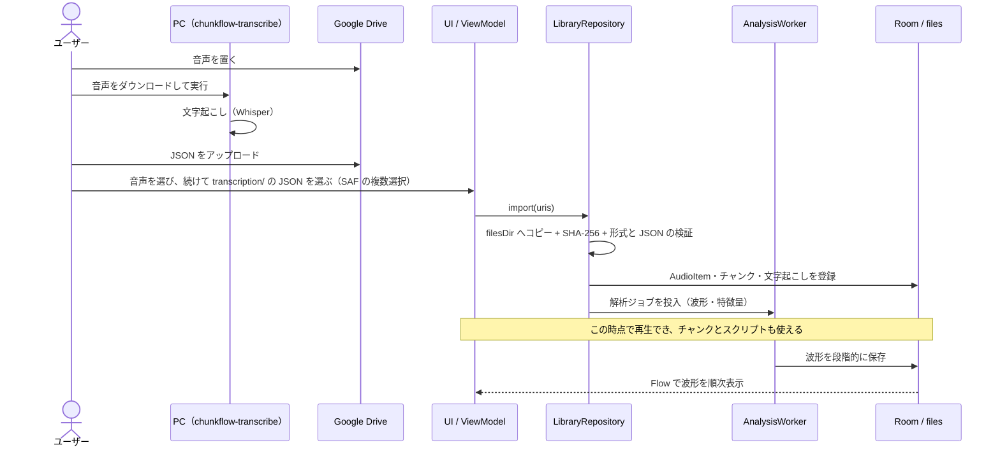

# Design Doc: Chunk Flow（語学学習用オーディオプレイヤー）

| 項目 | 内容 |
| --- | --- |
| Status | Draft v0.5 |
| Last updated | 2026-10-14 |
| Owner | miuraken |
| リポジトリ | https://github.com/miuraken/chunk-flow |
| applicationId | `com.miuraken.chunkflow` |
| 利用形態 | 個人利用（自分の端末にインストールする。Google Play では公開しない） |
| 対象 | Android 14 以上（minSdk 34）。主な対象端末は Pixel 8 以降 |
| 主要技術 | アプリ: Kotlin / Jetpack Compose + Material 3 / Media3（ExoPlayer・Session）/ Room / WorkManager / Hilt。PC ツール: Python + Whisper（macOS / Linux / Windows 11 の WSL2） |

| 版 | 内容 |
| --- | --- |
| v0.1 | 初版ドラフト |
| v0.2 | v0.1 をレビューして全面改訂 |
| v0.3 | 個人利用に決定。文字起こしを GPU 搭載 PC 上の Whisper で生成し、Google Drive 経由で取り込む方式に変更。教材ごとに異なる言語ペアに対応 |
| v0.4 | PC ツールの対応環境（macOS: Apple Silicon、Linux / Windows 11: NVIDIA）、Drive との手動でのやり取り（監視モードは廃止）、Drive のフォルダ構成（文字起こしは `<コース>/transcription/`）、想定する言語と言語ごとの対策（中国語は簡体字が既定で繁体字も表示可、広東語は口語の表記）、教材の想定（BGM なし、2〜30 分）、minSdk 34 の維持、アプリ名（Chunk Flow）と applicationId、Drive の手動同期（同期ボタン）、自動バックアップによる DB と設定のバックアップを決定 |
| v0.5 | 複数チャンクのリピート、拡大波形の既定範囲（前後 2 分）を反映。Android Studio と Android CLI を使った UI の確認・修正の進め方（§10.5）を追加 |

本書は、人間と AI エージェントの双方が参照する設計の単一の情報源です。重要な判断は ADR（`docs/adr/`）に切り出し、本書には結論と理由の要約を残します。v0.1 からの変更点は[付録 A](#付録-a-v01-からの主な変更点) にまとめています。

---

## 0. 主要な設計判断（サマリー）

| # | 論点 | 決定 | 主な理由 | 詳細 |
| --- | --- | --- | --- | --- |
| D1 | 解析と再生の関係 | 取り込み直後から再生できる。解析（波形 → チャンク）はバックグラウンドで実行し、できた順に画面へ反映する | 解析が終わるまで操作できない画面は体験を大きく損なう | §5.3 |
| D2 | 音声ファイルの保存先 | アプリ専用の内部ストレージ `filesDir/media/`（削除はユーザー操作） | `cacheDir` は OS が随時削除するため、教材ライブラリと解析結果が失われる | §7.1 |
| D3 | チャンク境界での制御 | `PlaybackService` 内で ExoPlayer の `PlayerMessage` を使い、次の境界を予約して処理する | 100ms ポーリングでは最大 100ms 行き過ぎ、次の単語の頭が聞こえてしまう | §7.2.4 |
| D4 | 前/次ボタン（イヤホン・通知・アプリ内） | `ForwardingSimpleBasePlayer` で「前/次のチャンク」に再割り当てする | 画面オフの「ながら学習」で最も使う操作。標準コマンドに載せれば全経路で動作が一致する | §7.2.3 |
| D5 | 波形データ | 10ms/ビンの固定時間分解能（dB スケール）で保存し、表示時に縮約する | 全体を 1,000 点に固定すると 30 分音声で 1 点 = 1.8 秒になり、0.5 秒の無音すら描けない | §7.3.2 |
| D6 | 端末内の無音検出 | 適応閾値 + ヒステリシス + 最短/最長チャンク制約 + 前後パディング。VAD は差し替え可能にする。文字起こしファイルがない教材で使う | 固定 dBFS 閾値は BGM や録音レベルの差に弱い。発話端ぎりぎりで切ると子音が欠ける | §7.3.3 |
| D7 | 文字起こし | GPU 搭載の PC 上で Whisper を使って生成し、決めた形式（`chunkflow-transcript` JSON）で音声と同じ Google Drive のフォルダに置いて、アプリで取り込む。端末内やクラウドでの文字起こしは当面しない | 大きなモデルを使えるので精度が高く、多言語に強い。アプリが単純になり、通信も課金も発生しない。個人利用なら PC での前処理の手間は許容できる | §7.4 |
| D8 | 2 言語の判定方法 | PC 側でチャンクごとに、候補を教材の言語ペアに限定して判定する | Whisper は冒頭で言語を 1 つに決めると、もう一方の言語の発話を訳して書いてしまうことがある。両言語で認識して信頼度を比べる方式は、信頼度が較正されていないため使わない | §7.4.5 |
| D9 | UI 状態 | 関心ごとに状態を分け、高頻度で変わる再生位置は UiState に含めず描画フェーズで読む | 位置が変わるたびに画面全体が再コンポーズされるのを防ぐ | §6.2 |
| D10 | モジュール分割 | 機能別（feature）+ 基盤（core）。信号処理は Android に依存しない純 Kotlin モジュールに置く | 並行開発時の衝突を避け、高速な JVM 単体テストを可能にする | §5.2 |
| D11 | プライバシー | アプリの通信は、同期ボタンを押したときの Google Drive からの読み取り（読み取り専用の権限）だけで、アプリから外部へは送信しない。音声と文字起こしは、端末・自分の PC・自分の Google Drive の外に出ない | 教材音声は著作物や個人的な内容を含み得る | §8 |
| D12 | 言語 | 教材ごとに任意の言語ペア（BCP-47）を持つ。母語側は省略できる（単一言語の教材） | 英語と各言語（中国語、広東語、ベトナム語、ロシア語、スペイン語、ヒンディー語、ドイツ語、ギリシャ語など）、日本語と中国語・韓国語など、教材によって組み合わせが異なる | §6.1 |
| D13 | 文字起こしの形式 | JSON Schema で定義し、PC ツールとアプリの間の契約として版を管理する | 別々に開発する 2 つのプログラムの境界を明確にする | §7.4.3 |

---

## 1. 背景と目的

### 1.1 背景

語学学習のリスニングでは、「特定の短いフレーズの集中リピート」「無音区間での一時停止と発話練習（リピーティング / シャドーイング）」「スクリプトとの照合」が頻繁に行われます。汎用のメディアプレイヤーはシークバーでの手動の位置合わせが前提で、フレーズ単位の操作や、画面を見ずにイヤホン操作だけで同じ文を聞き直すことが困難です。

### 1.2 想定ユーザーと利用シーン

- **ユーザー**: 開発者本人（日本語が母語）。複数の言語を学んでおり、教材ごとに言語の組み合わせが異なる。英語で学ぶ各言語（中国語（普通話）、広東語、ベトナム語、ロシア語、スペイン語、ヒンディー語、ドイツ語、ギリシャ語など）と、日本語で学ぶ中国語・韓国語など。
- **想定する教材**
  - 講座型: 解説の言語（例: 日本語、英語）と学習言語（例: 韓国語、広東語、ロシア語）のダイアログが交互に現れる
  - 教材付属の音声（MP3 など）: 例文が無音を挟んで並ぶ
  - 瞬間作文型: 「母語 →（ポーズ）→ 学習言語」の繰り返し
  - Podcast など、学習言語だけの音声
  - 長さは 1 ファイル 2〜30 分程度。当面は BGM のない教材を想定する（BGM への対応は必要になってから。§7.3.3）
- **利用シーン**
  - U1 移動中: 画面オフ、Bluetooth イヤホン。ボタン操作で「もう一度」「次の文」
  - U2 机上: 波形とスクリプトを見ながら精聴・シャドーイング・ディクテーション
  - U3 発話練習: 各チャンクの後で自動的に一時停止し、声に出して繰り返す
  - U4 準備: 新しい教材を Google Drive に置き、PC で文字起こしを作ってから端末に取り込む

### 1.3 Goals

- **G1 即時再生**: ローカルや Google Drive から取り込んだ音声を待たずに再生でき、解析が再生を妨げない。
- **G2 チャンク単位の操作**: 発話単位のチャンク（PC の文字起こし、または端末内の無音検出で作る）ごとに、移動・リピート・自動ポーズができる。リピートは複数のチャンクの指定も可能。チャンク以外でも、巻き戻し・早送り（既定 3 秒 / 5 秒）などの操作ができる。
- **G3 波形表示**: 全体の波形の下に、現在再生している周辺前後2分間の波形をチャンク境界とともに表示し、波形上で直接シークや範囲指定ができる。
- **G4 スクリプトと言語**: PC で作った文字起こし（チャンクの区切り・テキスト・言語）を取り込み、再生位置と同期して表示する。言語の判定結果を使った再生モード（学習言語のみ再生、瞬間作文モードなど）を提供する。
- **G5 ながら学習**: 画面オフでも、イヤホン・ロック画面・通知から主要な操作（再生 / 停止、前 / 次のチャンク）ができる。
- **G6 標準準拠**: Media3 / Material 3 / Jetpack の標準部品を優先し、保守性と OS との親和性を高める。
- **G7 プライバシー**: アプリの通信は Google Drive からの読み取りだけで、送信はしない。
- **G8 PC ツール**: Google Drive 上の音声から、文字起こしファイルを手間なく作れる（コースフォルダ単位の一括処理。Drive とのやり取りは手動）。

MVP は M1 + M2（§11）とします。M2 では、端末内の自動分割に加えて、PC で作った文字起こしの取り込みとスクリプト表示も行います。

### 1.4 Non-Goals（当面のスコープ外）

- 端末内やクラウドでの文字起こし（PC で生成したファイルを取り込む。端末内で行う場合の選択肢は付録 C）
- Google Play での公開（個人利用のため）
- 音声ファイルの編集・トリミング・再エンコード保存（チャンク境界の手動調整はメタデータの編集なので対象内: M4）
- ストリーミング再生、Podcast の購読（RSS）
- 3 言語以上の同時判定（ただし、データモデルは任意の BCP-47 言語ペアを扱える設計にする）
- アカウント、端末間の同期
- 自分の声の録音・比較（当面は実装しない。`RECORD_AUDIO` 権限が必要になるため、加えるときに別途検討する）
- 母語の訳の付与
- Google Drive との自動・定期的な同期（同期ボタンによる手動の同期だけを行う）
- 動画の再生（動画ファイルから音声トラックだけを取り込む機能は将来の候補）

### 1.5 設計原則

1. **再生を最優先する**: どの解析処理も、再生の開始や操作をブロックしない。
2. **段階的に情報を付け加える**: 再生 → 波形 → チャンク → スクリプトの順に、準備できたものから表示する。
3. **解析結果は資産として扱う**: 高コストな結果は永続化して再計算を避ける。アルゴリズムを更新したらバージョンで判別する。
4. **標準を優先し、自作は最小限にする**: 標準 API で実現できるものは自作しない。自作する部分（波形、チャンクスケジューラなど）は境界を明確にする。
5. **テストしやすくする**: 信号処理と分割アルゴリズムは Android に依存しない純 Kotlin で書き、JVM 単体テストで検証する。
6. **最小権限**: 危険な権限を要求しない。ネットワークは Drive からの読み取りにだけ使う。
7. **重い処理は PC へ**: 大きなモデルが必要な処理（文字起こし）は PC で行い、アプリは結果を取り込んで使う。

---

## 2. 機能要件

優先度: **P0** = MVP（M1〜M2）に必須 / **P1** = 重要。「時期」のマイルストーンで実装するが、遅れる場合は後ろへ回してよい / **P2** = あると良い（時期は目安）

| ID | 機能 | 優先度 | 時期 |
| --- | --- | --- | --- |
| F1.1 | SAF による単一ファイルの取り込み（ローカル / Google Drive） | P0 | M1 |
| F1.2 | 複数ファイルの一括取り込み（音声に続けて文字起こしファイルを選び、SHA-256 と名前で対応付ける）、他アプリからの共有・「アプリで開く」 | P0 | M2 |
| F1.3 | 文字起こしファイル（`chunkflow-transcript` JSON）の取り込み（音声と同時に、または後から単独で） | P0 | M2 |
| F1.4 | 他の形式の字幕・スクリプト（SRT / WebVTT / LRC）の取り込み | P1 | M3 |
| F1.5 | Google Drive の `ChunkFlow/` フォルダとの手動同期（同期ボタン。Drive API、読み取り専用） | P1 | M3 |
| F2.1 | ライブラリ一覧（タイトル、長さ、進捗、解析状態、文字起こしの有無）と削除 | P0 | M1 |
| F2.2 | 教材ごとのレジューム（再生位置、速度、学習モード） | P0 | M1 |
| F2.3 | コース単位での整理（Drive のコースフォルダに対応） | P1 | M3 |
| F2.4 | DB と設定のバックアップ・復元（Android の自動バックアップ） | P1 | M4 |
| F3.1 | 再生 / 一時停止 / シーク、バックグラウンド再生、通知・ロック画面からの操作 | P0 | M1 |
| F3.2 | ピッチを保った速度変更（0.5〜2.0 倍、0.05 刻み、プリセットあり） | P0 | M1 |
| F3.3 | 巻き戻し / 早送り（既定 3 秒 / 5 秒、設定で変更可） | P0 | M1 |
| F3.4 | イヤホン・通知・アプリ内の前 / 次ボタン → 前 / 次のチャンク | P0 | M2 |
| F4.1 | 全体波形とチャンク境界の表示、タップ / ドラッグでシーク | P0 | M2 |
| F4.2 | 拡大波形（全体波形の下に、再生位置の前後 2 分をチャンク境界とともに表示。ピンチで範囲を変更、再生位置に追従） | P0 | M2 |
| F5.1 | 端末内の無音検出による自動チャンク分割（文字起こしファイルがない教材向け） | P0 | M2 |
| F5.2 | 分割パラメータの調整と即時再分割 | P1 | M2 |
| F5.3 | チャンクの手動編集（分割・結合・境界のドラッグ） | P1 | M4 |
| F5.4 | チャンクの出どころの切り替え（文字起こしファイル / 端末内の自動分割） | P1 | M2 |
| F6.1 | チャンク移動（前 / 次 / 頭出し）とチャンクリピート（1 つ、または連続する複数のチャンク。N 回 / 無限） | P0 | M2 |
| F6.2 | A-B リピート（A / B ボタン、または波形上で範囲を選択） | P0 | M2 |
| F6.3 | 自動ポーズ（固定秒数 / チャンク長 × 係数） | P0 | M2 |
| F6.4 | 言語フィルタ再生（学習言語のみ / 母語のみ） | P1 | M3 |
| F6.5 | 瞬間作文モード（母語のチャンクの後にだけ自動ポーズ） | P1 | M3 |
| F6.6 | 無音を短縮して再生 | P2 | — |
| F7.1 | 再生位置に同期したスクリプト表示（言語ラベル付き） | P0 | M2 |
| F7.2 | ブラインドモード（テキストを伏せ、タップで表示） | P1 | M2 |
| F7.3 | 言語ラベルの手動修正 | P1 | M3 |
| F7.4 | テキストの手動修正 | P2 | M4 |
| F7.5 | 書き出し（SRT / LRC / TXT） | P2 | M4 |
| F7.6 | 文字起こしと音声の時刻のずれの自動補正と手動調整 | P1 | M3 |
| F7.7 | 単語単位のハイライト（カラオケ表示） | P2 | M4 |
| F8.1 | チャンクのブックマークと、ブックマークしたチャンクだけの連続再生 | P2 | M4 |
| F9.1 | 設定（既定の言語ペア、漢字の字体（中国語・広東語）、既定速度、スキップ秒数、自動ポーズ、分割パラメータ） | P0〜P1 | M1〜M3 |
| F10.1 | PC ツール: ファイル / フォルダ単位で文字起こしし、JSON を出力する | P0 | M2 |

---

## 3. 非機能要件

目標値は Phase 0 と M2 で実測して見直します。

| 区分 | 要件 |
| --- | --- |
| 応答性 | 取り込み済みの教材は 1 秒未満で再生を開始する。取り込み（コピー）中は進捗を表示し、キャンセルできる |
| 解析性能 | 30 分の音声の波形とチャンクを 60 秒以内に生成する（Pixel 8 クラス） |
| 描画 | 再生中も波形とリストが 60fps 以上を保つ。再生位置の更新で画面全体を再コンポーズしない |
| メモリ | PCM 全体をメモリに載せない（ストリーミング処理）。解析中の追加ヒープは 64MB 未満を目標とする |
| 時刻精度 | チャンク境界での停止・ループの行き過ぎは 50ms 未満。解析と再生の時間軸のずれ、文字起こしの時刻と再生位置のずれは、それぞれ 20ms / 50ms 未満 |
| 対応形式 | MP3、AAC（M4A / MP4）、Ogg（Vorbis / Opus）、FLAC、WAV |
| 長さ | 想定は 1 ファイル 2〜30 分。60 分程度までは上記を満たす（それより長いファイルも、遅くはなっても動作する） |
| 堅牢性 | プロセスが終了しても再生位置と解析の進捗を復元する。破損したファイルや不正な文字起こしファイルでもクラッシュせず、エラーを表示する |
| 電池 | 再生中と自動ポーズ中（タイムアウト付き）以外は WakeLock を保持しない。解析は WorkManager の管理下で実行する |
| プライバシー | 通信は、同期ボタンを押したときの Google Drive からの読み取りだけ。分析・トラッキング用 SDK は入れない |
| 多言語表示 | 日本語、中国語（簡体字 / 繁体字）、広東語、韓国語、キリル文字（ロシア語）、ギリシャ文字、デーヴァナーガリー（ヒンディー語）、声調記号を含むラテン文字（ベトナム語）などを、言語に合った字形と改行規則で表示する |
| PC ツールの処理時間 | 30 分の音声を、NVIDIA GPU で 5 分以内、Apple Silicon（M3 Pro）で 10 分以内（turbo 系モデルの場合の目安。S1 で実測） |
| アクセシビリティ | TalkBack 対応、タップ領域 48dp 以上、文字サイズ設定に追従、言語ラベルを色だけで区別しない |
| UI 言語 | 日本語（既定）、英語 |

---

## 4. 技術スタックと対象環境

### 4.1 SDK レベルと配布

- **minSdk 34**: 個人利用で、手持ちの Pixel を前提に古い OS 向けの分岐を減らす。Android 16 以上に限定すると使えるようになる機能で、本アプリに大きな利点があるものは見当たらないため、34 のままにする（35 に上げても、解析のフォアグラウンドサービスの種類の分岐（API 34 の `dataSync`）がなくなる程度）。新しい OS の機能（例: Android 16 の進捗表示付きの通知 `Notification.ProgressStyle`）は、OS のバージョンを確かめて使う。
- **compileSdk / targetSdk**: 最新の安定 API。Google Play の要件（2026-08-31 以降は API 36 以上）には縛られないが、最新の挙動に合わせておく。
- **配布**: Android Studio または `adb install` で自分の端末に入れる。署名鍵はリポジトリの外で管理する。
- targetSdk 35 / 36 の挙動変更に対応する: edge-to-edge の強制、予測型「戻る」、大画面での向き・リサイズ制限の無視（→ アダプティブレイアウトが必須。§7.5.6）。
- **端末内で機械学習の推論はしない**（文字起こしは PC で行う）。

### 4.2 ライブラリ

| 領域 | 採用 | 備考 |
| --- | --- | --- |
| 言語 | Kotlin 2.x、Coroutines / Flow | |
| UI | Jetpack Compose（BOM）、Material 3、material3-adaptive | Expressive 系の API は安定版に揃ってから段階的に採用する |
| 画面遷移 | Navigation 3 | |
| 再生 | Media3: `exoplayer`、`session`、`ui-compose`、`ui-compose-material3` | |
| メディア解析 | `MediaCodec` + `MediaExtractor`（または `media3-inspector` の `MediaExtractorCompat`） | スパイク S3 で選ぶ |
| DI | Hilt（KSP） | Worker（`@HiltWorker`）と Service への注入も Hilt で統一する |
| 永続化 | Room（KSP）、DataStore | |
| バックグラウンド処理 | WorkManager | |
| 文字起こしの取り込み | kotlinx.serialization（JSON） | アプリは解析・検証して取り込むだけ（§7.4.6） |
| Drive の同期 | Google Play 開発者サービスの認可（`play-services-auth` の `AuthorizationClient`）、OkHttp | Drive API は REST で直接呼ぶ（クライアントライブラリは大きいので使わない。§7.1） |
| PC ツール | Python 3.12 以上、uv、ffmpeg、faster-whisper（NVIDIA）/ mlx-whisper（Apple Silicon）、Silero VAD、OpenCC（中国語の字体の変換）、jsonschema、pytest | 環境ごとにエンジンを選ぶ（§7.4.4） |
| ビルド | Gradle Kotlin DSL、Version Catalog、convention plugins（`build-logic/`） | |
| テスト | JUnit、kotlinx-coroutines-test、Robolectric、`media3-test-utils`、Compose UI Test、Compose Preview Screenshot Testing、（Turbine、Roborazzi） | 括弧内は導入審査の対象。スクリーンショットテストは §10.5 |
| 静的解析 | Android Lint、Spotless + ktlint。PC ツールは Ruff | |
| CI | GitHub Actions | |
| 開発ツール | Android Studio（Quail 2 以降）、Android CLI | エージェントによる UI の確認に使う（§10.5） |

確認時点（2026-10-14）の最新安定版: Media3 1.11.1、Compose Material3 1.4.0、Navigation 3 1.2.0、Material3 Adaptive 1.3.0。実際に使うバージョンは Phase 0 で `gradle/libs.versions.toml` に固定します。

---

## 5. アーキテクチャ

### 5.1 全体構成

アプリは Google 推奨のアーキテクチャ（UI 層とデータ層、単方向データフロー、単一の情報源）に従います。文字起こしは PC 上の別のツールが作り、Google Drive を経由してアプリに渡します。



- **PC ツール**: GPU 搭載 PC 上の `chunkflow-transcribe`（`tools/transcriber/`）が、Drive からダウンロードした音声を文字起こしし、ローカルのコースフォルダの `transcription/` に JSON を書き込む。利用者がそれを Drive にアップロードする。アプリとは JSON の形式（§7.4.3）だけでつながり、コードは共有しない。
- **Drive の同期**: 同期ボタンを押したときだけ、`core:drive` が Drive API で新しいファイルをダウンロードし、取り込み処理に渡す（§7.1）。
- **UI 層**: Compose の画面。ViewModel の `StateFlow` を `collectAsStateWithLifecycle` で購読し、ユーザー操作はイベントとして ViewModel に渡す。
- **データ層**: Repository が Room・ファイル・DataStore をまとめ、単一の情報源（SSOT）として Flow を公開する。取り込んだ JSON は `TranscriptImporter` が検証し、チャンクと文字起こしとして保存する。
- **再生**: `PlaybackService`（`MediaSessionService`）が ExoPlayer を所有する。アプリの UI は `PlaybackController`（`MediaController` のラッパー）経由でのみ操作し、通知・ロック画面・イヤホンと同じ経路（MediaSession）を通る。
- **解析**: WorkManager 上の Worker が波形と特徴量を作り（文字起こしがない教材ではチャンクも作り）、結果を Room / ファイルに書き込む。UI は Repository の Flow で結果を受け取り、Worker と UI は直接やり取りしない。

### 5.2 モジュール構成

```text
:app                    Application、MainActivity、Navigation 3、DI の組み立て
:feature:library        ライブラリ画面 + ViewModel
:feature:player         プレイヤー画面（波形、操作部、チャンク / スクリプト一覧）+ ViewModel
:feature:settings       設定画面 + ViewModel
:core:model             ドメインモデル（純 Kotlin、Android 非依存）
:core:audio             波形の縮約・特徴量・VAD・チャンク分割・リサンプラ（純 Kotlin、Android 非依存）
:core:transcript        文字起こしファイル（Chunk Flow JSON / SRT / WebVTT / LRC）の解析・検証・チャンクへの対応付け（純 Kotlin）
:core:media             デコード（MediaExtractor + MediaCodec）、メタデータ取得、形式検証
:core:drive             Google Drive の手動同期（認可、Drive API の呼び出し、ダウンロード）
:core:playback          PlaybackService、LearningPlayer、ChunkScheduler、PracticeController、PlaybackController
:core:database          Room（Entity / DAO / Migration）
:core:datastore         DataStore（アプリ設定）
:core:data              Repository、取り込み処理、Worker
:core:designsystem      テーマ、共通 Composable（波形 Composable を含む）
:core:testing           Fake 実装、テスト用の音声生成ユーティリティ、フィクスチャ
build-logic/            convention plugins（共通の Gradle 設定）
gradle/libs.versions.toml
tools/transcriber/      PC ツール（Python）。音声を文字起こしして JSON を出力する
docs/format/            文字起こしの形式の仕様（JSON Schema とサンプル）
```

依存ルール:

- `feature:*` 同士は依存しない。画面遷移は `:app` で組み立てる。
- `core:model`、`core:audio`、`core:transcript` は Android SDK に依存しない（JVM モジュール）。
- ExoPlayer を直接触るのは `core:playback` だけ。ViewModel は `PlaybackController` インターフェースに依存する。
- ネットワークに触るのは `core:drive` だけ。
- PC ツールとアプリが共有するのは `docs/format/` の JSON Schema とサンプルだけ。どちらもそのサンプルでテストする（§9）。

v0.1 の `feature/player/ui` と `feature/player/viewmodel` の分離はやめ、feature モジュールに統合します。UI と ViewModel は常に一緒に変更されるため、モジュールを分けても変更コストが増えるだけだからです。

### 5.3 主要フロー: 文字起こしから取り込み・再生まで



- JSON がない教材は、Worker が端末内の無音検出でチャンクを作る（§7.3.3）。JSON は後から単独で取り込んでもよい（音声の SHA-256 で対応付ける。§7.4.6）。

### 5.4 スレッドモデル

- ExoPlayer / MediaSession: メインスレッド（アプリケーションの Looper）
- デコード・特徴量計算: Worker 内の `Dispatchers.Default`。`MediaCodec` は同期モードのループで回す
- DB / ファイル I/O: `Dispatchers.IO`
- Dispatcher は DI で注入し、テストで差し替えられるようにする

---

## 6. データモデルと永続化

### 6.1 ドメインモデル（`core:model`）

Phase 0 で lead が確定させる契約です。確定後の変更は §10.3 の手順に従います（v0.1 の「変更不可」ではなく、「変更を管理する」方針にします）。

```kotlin
package com.miuraken.chunkflow.core.model

// ---------- 識別子・値型 ----------
@JvmInline value class MediaId(val value: String)    // UUID 文字列
@JvmInline value class ChunkId(val value: Long)
@JvmInline value class EngineId(val value: String)   // 文字起こしの出どころ。例: "whisper-large-v3-turbo"（JSON の generator）、"srt"、"manual"

/** BCP-47 言語タグ（例: "en", "id", "ja", "ko"） */
@JvmInline value class LanguageTag(val value: String)

/**
 * 学習言語（target）と、母語・解説の言語（base）の組。教材ごとに持つ。
 * base が null なら単一言語の教材（言語フィルタと瞬間作文モードは使えない）。
 */
data class LanguagePair(val target: LanguageTag, val base: LanguageTag?)

// ---------- ライブラリ ----------
data class AudioItem(
    val id: MediaId,
    val title: String,              // 表示専用。ファイルパスには使わない
    val durationMs: Long,
    val mimeType: String,
    val sizeBytes: Long,
    val contentSha256: String,      // 重複の検出と、文字起こしファイルとの対応付けに使うキー
    val course: String?,            // コース名（Drive のコースフォルダ名）。手動で取り込んだ場合は任意
    val languagePair: LanguagePair,
    val transcriptOffsetMs: Int = 0, // 文字起こしの時刻に足す補正値（§7.4.6）
    val importedAtEpochMs: Long,
)

// ---------- 解析結果 ----------
/**
 * 固定時間分解能の波形。各ビンの値は dBFS（-60〜0dB）を 0..255 に量子化したもの。
 * 表示時は表示範囲と幅に合わせて max プーリングで縮約する（core:audio の WaveformReducer）。
 */
class Waveform(
    val binMs: Int,                 // 既定 10ms
    val peak: ByteArray,            // ビンごとのピーク
    val rms: ByteArray,             // ビンごとの RMS
) {
    init { require(peak.size == rms.size) }
    val durationMs: Long get() = peak.size.toLong() * binMs
}

/** 発話の単位。startMs / endMs は前後のパディングを含む再生範囲 */
data class Chunk(
    val id: ChunkId,
    val startMs: Long,
    val endMs: Long,
    val origin: ChunkOrigin,
) {
    init { require(startMs < endMs) }
    val durationMs: Long get() = endMs - startMs
}

enum class ChunkOrigin { AUTO, MANUAL, IMPORTED }   // AUTO = 端末内の無音検出、IMPORTED = 文字起こしファイル

data class SegmentationParams(
    val minSilenceMs: Int = 500,      // これ以上続く無音を区切りとみなす
    val minSpeechMs: Int = 250,       // これより短い発話は「短い発話」として扱う（§7.3.3 の手順 5）
    val mergeGapMs: Int = 1_000,      // 短い発話を隣のチャンクへ統合するときの最大の間隔（minSilenceMs 以上）
    val maxChunkMs: Int = 15_000,     // これより長いチャンクは、最もエネルギーの低い谷で再分割する
    val prePaddingMs: Int = 150,      // 発話の前に含める余白（子音の欠けを防ぐ）
    val postPaddingMs: Int = 200,     // 発話の後に含める余白
    val thresholdRatio: Float = 0.3f, // ノイズフロアと発話レベルの間のどこに閾値を置くか（0..1）
)

data class Transcript(
    val chunkId: ChunkId,
    val text: String,
    val textVariants: Map<String, String> = emptyMap(), // 別の字体のテキスト。キーは ISO 15924（"Hans" / "Hant"）
    val language: LanguageTag?,       // null = 判定できなかった
    val languageConfidence: Float?,   // 0..1。提供されない場合は null（0 と区別する）
    val words: List<WordTiming> = emptyList(),  // 単語単位の時刻（JSON にある場合）
    val engine: EngineId,
    val userEdited: Boolean = false,  // true なら再取り込みで上書きしない
)

data class WordTiming(val startMs: Long, val endMs: Long, val text: String, val confidence: Float?)

// ---------- 解析の状態 ----------
enum class AnalysisStage { FEATURES, SEGMENTATION }   // 文字起こしは PC で行うため含まない

sealed interface StageStatus {
    data object NotStarted : StageStatus
    data class Running(val progress: Float?) : StageStatus  // null = 進捗不明
    data object Done : StageStatus
    data class Failed(val error: AnalysisError) : StageStatus
}

enum class AnalysisError { UNSUPPORTED_FORMAT, DECODE_FAILED, IO }

// ---------- 学習モード ----------
sealed interface LoopMode {
    data object Off : LoopMode
    data class SingleChunk(val chunkId: ChunkId, val times: Int?) : LoopMode  // times = null は無限
    /** 連続する複数のチャンク（first から last まで）をまとめてリピートする */
    data class ChunkRange(val firstChunkId: ChunkId, val lastChunkId: ChunkId, val times: Int?) : LoopMode
    data class AbRange(val startMs: Long, val endMs: Long) : LoopMode {
        init { require(startMs < endMs) }
    }
}

sealed interface AutoPause {
    data object Off : AutoPause
    data class Fixed(val pauseMs: Long) : AutoPause
    /** ポーズ長 = max(minMs, チャンクの実再生時間 × factor)。実再生時間は再生速度を考慮する */
    data class Proportional(val factor: Float = 1.0f, val minMs: Long = 1_000) : AutoPause
}

enum class AutoPauseScope { ALL_CHUNKS, AFTER_BASE_LANGUAGE }  // 後者が瞬間作文モード
enum class LanguageFilter { ALL, TARGET_ONLY, BASE_ONLY }

data class PracticeSettings(
    val loop: LoopMode = LoopMode.Off,
    val autoPause: AutoPause = AutoPause.Off,
    val autoPauseScope: AutoPauseScope = AutoPauseScope.ALL_CHUNKS,
    val languageFilter: LanguageFilter = LanguageFilter.ALL,
)
```

### 6.2 UI 状態（`feature:player`）

v0.1 の `PlayerUiState`（Idle / Loading / Ready / Error の排他）には、「解析中は再生できない」「再生位置の更新で画面全体が再コンポーズされる」という問題があるため、次のように変更します。

```kotlin
// feature:player — UI 層専用の型（core:model には置かない）
data class PlayerUiState(
    val title: String = "",
    val isPlaying: Boolean = false,
    val durationMs: Long = 0L,
    val speed: Float = 1.0f,
    val practice: PracticeSettings = PracticeSettings(),
    val autoPauseEndsAtMs: Long? = null,                     // 自動ポーズ中のみ（elapsedRealtime 基準。UI でカウントダウン）
    val waveform: Waveform? = null,                          // null = まだない（生成中かどうかは analysis で表す）
    val chunks: List<ChunkUi> = emptyList(),
    val activeChunkIndex: Int? = null,                       // PlaybackStatus.currentChunkId から求める（チャンク境界でのみ変わる）
    val analysis: Map<AnalysisStage, StageStatus> = emptyMap(),
    val message: UserMessage? = null,                        // Snackbar などの一過性の通知（定義は省略）
)

data class ChunkUi(
    val id: ChunkId,
    val startMs: Long,
    val endMs: Long,
    val text: String?,                  // null = 文字起こしがない
    val language: LanguageTag?,         // null = 未判定、または信頼度が低い（UI では「?」と表示）
    val isBookmarked: Boolean,
)
```

- 解析の段階ごとの状態（`analysis`）と再生の状態（`isPlaying` など）は独立しており、同時に存在できる。
- 高頻度で変わる再生位置は UiState に入れず、`PlaybackController.position`（§6.3）から描画フェーズでのみ読む。
- `Throwable` を UI に持ち込まない。ViewModel でエラー種別（`AnalysisError` など）に変換し、表示する文言は UI 側の文字列リソースで決める。
- `core:model` の型は Compose に依存しないため、Compose コンパイラの安定性設定ファイル（stability configuration）で安定型として扱う。

### 6.3 主要インターフェース

並行開発の境界になるインターフェースです。Phase 0 で Fake 実装（`core:testing`）とセットで用意し、各エージェントは Fake を使って独立に開発します。

```kotlin
// ---------- core:playback ----------
// ViewModel はこのインターフェースだけに依存する（テストでは Fake を注入する）
interface PlaybackController {
    /** Media3 の Compose 部品（PlayPauseButton など）に渡す Player。実体は MediaController */
    val player: StateFlow<Player?>
    val status: StateFlow<PlaybackStatus>        // 低頻度の状態
    val practice: StateFlow<PracticeSettings>
    val position: PositionProvider               // 高頻度の位置（MediaController の推定値を読むだけで IPC は発生しない）

    suspend fun open(mediaId: MediaId)           // 前回の位置・速度で準備する
    fun seekToChunk(chunkId: ChunkId)
    fun setSpeed(speed: Float)
    fun updatePractice(transform: (PracticeSettings) -> PracticeSettings)
    // 再生 / 一時停止 / シーク / 前後のチャンク / スキップは Player の標準 API を使う
    // （seekToPrevious / seekToNext は LearningPlayer がチャンク移動に再割り当てする。§7.2.3）
}

/** 高頻度で変わる再生位置。描画フェーズでのみ読む */
fun interface PositionProvider {
    fun currentPositionMs(): Long
}

// android.media.session.PlaybackState や SimpleBasePlayer.State と紛れないよう、Status と呼ぶ
data class PlaybackStatus(
    val mediaId: MediaId? = null,
    val isPlaying: Boolean = false,
    val durationMs: Long = 0L,
    val speed: Float = 1.0f,
    val currentChunkId: ChunkId? = null,         // ChunkScheduler がチャンク境界で更新する
    val autoPauseEndsAtMs: Long? = null,         // 自動ポーズ中のみ（elapsedRealtime 基準）
    val error: PlaybackError? = null,
)

enum class PlaybackError { SOURCE_MISSING, DECODER, UNKNOWN }

// ---------- core:data ----------
interface LibraryRepository {
    fun observeItems(): Flow<List<AudioItem>>
    fun observeItem(id: MediaId): Flow<AudioItem?>
    /** 音声と文字起こしファイルをまとめて取り込む（名前と SHA-256 で対応付ける）。uris は SAF の content:// */
    fun import(uris: List<Uri>): Flow<ImportProgress>
    /** 文字起こしファイルだけを取り込み、SHA-256 が一致する既存の教材に付ける */
    suspend fun importTranscript(uri: Uri): TranscriptImportResult
    /** Drive の ChunkFlow/ フォルダから新しい音声と文字起こしを取り込む（§7.1）。認可が必要なら NOT_AUTHORIZED で終わる */
    fun syncFromDrive(): Flow<SyncProgress>
    suspend fun delete(id: MediaId)
}

sealed interface ImportProgress {
    data class Copying(val fraction: Float?) : ImportProgress
    data class Done(val mediaIds: List<MediaId>, val duplicates: Int, val transcriptsAttached: Int) : ImportProgress
    data class Failed(val error: ImportError) : ImportProgress
}

enum class ImportError { UNSUPPORTED_FORMAT, TOO_LARGE, NO_SPACE, IO, CANCELLED }

sealed interface SyncProgress {
    data object Listing : SyncProgress
    data class Downloading(val done: Int, val total: Int) : SyncProgress
    data class Done(val newAudio: Int, val newTranscripts: Int, val failed: Int) : SyncProgress
    data class Failed(val error: SyncError) : SyncProgress
}

enum class SyncError { NOT_AUTHORIZED, NETWORK, FOLDER_NOT_FOUND, NO_SPACE, IO, CANCELLED }

sealed interface TranscriptImportResult {
    data class Attached(val mediaId: MediaId, val chunkCount: Int, val durationMismatch: Boolean) : TranscriptImportResult
    data class NoMatchingAudio(val audioFileName: String?) : TranscriptImportResult   // 対応する音声がまだ取り込まれていない
    data class Invalid(val error: TranscriptError) : TranscriptImportResult
}

interface AnalysisRepository {
    fun observeStatus(id: MediaId): Flow<Map<AnalysisStage, StageStatus>>
    fun observeWaveform(id: MediaId): Flow<Waveform?>
    fun observeChunks(id: MediaId): Flow<List<Chunk>>
    fun observeTranscripts(id: MediaId): Flow<Map<ChunkId, Transcript>>
    suspend fun requestAnalysis(id: MediaId, stages: Set<AnalysisStage>)
    suspend fun resegment(id: MediaId, params: SegmentationParams)   // 保存済みの特徴量から再計算（再デコード不要）
    suspend fun setChunkSource(id: MediaId, source: ChunkOrigin)      // IMPORTED / AUTO の切り替え（F5.4）
    suspend fun setTranscriptOffset(id: MediaId, offsetMs: Int)       // 時刻の補正（F7.6）
}

// ---------- core:transcript（純 Kotlin） ----------
interface TranscriptParser {
    /** chunkflow-transcript JSON / SRT / WebVTT / LRC を読み、検証して共通の形にする。上限（§8.1）を超えたら失敗にする */
    fun parse(bytes: ByteArray, fileName: String): TranscriptParseResult
}

sealed interface TranscriptParseResult {
    data class Ok(val document: TranscriptDocument) : TranscriptParseResult
    data class Error(val error: TranscriptError, val detail: String) : TranscriptParseResult
}

enum class TranscriptError { UNKNOWN_FORMAT, UNSUPPORTED_VERSION, SCHEMA_VIOLATION, TOO_LARGE, TIME_OUT_OF_RANGE }

data class TranscriptDocument(
    val audioSha256: String?,          // Chunk Flow JSON のみ。SRT などでは null
    val audioFileName: String?,
    val durationMs: Long?,
    val languages: LanguagePair?,
    val generator: EngineId,
    val segments: List<TranscriptSegment>,
)

data class TranscriptSegment(
    val startMs: Long,                 // 発話そのものの範囲（パディングなし）
    val endMs: Long,
    val language: LanguageTag?,
    val languageConfidence: Float?,
    val text: String,
    val textVariants: Map<String, String>,
    val words: List<WordTiming>,
)
```

### 6.4 永続化

| データ | 保存先 | 備考 |
| --- | --- | --- |
| 音声ファイル | `filesDir/media/<MediaId>.<ext>` | ファイル名は UUID。元の表示名は DB の `title` にのみ保存する |
| 文字起こしファイルの原本 | `filesDir/media/<MediaId>.transcript.<ext>` | 取り込んだファイルをそのまま保存する（再取り込みや不具合の調査に使う） |
| 波形・フレーム特徴量 | `filesDir/analysis/<MediaId>/waveform.bin`、`features.bin` | 独自バイナリ（マジック・バージョン・件数のヘッダ付き）。検証に失敗したら破棄して再計算する |
| メタデータ・チャンク・文字起こし・ブックマーク・教材ごとの状態 | Room | |
| アプリ設定 | DataStore | |

Room のテーブル（概要。外部キーは ON DELETE CASCADE）:

| テーブル | 主な列 |
| --- | --- |
| `media_item` | `id`（PK）、`title`、`duration_ms`、`mime_type`、`size_bytes`、`sha256`（UNIQUE）、`course`（NULL 可）、`target_lang`、`base_lang`（NULL 可）、`transcript_offset_ms`、`imported_at` |
| `item_state` | `media_id`（PK）、`position_ms`、`speed`、`chunk_source`、`auto_pause`、`auto_pause_scope`、`language_filter`、`updated_at` |
| `analysis_state` | `media_id` + `stage`（PK）、`status`、`progress`、`error`、`algorithm_version`、`updated_at` |
| `chunk` | `id`（PK）、`media_id`（`start_ms` との複合インデックス）、`start_ms`、`end_ms`、`origin`、`algorithm_version` |
| `transcript` | `chunk_id`（PK）、`text`、`text_variants`（JSON 文字列）、`language`、`language_confidence`、`words`（JSON 文字列）、`engine`、`user_edited`、`created_at` |
| `bookmark` | `id`（PK）、`media_id`（`position_ms` との複合インデックス）、`position_ms`、`note`、`created_at` |
| `drive_file` | `drive_file_id`（PK）、`kind`（AUDIO / TRANSCRIPT）、`course`、`modified_time`、`sha256`（NULL 可）、`media_id`（NULL 可） |

- ブックマークはチャンク ID ではなく**時刻**で持ち、表示時にその時刻を含むチャンクに対応付けます。再分割でチャンクが作り直されても消えません。
- `chunk` には、文字起こし由来（`IMPORTED`）と端末内の自動分割（`AUTO`）の両方を保存し、`item_state.chunk_source` で使う方を選びます（文字起こしがあれば `IMPORTED` が既定）。`AUTO` を使うときのスクリプトは、時刻が重なる文字起こしを表示します。手動編集（M4）の扱いは M4 の着手時に決めます。
- **チャンクの作り直しは 1 つのトランザクションで行います**（再分割、文字起こしの再取り込み）: 新しいチャンクを挿入 → 文字起こしを新しいチャンクに付け替え（§7.4.6 の規則）→ 古いチャンクを削除。`transcript` は `chunk_id` に ON DELETE CASCADE が付いているため、この順序を守らないと文字起こしが消えます。

同じ音声をもう一度取り込んだ場合は SHA-256 で検出して既存の項目を開くため、解析結果は教材（`media_id`）ごとに 1 組だけ持ちます。各結果には生成したアルゴリズムのバージョンを記録し、アルゴリズムを更新したときは自動生成（`AUTO`）の結果だけを再計算します（再計算も上記と同じトランザクションで行う）。

**バックアップからの復元**（F2.4）: 復元されるのは DB と設定だけで、音声と解析ファイルは含まれない（§8.2）。起動時に音声ファイルがない教材を「音声なし」と表示し、同じ音声を取り込み直す（手動または同期）と、SHA-256 で既存の項目に結び付く。文字起こし・手動の修正・ブックマーク・再生位置はそのまま戻り、波形と端末内の分割は再計算する。

---

## 7. 機能仕様

### 7.1 取り込みとストレージ（`core:data` / `core:media`）

- **ピッカー**: `ActivityResultContracts.OpenMultipleDocuments()`。音声（`audio/*`）と文字起こしファイル（`*.chunkflow.json`。Drive では JSON の MIME が `application/json` 以外になることがあるため、拡張子でも判定する）を選ぶ。Google Drive のファイルも SAF の Drive プロバイダ経由で選べるため、Drive API や OAuth は不要。
- **2 段階で選ぶ**: 文字起こしは音声とは別のフォルダ（`<コース>/transcription/`）にあり、システムのファイル選択画面では通常、複数のフォルダにまたがって選べない。そこで取り込み画面では「音声を選ぶ」→「文字起こしを選ぶ」の順にピッカーを開く（後者は省略できる。2 回目は、可能なら `EXTRA_INITIAL_URI` で同じコースの近くから開く）。対応付けは SHA-256 で行うので、選ぶ順番や数がそろっていなくてよい。
- **フォルダ単位のアクセス**: Google Drive のプロバイダがフォルダの選択（`OpenDocumentTree`）に対応していれば、コースフォルダを 1 回選ぶだけで音声と `transcription/` の JSON をまとめて取り込める。対応していない可能性が高いため（S2 で確認）、上の 2 段階の方式を基本とし、フォルダ選択は使えた場合の追加機能とする。
- **取り込み処理**（`LibraryRepository.import`）
  1. 選ばれたファイルを音声と文字起こしファイルに分ける。`ContentResolver` で表示名・サイズ・MIME を取得する（表示名は `title` の初期値と対応付けの手がかりとしてのみ使う）。
  2. 音声ごとに、サイズの上限（例: 2GB）と空き容量（サイズの 1.2 倍以上）を確認する。
  3. `filesDir/media/<UUID>.tmp` へストリームでコピーしながら SHA-256 を計算し、進捗を通知する（キャンセル可能）。
  4. 同じハッシュの項目が既にあれば、コピーを破棄して既存の項目を使う。
  5. デコーダで音声トラックの有無と形式を検証し、不可なら破棄してエラーにする。
  6. 検証済みの形式から拡張子を決めてリネームし、DB に登録して解析ジョブを投入する。
  7. 文字起こしファイルは `TranscriptParser` で検証し（§7.4.6）、JSON に書かれた音声の SHA-256 で対応する音声を探す（SRT などハッシュのない形式は、拡張子を除いたファイル名が一致する音声に付ける）。見つかればチャンクと文字起こしを登録する。
- **文字起こしだけの取り込み**（`LibraryRepository.importTranscript`）: 音声を先に取り込んだあとで PC の処理が終わった場合に使う。SHA-256 で既存の教材を探して付ける。見つからなければ「対応する音声がまだない」と表示する。
- 取り込み後は元の URI にアクセスしないため、永続的な URI 権限は取得しない（将来「コピーせずにリンク登録」を加える場合のみ `takePersistableUriPermission` を使う）。
- Drive 上のファイルは選択時にダウンロードされるため時間がかかることがある。進捗表示を必須とし、オフラインで取得できない場合はエラーメッセージで案内する。
- メタデータ（タイトル、アーティスト、長さ。アートワークは P2）は Media3 の inspector または `MediaMetadataRetriever` で取得する。
- 他アプリからの共有・「アプリで開く」（F1.2）も、受け取った `content://` URI を同じ取り込み処理に通す。
- **Google Drive との手動同期**（F1.5）: ライブラリ画面の「同期」ボタンを押すと、Drive の `ChunkFlow/` フォルダを確認し、新しい音声と文字起こしを取り込む。自動・定期的な同期はしない。
  - **方式**: Drive API v3（REST）を読み取り専用の権限（`drive.readonly`）で使う。SAF の Drive プロバイダはフォルダの選択に対応していないと見られ、アプリからフォルダの中身を一覧できないため（S2 で確認）。
  - **認可**: Google Play 開発者サービスの `AuthorizationClient` で権限を求め、アクセストークンを受け取る。利用者の操作が必要な場合は、UI がその画面（`PendingIntent`）を開いてから同期をやり直す。トークンはアプリで保存せず、同期のたびに受け取る。事前に Google Cloud のプロジェクトで Drive API を有効にし、Android 用の OAuth クライアント（パッケージ名と署名鍵の SHA-1）を登録する（§13）。
  - **処理**
    1. `ChunkFlow/` の直下のフォルダをコースとし、各コースの直下の音声と、`transcription/` の `*.chunkflow.json` を一覧する（`files.list`。`fields` で `id`、`name`、`mimeType`、`size`、`modifiedTime`、`sha256Checksum` だけを取る）。
    2. 音声は Drive の `sha256Checksum` を DB の `sha256` と比べ、まだない音声だけをダウンロードする。文字起こしは Drive のファイル ID と `modifiedTime` を記録しておき、新しいものと更新されたものだけをダウンロードする。
    3. ダウンロードの前に `size` で上限と空き容量を確かめ、ダウンロードしたファイルは手動の取り込みと同じ処理（上の手順）に通す。コースのフォルダ名を `course` に入れる。
    4. 結果（追加した音声と文字起こしの数、失敗したファイル）を表示する。
  - Drive から消えたファイルは、アプリからは削除しない（ライブラリの削除はユーザーの操作だけで行う）。
  - **実行**: アプリが前面にある間に、WorkManager の一回限りのワーク（ネットワーク接続を条件にする）として開始する。`setForeground()` を使う長時間ワーカー（種類は `dataSync`）にし、進捗を表示してキャンセルできるようにする。
  - Drive のファイル ID などの記録は Room の `drive_file` テーブルに置く（§6.4）。

### 7.2 再生エンジン（`core:playback`）

#### 7.2.1 構成

```text
PlaybackService : MediaSessionService
 ├─ MediaSession
 │   └─ LearningPlayer : ForwardingSimpleBasePlayer  前 / 次 → チャンク移動、利用可能コマンドの調整
 │       └─ ExoPlayer                                 実際の再生
 ├─ ChunkScheduler                                    PlayerMessage で境界イベントを処理（ループ・自動ポーズ・言語フィルタ）
 └─ PracticeController（@Singleton）                  学習モードの状態を保持（ViewModel と共有）
```

`ChunkScheduler` はチャンクと言語ラベルを `AnalysisRepository` の Flow から直接受け取ります。大きなリストを UI から MediaSession 経由で渡すことはしません。

#### 7.2.2 ExoPlayer の設定

- `AudioAttributes` は `USAGE_MEDIA` + `AUDIO_CONTENT_TYPE_SPEECH`、`handleAudioFocus = true`（通話や他アプリの再生で自動的に止まる）。
- `setHandleAudioBecomingNoisy(true)`（イヤホンが外れたら止める）。
- `setWakeMode(C.WAKE_MODE_LOCAL)`（画面オフでローカルファイルを再生するため。WakeLock は再生中だけ保持され、一時停止すると解放される。`WAKE_LOCK` 権限が必要）。
- **MP3 のシーク精度**: `DefaultExtractorsFactory().setMp3ExtractorFlags(Mp3Extractor.FLAG_ENABLE_INDEX_SEEKING)` を指定する。ただし現行の API リファレンスでは、このフラグは「VBR だが目次（TOC）がない」「CBR でファイル長が不明」の場合のフォールバックとされている。Xing の TOC を持つ VBR（LAME の一般的な出力）は TOC による概算のシークになり、ヘッダのない VBR は CBR として概算される。概算のシークでも ExoPlayer は要求した位置を報告するため、チャンクの頭出し・A-B リピート・解析と再生の時間軸が気づかないうちにずれる。語学教材は MP3 が多いため、S2 で CBR / VBR + Xing / ヘッダのない VBR の 3 種をクリック音入りのテスト音源で検証し、対策（§12）を決める（固定したバージョンの `Mp3Extractor` の実装も確認する）。
- 速度は `setPlaybackSpeed()` で変える（Sonic による時間伸縮のため、ピッチは変わらない）。
- スキップ秒数は `setSeekBackIncrementMs()` / `setSeekForwardIncrementMs()` で設定値を反映し、UI・通知とも標準の `seekBack()` / `seekForward()` を使う。

#### 7.2.3 LearningPlayer（前 / 次ボタンの再割り当て）

- `handleSeek()` で `COMMAND_SEEK_TO_PREVIOUS` / `COMMAND_SEEK_TO_NEXT` を受けたとき、チャンクがあればチャンク境界へ移動する。チャンクがまだなければ、巻き戻し / 早送りとして扱う。単一の音声では、引数の `mediaItemIndex` が `C.INDEX_UNSET`、`positionMs` が `C.TIME_UNSET` で届くことがある（既定の動作が「何もしない」場合）ため、引数は使わず、現在の位置から移動先を求める。
- 「前」の意味: 現在のチャンクの開始から 1 秒以上経っていれば現在のチャンクの頭へ、1 秒未満なら前のチャンクへ（音楽プレイヤーの慣習に合わせる）。
- 単一の音声でも通知やイヤホンの前 / 次ボタンが有効になるよう、`getState()` で `COMMAND_SEEK_TO_PREVIOUS` / `COMMAND_SEEK_TO_NEXT` を利用可能として公開する。
- アプリ内の前 / 次ボタン（`media3-ui-compose-material3` の `PreviousButton` / `NextButton`）も同じコマンドを送るため、すべての操作経路で動作が一致する。

#### 7.2.4 ChunkScheduler（境界の処理）

- **方式**: ExoPlayer の `createMessage(...).setPosition(境界のms).setLooper(mainLooper)` で、次のチャンク境界（開始または終了）を常に 1 件だけ予約する。境界に達したら `PlaybackStatus.currentChunkId` を更新し、モードに応じた動作を実行して、次の境界を予約し直す。シーク（`onPositionDiscontinuity`）、チャンクの更新、モードの変更のときも予約し直す。
- `PlayerMessage` は再生スレッドで再生位置に基づいて配信されるため、UI 側のポーリングより正確で、画面が非表示でも動作する。
- **実装上の注意**
  - `createMessage` は ExoPlayer にしかない API なので、ChunkScheduler は LearningPlayer ではなく内側の ExoPlayer を直接持つ。
  - 新しいメッセージを予約する前に、前のメッセージを必ず `cancel()` する。
  - ChunkScheduler 自身の `seekTo()` でも `onPositionDiscontinuity`（理由は SEEK）が発生する。自分のシークとユーザーのシークを区別するフラグを持ち、自分のシークではリピート回数をリセットしない。
  - A-B リピートは、`setDeleteAfterDelivery(false)`（位置を通過するたびに再配信される）を使うと単純にできる可能性がある。

| モード | 境界 | 動作 |
| --- | --- | --- |
| A-B リピート | B に到達 | A へシークする |
| チャンクリピート（N 回 / 無限） | チャンクの終端 | 回数を数えて開始位置へシークする。N 回終えたら次へ進み、モードを解除する |
| 範囲リピート（複数のチャンク、N 回 / 無限） | 範囲の最後のチャンクの終端 | 範囲の最初のチャンクの開始位置へシークする。回数の扱いはチャンクリピートと同じ。自動ポーズは範囲内の各チャンクの終端に入る |
| 自動ポーズ | チャンクの終端（`AutoPauseScope` に該当するチャンクのみ） | 一時停止し、ポーズ長が過ぎたら再生を再開する。途中でユーザーが操作したらタイマーを取り消す |
| 言語フィルタ | チャンクの終端 | 次の対象言語のチャンクの開始位置へシークする |

- **組み合わせの優先順位**: A-B > チャンクリピート / 範囲リピート > 言語フィルタ。自動ポーズは各終端での動作の前に適用する（リピートの間にもポーズが入るので、リピーティング練習になる）。
- ユーザーによる手動のシークは常に優先し、言語フィルタは次の境界から適用する。
- チャンクがまだない間は、チャンクを前提とするモードを無効化する（A-B リピートはチャンクがなくても使える）。
- 自動ポーズの再開タイマーは Service 側で持ち、`PlaybackStatus.autoPauseEndsAtMs` として UI に公開する（カウントダウン表示用）。
- **自動ポーズ中の CPU スリープ**: 一時停止すると ExoPlayer は WakeLock を解放し、フォアグラウンドサービスであっても CPU はスリープし得る。画面オフ中は再開タイマーが大きく遅れるおそれがあるため、自動ポーズの間だけ `PARTIAL_WAKE_LOCK` を「ポーズ長 + 余裕」のタイムアウト付きで保持し、再開・取り消しの時点で解放する。
- **フォアグラウンドの維持**: Media3 の `MediaSessionService` は一時停止後も一定時間（既定 10 分、`setForegroundServiceTimeoutMs`）フォアグラウンドを維持する。自動ポーズ（数秒〜数十秒）からの再開は、バックグラウンドからのフォアグラウンドサービス開始の制限に当たらない想定。実際の挙動は S2 で確認する。

#### 7.2.5 操作の経路

- **アプリの UI** → `PlaybackController` → 標準操作は `MediaController`（Player API）、学習モードは `PracticeController`（同一プロセスの Singleton で型安全に扱う）。
- **通知・ロック画面・Bluetooth イヤホンなどのシステム経路** → `MediaSession` → `LearningPlayer`（標準コマンド）、またはカスタムボタン（例: 「チャンクリピート切り替え」）→ `MediaSession.Callback.onCustomCommand` → `PracticeController`。Android Auto 対応（`MediaLibraryService` が必要）はスコープ外。
- カスタムコマンドは信頼できるコントローラ（自アプリとシステム UI）からのみ受け付ける（§8）。
- `MediaSession.Callback.onPlaybackResumption` を実装し、システムのメディアコントロールから前回の教材と位置で再開できるようにする。この再開機能には、エクスポートした `androidx.media3.session.MediaButtonReceiver`（`MEDIA_BUTTON` のインテントフィルタ付き）の宣言が必要。
- 学習モード（自動ポーズ、言語フィルタ）と速度は教材ごとに `item_state` に保存する。ループは再開時に解除する。
- 再生位置は、再生中は 5 秒ごとに、また一時停止・停止・教材の切り替えのときに `item_state.position_ms` へ保存する（レジュームに使う）。

#### 7.2.6 フォアグラウンドサービスと通知

- `PlaybackService` は `foregroundServiceType="mediaPlayback"`。権限は `FOREGROUND_SERVICE`、`FOREGROUND_SERVICE_MEDIA_PLAYBACK`、`WAKE_LOCK`。フォアグラウンド化と通知は Media3 が自動で管理する。
- メディアセッションの通知は `POST_NOTIFICATIONS` 権限の対象外（Android 13 以降）。この権限は解析の進捗通知のためだけに求め、拒否されても機能は動作する。
- 通知のボタンは「前のチャンク / 再生・一時停止 / 次のチャンク」。P1 で「チャンクリピート切り替え」のカスタムボタンを追加する。

### 7.3 音声解析パイプライン（`core:media` / `core:audio`）

#### 7.3.1 デコード

- `MediaExtractor`（または `media3-inspector` の `MediaExtractorCompat`。ExoPlayer と同じ抽出器を使えるため時間軸を揃えやすい。スパイク S3 で選ぶ）と `MediaCodec`（同期モード）で PCM にデコードする。
- 1 パスのストリーミング処理にする: デコード → モノラル化 → 16kHz にリサンプル → 次の 2 つへ分配。PCM 全体はメモリに保持しない（60 分・44.1kHz・ステレオの 16bit PCM は約 635MB になる）。
  1. 波形のビン（10ms ごとのピークと RMS）
  2. フレーム特徴量（10ms ホップ、25ms 窓の対数エネルギー。Silero VAD を採用する場合は発話確率）。端末内の自動分割と、文字起こしの時刻のずれの自動補正（§7.4.6）に使う
- **時間軸**: 出力したサンプル数の累計から時刻を求め、エンコーダ遅延（ギャップレス情報）の扱いを ExoPlayer と一致させる。既知の位置にクリック音を置いたテスト音源で、解析上の時刻と再生位置のずれが 20ms 未満であることを検証する。
- 波形と特徴量は数秒分ごとに途中保存し、UI に段階的に表示する。

#### 7.3.2 波形

- 10ms/ビン（30 分で 18 万ビン。ピークと RMS で約 360KB）。値は dBFS（-60〜0dB）を 0..255 に量子化する。線形の振幅では小さな声がほとんど見えないため、対数スケールで保存・表示する。
- 表示時は表示範囲と幅に合わせて max プーリングで縮約する（`WaveformReducer`、純 Kotlin）。縮約結果は（範囲、幅）をキーにキャッシュする。

#### 7.3.3 チャンク分割のアルゴリズム（`core:audio`、純 Kotlin）

1. フレームエネルギー E[n]（dBFS、10ms ホップ）を 5 フレームのメディアンフィルタで平滑化する。
2. **適応閾値**: ノイズフロア N = E の 10 パーセンタイル、発話レベル S = 90 パーセンタイルとし、閾値 T = N + r × (S − N)（r = `thresholdRatio`、既定 0.3）とする。T は -60〜-25 dBFS に収める。（BGM のある教材に対応する場合は、パーセンタイルを 30 秒程度の移動窓で求めるモードを加える。当面は BGM なしを想定するため作らない。）
3. **ヒステリシス**: E > T + 3dB で発話の開始、E < T で発話の終了とみなす。
4. `minSilenceMs` 以上続く無音を区切りとして発話区間を抽出する。
5. `minSpeechMs` 未満の短い発話は、前後どちらかの隣の発話との間隔が `mergeGapMs`（既定 1,000ms。`minSilenceMs` 以上）未満なら、近い方に統合する。統合先がなく、かつエネルギーが低い（ピークが T + 6dB 未満）場合だけノイズとして捨てる（「Yes」「はい」のような短い単語は残す）。
6. `maxChunkMs` を超える区間は、内部で最もエネルギーの低い谷（150ms 以上の低エネルギー区間を優先）で再帰的に分割する。
7. 前後にパディング（`prePaddingMs` / `postPaddingMs`）を付ける。ただし、隣のチャンクとの間にある無音の中点を越えない。

- VAD は `VoiceActivityDetector` インターフェースで差し替えられるようにする。既定はエネルギー方式（依存ライブラリなし）。BGM のある教材を扱うことになったら、Silero VAD（ONNX、約 2MB）を評価する（当面は BGM なしを想定するため見送る）。
- **再分割**: パラメータを変えたら、保存済みの特徴量から再計算する（数十 ms で終わる）。スライダーを動かしながら結果を即座にプレビューできる。確定したら §6.4 のトランザクションで保存する。
- `algorithmVersion` を保存し、アルゴリズムを更新したら自動分割（`AUTO`）のチャンクだけを再計算の対象にする（手動編集や文字起こしファイルから取り込んだチャンクは保持する）。

#### 7.3.4 実行管理（WorkManager）

- 「特徴量の計算 + 分割」を `AnalysisWorker`（`CoroutineWorker`）で行い、MediaId ごとのユニークワーク（`analysis-<MediaId>`、`ExistingWorkPolicy.KEEP`）として投入する。文字起こしは PC で行うため、端末内に文字起こしの Worker はない。
- **前提となるプラットフォームの制約**
  - Android 12 以降、アプリがバックグラウンドにある間に `setForeground()` を呼ぶと `ForegroundServiceStartNotAllowedException` になる（「すでに別のフォアグラウンドサービスを実行中」は例外の条件にない）。
  - Android 16 では、通常 / expedited のジョブは、アプリが可視の間に開始したものや、フォアグラウンドサービスと並行して動くもの（再生中など）にも実行時間の割り当て（quota）が適用される。停止の理由は `WorkInfo.getStopReason()` で記録する。
  - targetSdk 35 以上では、`dataSync` と `mediaProcessing` のフォアグラウンドサービスはそれぞれ 24 時間あたり 6 時間までで、超えると `onTimeout` で止められる。
- **実行方式**: 取り込み直後（アプリが前面にある間）に、`setForeground()` を使う長時間ワーカーとして開始する（前面で開始したフォアグラウンドサービスは、その後アプリが背面に回っても続けられる。種類は API 35 以上で `mediaProcessing`、API 34 で `dataSync`）。バックグラウンドで投入された場合（例: アルゴリズム更新による再計算）は、次にアプリが前面に来たときに実行する。30 分の音声で 60 秒以内が目標で、実行方式の最終判断は S3 の実測で行う。
- **マニフェスト**: WorkManager の `androidx.work.impl.foreground.SystemForegroundService` に `foregroundServiceType="mediaProcessing|dataSync"` を `tools:node="merge"` で追加し、`FOREGROUND_SERVICE_MEDIA_PROCESSING` と `FOREGROUND_SERVICE_DATA_SYNC` の権限を宣言する。
- 進捗は Room の `analysis_state` に書き込み（0.5 秒に 1 回程度に間引く）、UI は Repository の Flow で購読する。プロセスが終了しても表示を復元できる。
- **中断と再開**: デコードは高速なので、止められたら最初からやり直す。

### 7.4 文字起こし（PC で生成して取り込む）

#### 7.4.1 目的

1. 再生位置に同期したスクリプトの表示
2. 自然なチャンクの区切り（文単位。端末内の無音検出より学習に使いやすい）
3. チャンクごとの言語ラベル → 言語フィルタ再生、瞬間作文モード
4. 検索やブックマークの手がかり

#### 7.4.2 全体の流れ

```text
ChunkFlow/                    Google Drive 上のルート
  korean-course/                 コース（教材フォルダ）
    chunkflow.toml                  コースの設定（言語ペア、モデルなど）
    lesson01.mp3                 音声はコースフォルダの直下に置く
    lesson02.mp3
    transcription/               文字起こし（PC で作ってアップロードする）
      lesson01.chunkflow.json
      lesson02.chunkflow.json
  cantonese-course/
    ...
```

```text
[利用者]   音声を Drive のコースフォルダに置く
     │
[利用者]   コースフォルダ（音声と chunkflow.toml）を PC のローカルにダウンロードする（手動）
     │
[PC]       chunkflow-transcribe <ローカルのコースフォルダ>
           → <コース>/transcription/lesson01.chunkflow.json などをローカルに書き込む
     │
[利用者]   transcription/ の JSON を Drive の同じコースの transcription/ にアップロードする（手動）
     │
[アプリ]   音声を選び、続けて transcription/ の JSON を選んで取り込む（JSON だけを後から取り込んでもよい）
```

- **この方式を選んだ理由**: GPU で大きな Whisper モデル（`large-v3` 系）を使えるため、端末内の認識より精度が高く、中国語・広東語・ヒンディー語などを含む多くの言語に対応できる。アプリには機械学習の処理も通信も不要になり、課金も発生しない。
- **Drive とのやり取りは手動にする**: PC ツールは Google Drive を扱わず、ローカルのフォルダだけを読み書きする。PC で Drive を同期・マウントする仕組み（OS ごとに異なる）や、フォルダの監視は作らない。Drive 上とローカルで同じフォルダ構成にしておけば、アップロード先に迷わない。
- **代償**: 文字起こしが使えるのは、PC で処理してアップロードした後になる。文字起こしがなくても、アプリは端末内の無音検出でチャンクを作って使える（§7.3.3）。
- PC ツールは、コースフォルダ直下の音声だけを処理する（サブフォルダは見ない。`transcription/` も対象外）。

#### 7.4.3 文字起こしの形式（`chunkflow-transcript` v1）

- **ファイル名と置き場所**: 音声のファイル名から拡張子を除いて `.chunkflow.json` を付け、同じコースフォルダの `transcription/` に置く（例: `korean-course/lesson01.mp3` → `korean-course/transcription/lesson01.chunkflow.json`）。
- **仕様**: JSON Schema（`docs/format/chunkflow-transcript-v1.schema.json`）とサンプル（`docs/format/examples/`）を lead が管理する。PC ツールとアプリの間の契約なので、変更は §10.3 の手順に従う。

```json
{
  "format": "chunkflow-transcript",
  "version": 1,
  "audio": { "fileName": "lesson01.mp3", "sha256": "3f8a…（64 桁の 16 進数）", "durationMs": 1834560 },
  "languages": { "target": "zh", "base": "ja" },
  "generator": { "tool": "chunkflow-transcribe 0.1.0", "engine": "faster-whisper 1.x", "model": "large-v3-turbo", "createdAt": "2026-10-14T12:00:00Z" },
  "segments": [
    { "startMs": 12340, "endMs": 14020, "lang": "ja", "langProb": 0.99,
      "text": "では、聞いてみましょう。" },
    { "startMs": 15210, "endMs": 17480, "lang": "zh", "langProb": 0.97,
      "text": "你们好，欢迎来到北京。",
      "textVariants": { "Hant": "你們好，歡迎來到北京。" },
      "words": [
        { "startMs": 15210, "endMs": 15990, "text": "你们好，", "prob": 0.95 },
        { "startMs": 16120, "endMs": 16630, "text": "欢迎", "prob": 0.93 },
        { "startMs": 16700, "endMs": 17480, "text": "来到北京。", "prob": 0.96 }
      ] }
  ]
}
```

- **規則**
  - 文字コードは UTF-8、テキストは NFC に正規化する（ベトナム語の声調記号などを合成済みの形に揃える）。マークアップは含めない。
  - 時刻はミリ秒の整数で、デコードした音声の先頭からの時刻。エンコーダ遅延はギャップレス情報に従って取り除く（ffmpeg と ExoPlayer の既定の扱いに合わせる）。残るずれはアプリ側で補正する（§7.4.6）。
  - `segments` は学習用のチャンク（文単位が目安）。時刻は発話そのものの範囲で、前後のパディングはアプリが付ける。開始時刻の順に並べ、重ならないようにする。
  - **言語タグ**は BCP-47。Whisper の言語コード（`en`、`ja`、`ko`、`zh`、`yue`、`vi`、`ru`、`es`、`hi`、`de`、`el` など）をそのまま使う（いずれも BCP-47 として有効）。中国語（普通話）は `zh`、広東語は `yue`。
  - `lang` は `languages` のどちらかと完全に一致させる。判定できなければ `null`。`langProb` は、候補の 2 言語の中での確率（0〜1）。
  - **漢字の字体**: `text` の字体は言語ごとに決める。中国語（`zh`）は簡体字、広東語（`yue`）は繁体字（香港式）の口語の表記にする。もう一方の字体のテキストは `textVariants` に ISO 15924 の文字コード（`Hans` / `Hant`）をキーにして入れる。アプリは設定に従ってどちらかを表示する（§7.5.5）。
  - `words`（単語単位の時刻）は任意。カラオケ表示（F7.7）や、アプリでのチャンクの分割・結合に使う。単語には `textVariants` を持たせない（§7.5.5 の扱いを参照）。
  - `audio.sha256` は音声ファイルのバイト列そのものの SHA-256（小文字の 16 進数）。アプリはこれで音声と対応付ける。
  - `languages.base` は省略できる（単一言語の教材）。
  - `generator` には、ツール・エンジン・モデルを記録する（エンジンによって結果が少し異なるため、問題の調査に使う）。
- **互換性**: 知らないフィールドは無視する（フィールドの追加は互換）。互換性を壊す変更では `version` を上げ、アプリは対応していない版を「非対応の版」として拒否する。将来の追加の候補は `speaker`（話者）。

#### 7.4.4 PC ツール（`tools/transcriber`、Python）

- **位置付け**: 単体で動くアプリケーションにはしない。各環境（macOS / Linux / Windows 11 の WSL2）で、利用者が uv・ffmpeg・GPU のドライバなどを入れ、リポジトリの `tools/transcriber/` からスクリプトとして実行する。Windows では WSL2 の Linux 環境で動かし、Linux と同じ手順・同じコードにする（Windows 専用の分岐を作らない）。入出力はローカルのフォルダだけ（§7.4.2）。

| 環境 | エンジン | 準備 |
| --- | --- | --- |
| macOS（Apple Silicon） | mlx-whisper（Metal） | Homebrew で `ffmpeg` と `uv` を入れる |
| Linux（NVIDIA） | faster-whisper（CUDA 12 / cuDNN 9） | NVIDIA ドライバ、パッケージマネージャで `ffmpeg` を入れる。cuBLAS と cuDNN は pip のパッケージ（`nvidia-cublas-cu12`、`nvidia-cudnn-cu12`）でも入れられる |
| Windows 11（NVIDIA） | faster-whisper（WSL2 上の CUDA） | Windows 側に NVIDIA ドライバ、WSL2（Ubuntu）の中は Linux と同じ。作業フォルダは WSL 側のファイルシステム（例: `~/chunkflow/`）に置く（`/mnt/c` 経由は遅い） |

- **インストール**: `uv sync` だけで依存がそろうようにする。`pyproject.toml` では、mlx-whisper を `sys_platform == 'darwin' and platform_machine == 'arm64'`、faster-whisper を `sys_platform == 'linux'` の条件付きの依存にして、1 つの `uv.lock` で全環境に対応する。手順は `tools/transcriber/README.md` に環境ごとに書く。
- **コマンド**: `chunkflow-transcribe <コースフォルダ（複数可） | 音声ファイル> [--target ko] [--base ja] [--model large-v3-turbo] [--engine auto|mlx|faster-whisper] [--force]`
  - JSON がすでにある音声は飛ばす（`--force` で作り直す）。古い版のツールで作った JSON は作り直す。
  - `--engine auto` は、macOS（Apple Silicon）なら mlx-whisper、CUDA が使えれば faster-whisper（GPU）、どちらもなければ faster-whisper（CPU、int8。遅い）を選ぶ。
  - 最後に、作成した JSON の一覧と、アップロード先（`<コース>/transcription/`）を表示する。
- **設定**は 2 種類に分ける。
  - **コースの設定**（`<コース>/chunkflow.toml`）: 言語ペア、モデル、VAD とチャンクのパラメータ、言語ごとの書き起こしのヒント。Drive のコースフォルダに置いておけば、音声と一緒にダウンロードされ、どの PC でも同じ設定で処理できる。コマンドの引数が優先する。言語ペアの指定がなければ、ファイル全体の言語判定で上位 2 言語を推定してログに出す（誤りやすいので、設定での指定を推奨する）。
  - **PC ごとの設定**（`~/.config/chunkflow-transcribe/config.toml`）: エンジン、デバイス、モデルの取得元とリビジョン。

```toml
# <コース>/chunkflow.toml の例（英語で学ぶ広東語）
[languages]
target = "yue"
base = "en"

[model]
name = "large-v3"            # 既定は large-v3-turbo。精度が足りない言語では large-v3 や、その言語向けのモデルにする

[hints.yue]
# 書き起こしの文体を口語の広東語に寄せるためのプロンプト（§7.4.5）
prompt = "佢哋喺度傾緊偈，我哋一齊聽下啦。"
```

- **処理の流れ**
  1. ffmpeg で 16kHz・モノラルにデコードし、音声ファイルの SHA-256 を計算する。
  2. Silero VAD で発話区間を求め、短い無音でつながる区間をまとめて候補チャンクにする（長すぎる区間は分ける）。
  3. 候補チャンクごとに Whisper の言語判定を行い、確率を言語ペアの 2 言語に限って比べる（§7.4.5）。
  4. チャンクごとに、判定した言語を指定して文字起こしする。言語ごとのプロンプト（`hints`）があれば付ける。単語単位の時刻を付け、前のチャンクの文脈は引き継がない（言語が混ざるのと、繰り返しの誤認識を防ぐため）。
  5. **文字体系の確認**: テキストの文字が、その言語で使う文字体系（ハングル、かな・漢字、漢字、キリル文字、ギリシャ文字、デーヴァナーガリー、ラテン文字）と合っているかを確かめる。合わない場合は、言語の誤判定や、もう一方の言語への翻訳が起きた疑いがあるので、もう一方の言語を指定して認識し直し、より妥当な方を採る。それでも合わなければ `lang` を `null` にする。
  6. **漢字の字体**（OpenCC）: 中国語は `t2s` で簡体字に揃えて `text` にし、`s2t` で繁体字を作って `textVariants.Hant` に入れる。広東語は `s2hk` で香港式の繁体字に揃えて `text` にし、`hk2s` で簡体字を作って `textVariants.Hans` に入れる。単語のテキストも `text` と同じ変換で揃える。
  7. 単語の時刻・句読点・無音を使って、学習に使いやすい文単位のチャンクに整える（長すぎるものは分け、短すぎるものはつなぐ）。
  8. JSON を一時ファイルに書き、JSON Schema で検証してから、名前を変えて `transcription/` に置く（処理が途中で止まっても、壊れた JSON が残らないようにする）。
- **エンジンの共通化**: エンジンは「言語の確率を返す」「言語を指定して文字起こしし、単語の時刻付きのセグメントを返す」の 2 つの操作を持つインターフェースにまとめ、手順 2〜8 は共通のコードにする。言語判定と文字起こしで別のモデルを使えるようにする（その言語向けに調整したモデルは、言語判定が苦手なことがあるため）。mlx-whisper で言語の確率を得る方法（公開されていない内部の API を使うかどうか）は S1 で確認する。同じ音声を 2 つのエンジンで処理し、結果の差を S1 で比べる。
- **モデル**: 取得元とリビジョンを固定する（PC ごとの設定で指定する。mlx-whisper は MLX 用に変換したモデルを使うため、取得元はエンジンごとに異なる）。
- **ログ**: 処理時間、チャンク数、言語ごとの割合、確率の低いチャンクの数、文字体系が合わなかったチャンクの数を出す（品質の目安）。
- **テスト**: チャンクの整形・言語の平滑化・文字体系の確認・字体の変換は純粋な関数にして pytest で検証する。出力はサンプルと JSON Schema で検証する。GPU が必要なテストは手元でのみ実行し、CI ではモックを使う。テストは macOS と Linux の両方で通るようにする。

#### 7.4.5 言語が混ざった教材の判定（PC 側）

- Whisper は既定では冒頭（約 30 秒）の音声で言語を 1 つに決め、ファイル全体をその言語として文字起こしする。そのまま使うと、もう一方の言語の発話を訳して書いたり、別の文字で書いたりすることがある。英語の解説と学習言語のダイアログが交互に現れるような教材では、チャンクごとの判定が必須になる。
- 判定はチャンクごとに行い、候補を `languages` の 2 言語に限る（Whisper が返す全言語の確率のうち、2 言語の値を比べる）。両方の言語で認識して信頼度を比べる方式は、信頼度が較正されておらずコストも 2 倍になるため使わない（文字体系が合わないときの再認識（§7.4.4 の手順 5）だけは例外とする）。
- 短いチャンク（1 秒未満。「OK」「はい」「네」など）は判定が不安定なため、前後のチャンクの言語と確率で平滑化する（教材では同じ言語が続きやすい性質を利用する）。それでも確率が低ければ `lang` を `null` にする。アプリでは「?」と表示し、手動で修正できる（F7.3）。
- 単一言語の教材（`base` なし）では判定を省く。
- **言語ごとの注意**（S1 で実際の教材を使って確かめる）

| 言語 | 起こりやすい問題 | 対策 |
| --- | --- | --- |
| 中国語（普通話） | 簡体字と繁体字が混ざる | OpenCC で簡体字に揃え、繁体字は別に作る（§7.4.4 の手順 6） |
| 広東語 | 口語の広東語（佢、喺、嘅、咗、唔、冇 など）ではなく、書き言葉の中国語（標準中国語の文体）に直して書くことがある。普通話と混同されることもある（`yue` は large-v3 で追加された） | 口語の文を例にしたプロンプト（`hints.yue.prompt`）で文体を寄せる。S1 で口語の表記になっているかを確かめ（口語に特有の字の出現率などを目安にする）、足りなければ広東語向けに調整したモデルや、広東語に強い別の認識エンジンを比べる。候補を言語ペアに限るため、普通話と広東語を両方含む教材でなければ混同は起きにくい |
| ヒンディー語 | ウルドゥー文字やローマ字で書かれることがある | 文字体系の確認（デーヴァナーガリーか）で検出し、言語を指定して認識し直す |
| 日本語と中国語 | 漢字を共有する | 判定は音声で行うため問題になりにくい。表示は行ごとのロケールで字形を切り替える（§7.5.5） |
| ベトナム語 | 声調記号の合成済み / 分解済みの表記が混ざる | NFC に正規化する |

- **モデルの選び方**: `large-v3-turbo` は速いが、言語によっては `large-v3` より精度が下がることがある。既定は turbo とし、コースごとに別のモデルを選べるようにする。言語ごとの差は S1 で測る。

#### 7.4.6 アプリでの取り込み（`core:transcript`）

- **解析**: Chunk Flow JSON は kotlinx.serialization で読み、知らないフィールドは無視する。SRT / WebVTT / LRC（F1.4）には言語の情報がないため、言語は未判定として取り込む（一括で学習言語に設定する操作を用意する）。
- **検証**（不正なら取り込まない）: 形式名と版、時刻が 0 以上で `startMs < endMs`、開始時刻の順で重ならない、音声の長さを超えない（超えた分は切り詰める）、`lang` が言語ペアのどちらかか `null`、サイズと件数の上限（§8.1）。
- **対応付け**: `audio.sha256` で教材を探す。教材の長さと `durationMs` が 0.5 秒以上違う場合は警告する（別の版の音声の可能性がある）。同じ音声の JSON が複数選ばれた場合（アップロードし直してできた重複など）は、`generator.createdAt` が最も新しいものを使う。
- **言語ペア**: JSON の `languages` を教材の言語ペアとして使う。教材側で手動設定した値と違う場合は、確認してから上書きする。
- **チャンクへの変換**: 各セグメントを `IMPORTED` のチャンクにし、前後のパディング（§7.3.3 の手順 7 と同じ規則）を付けて再生範囲にする。テキスト・言語・単語の時刻を `transcript` に保存し、`engine` には JSON の `generator.model` を入れる。
- **再取り込み**（PC で作り直した場合）: §6.4 のトランザクションでチャンクを作り直す。手動で修正した文字起こし（`userEdited = true`）は、境界が一致する（±50ms 以内）チャンクに引き継ぐ。一致しないものも捨てずに、最も重なりの大きい新しいチャンクへ引き継ぐ。
- **時刻のずれの補正**（F7.6）: 文字起こしの発話の開始時刻と、端末内の解析で求めた発話の立ち上がり（§7.3.1 の特徴量）を比べ、±500ms の範囲で最もよく一致するずれを `transcriptOffsetMs` として自動で設定する。設定画面で 10ms 単位の手動調整もできる。
- 端末内で文字起こしする場合の選択肢（現時点では採用しない）は付録 C にまとめる。

### 7.5 UI / UX（`feature:*`、`core:designsystem`）

#### 7.5.1 画面構成

- ライブラリ / プレイヤー / 設定 /（M4）チャンク編集。
- 画面遷移は Navigation 3。大画面（幅が Expanded）ではライブラリとプレイヤーを 2 ペインで表示する（`material3-adaptive`）。
- ライブラリ画面の下部にミニプレイヤーを表示する（`media3-ui-compose-material3` の `MiniController` を評価する）。

#### 7.5.2 プレイヤー画面（スマートフォン・縦）

```text
┌──────────────────────────────────────────┐
│ TopAppBar: タイトル                  [⋮] │
├──────────────────────────────────────────┤
│ 全体波形（チャンク境界・表示範囲の枠）   │ タップ / ドラッグでシーク
│ 拡大波形（学習言語 / 母語で色分け）      │ ピンチでズーム、長押し＋ドラッグで A-B
├──────────────────────────────────────────┤
│ チャンク / スクリプト一覧                │ 現在のチャンクを強調し、自動で追従
│  00:12  [JA] では、聞いてみましょう。    │ タップ = 頭出し
│  00:15  [KO] 안녕하세요. 만나서          │ 長押し = メニュー（リピート・ブックマーク・編集）
│              반갑습니다.                 │ 長い文は折り返す。行ごとにその言語のロケールで表示
│                       [現在位置へ戻る]   │
├──────────────────────────────────────────┤
│ [リピート×3] [自動ポーズ] [言語] [1.0x]  │ 学習モードの切り替え
│ ProgressSlider                           │
│  [⏮]  [↺3s]   [ ▶ ]   [↻5s]  [⏭]         │ ⏮ / ⏭ = 前 / 次のチャンク
└──────────────────────────────────────────┘
```

#### 7.5.3 標準部品の利用方針

| 用途 | 部品 |
| --- | --- |
| 再生 / 一時停止、前 / 次、巻き戻し / 早送り | `media3-ui-compose-material3` の `PlayPauseButton`、`PreviousButton`、`NextButton`、`SeekBackButton`、`SeekForwardButton` |
| 進捗バー・時間表示 | `ProgressSlider`、`TimeText` |
| 速度 | `PlaybackSpeedToggleButton` を評価する。細かい指定は `ModalBottomSheet` + `Slider` + プリセットの `FilterChip` |
| 学習モードの切り替え | `FilterChip`、`SegmentedButton` |
| チャンク一覧 | `LazyColumn` + `ListItem` |
| 解析の進捗 | `LinearProgressIndicator`（段階ごとに表示） |
| 確認（言語ペアの上書き、削除など） | `AlertDialog` |

- Media3 の Compose UI モジュールは比較的新しく、`@UnstableApi` を含む。`core:designsystem` の薄いラッパー経由で使い、API 変更の影響を局所化する。
- Material 3 Expressive 系の API は、安定版に揃った時点で段階的に採用する（当面は安定版 1.4 系の API を使う）。

#### 7.5.4 波形 Composable

- `Modifier.drawWithCache` で、波形のバーの Path を（表示範囲、幅、データ）をキーにキャッシュする。
- 再生ヘッドは別のレイヤーに描く。再生中だけ `withFrameNanos` のループで描画フェーズだけを無効化し、再コンポーズはしない。位置は `PositionProvider` から読む。
- 拡大波形は再生位置を中心に追従する。表示範囲の 3 倍の幅を描画済みにしておき、`graphicsLayer { translationX = ... }` で平行移動して、はみ出すときだけ Path を作り直す。
- ジェスチャー: タップ = シーク、横ドラッグ = スクラブ、ピンチ = 拡大波形の表示範囲の変更（既定は再生位置の前後 2 分。2 秒〜全体）、長押し＋ドラッグ = A-B の範囲選択。
- 画面端の横ドラッグはシステムの「戻る」ジェスチャーに取られるため、波形の操作領域に `Modifier.systemGestureExclusion()` を付ける（除外できるのは各辺で縦 200dp まで）か、ドラッグ用のハンドルを画面端から離して配置する。
- アクセシビリティ: `progressBarRangeInfo` と `customActions`（前 / 次のチャンク、巻き戻し）を付ける。

#### 7.5.5 スクリプト一覧

- `LazyColumn` の `key` にチャンク ID を使い、現在のチャンクを強調する（`ListItem` の色と左端のインジケーター）。
- **自動追従**: 現在のチャンクが変わったら `animateScrollToItem` でスクロールする。ユーザーがスクロールしている間と、その後 5 秒間は追従を止め、「現在位置へ戻る」ボタンを表示する。
- **言語のバッジ**: 言語コード（KO / JA / ID / EN など）のテキストと色の両方で示す（色覚の多様性への配慮）。色は言語ではなく役割（学習言語 / 母語）で決め、どの言語ペアの教材でも同じ配色にする。
- **言語に合った表示**: 各行の `TextStyle` に、その行の言語タグから作った `localeList` を指定する。日本語・中国語・韓国語で字形が異なる漢字や、言語ごとの改行の規則が正しく扱われる。言語が不明な行は端末の既定のロケールで表示する。
- **漢字の字体**: 中国語は簡体字、広東語は繁体字を既定で表示し、設定で言語ごとに切り替えられる。選んだ字体が `textVariants` にあればそれを、なければ `text` を表示し、ロケールにも字体を反映する（例: `zh-Hant`、`yue-Hans`）。カラオケ表示（F7.7）で別の字体を表示するときは、単語のテキストを `textVariants` の文字列に文字数で対応付ける（OpenCC の変換はほぼ 1 文字ずつ対応する）。対応付けられない行は、単語ではなく行単位で強調する。
- **ブラインドモード**: テキストを伏せておき、タップで一時的に表示する（聞き取りの練習用）。学習言語の行だけを伏せることもできる（母語の文を見て、学習言語で言ってみる練習に使う）。
- **文字起こしがない教材**: チャンクの時刻だけを表示し、「PC で文字起こしを作って取り込むと、スクリプトが表示されます」という案内と、文字起こしファイルを選ぶボタンを表示する。
- 言語を判定できなかったチャンク（`Transcript.language` が `null`）は「?」と表示し、長押しのメニューから修正できる（F7.3）。
- **範囲リピートの指定**（F6.1）: 行の長押しメニューの「ここから範囲を選ぶ」で選択モードに入り、終わりの行をタップして、連続する複数のチャンクを選ぶ。選んだ範囲はスクリプト一覧と拡大波形の両方で強調する。

#### 7.5.6 アダプティブ対応・テーマ・システム要件

- `enableEdgeToEdge()` と Scaffold の insets 処理（targetSdk 35 以上で強制）。
- 予測型「戻る」: Navigation 3 と `PredictiveBackHandler` で対応する。
- **大画面**: targetSdk 36 では、幅 600dp 以上の画面で向きとリサイズの制限が無視される。横向きと分割表示を前提にレイアウトする（Expanded では「波形 + 操作部」と「スクリプト」の 2 ペイン）。
- **テーマ**: ダイナミックカラー（Material You）と代替の配色、ダークテーマに対応する。

---

## 8. セキュリティとプライバシー

### 8.1 保護対象と脅威（簡易な脅威モデル）

| 資産・入力 | 脅威 | 対策 |
| --- | --- | --- |
| 教材の音声・文字起こし（著作物や個人的な内容を含み得る） | 他アプリからの読み取り、意図しない外部送信、バックアップ経由の流出 | 内部ストレージ（サンドボックス + ファイルベース暗号化）に保存し、外部ストレージには書かない。アプリから外部へは送信しない（通信は Drive からの読み取りだけ）。バックアップの対象から外す |
| 取り込む音声ファイル（信頼できない入力） | 不正なコンテナや巨大なファイルによるクラッシュ / DoS、パストラバーサル | 形式の検証、サイズと空き容量の確認、UUID のファイル名、デコード失敗を項目単位で隔離 |
| 文字起こしファイル（Chunk Flow JSON / SRT / WebVTT / LRC）。自分の PC で作ったものでも、信頼できない入力として扱う | 巨大な入力や異常な値によるメモリ不足・ハング・クラッシュ、表示の崩れ | 上限（ファイル 20MB、セグメント 50,000 件、1 セグメントのテキスト 2,000 文字）を読み込みながら確認する。厳密な検証（§7.4.6）。線形時間で動くパーサ（破滅的なバックトラックを起こす正規表現を使わない）。テキストはプレーンテキストとしてのみ表示する（HTML や WebVTT のタグを解釈しない） |
| Google のアクセストークン（Drive 全体の読み取り権限） | 漏えいによる Drive の中身の読み取り | 読み取り専用のスコープ。トークンは保存せず、同期のたびに Play 開発者サービスから受け取り、ログに出さない。通信は HTTPS のみ |
| Drive からダウンロードするファイル | 巨大なファイル、不正な内容 | ダウンロードの前に `size` で上限を確かめ、手動の取り込みと同じ検証を通す |
| メタデータ（ID3 タグなど） | 表示の崩れ、パスへの混入 | Compose の `Text` でプレーンテキストとしてのみ表示し（HTML として解釈しない）、パスには使わない |
| MediaSession（エクスポートされたサービス）と `MediaButtonReceiver`（エクスポートされた受信機） | 他アプリからの不正な操作 | 標準コマンドとメディアボタンのイベントは許可する（システム UI・Bluetooth・再生再開に必要。影響は再生操作に限られるため許容する）。カスタムコマンドは `ControllerInfo` を確認し、自アプリと信頼済みのシステムからのみ受け付ける |
| 他アプリから受け取るインテント（共有・「開く」） | 想定外のスキームの URI、巨大なファイル | `content://` のみ受け付け、取り込み処理と同じ検証を通す |
| PC ツール（`tools/transcriber`） | 改ざんされたモデルや依存パッケージの実行、音声の外部送信 | モデルは取得元とリビジョンを固定し、依存は `uv.lock` でハッシュごと固定する。推論はローカルで行い、音声や文字起こしを外部のサービスに送らない |

### 8.2 実装ルール

- **権限**: 最小限にし、追加するときは理由を ADR に残す。
  - 宣言する: `INTERNET`（Drive の同期だけに使う）、`FOREGROUND_SERVICE`、`FOREGROUND_SERVICE_MEDIA_PLAYBACK`、`FOREGROUND_SERVICE_MEDIA_PROCESSING`、`FOREGROUND_SERVICE_DATA_SYNC`、`WAKE_LOCK`、`POST_NOTIFICATIONS`。実行時に許可を求めるのは `POST_NOTIFICATIONS` だけで、解析の進捗通知のためなので、拒否されても機能は動作する。
  - 宣言しない: `READ_EXTERNAL_STORAGE` / `READ_MEDIA_AUDIO`（SAF のみを使う）、`RECORD_AUDIO`（自分の声の録音を加える場合にだけ見直す）。
  - 依存ライブラリがマニフェストのマージで権限を持ち込んでいないことを CI で確認する（持ち込まれた場合は `tools:node="remove"` で取り除くか、依存を見直す）。
  - Google Play では公開しないため、フォアグラウンドサービスの種類ごとの申告は不要（公開することになった場合は必要）。
- **ファイル**: 保存名は UUID にする。削除するときは、正規化したパスがアプリの管理ディレクトリ配下にあることを確認する。Java のシリアライズ（`ObjectInputStream`）は使わない。
- **文字起こしファイルの読み込み**: kotlinx.serialization で決まった型として読み（任意のクラスへの逆シリアライズはしない）、サイズの上限を超えたら読み込みを打ち切る。検証を通るまでは DB に書かない。
- **エクスポートするコンポーネント**: `MainActivity`（ランチャー、共有・「開く」の受け口）、`PlaybackService`、`MediaButtonReceiver`（再生の再開に必要）のみ。マージ後のマニフェストを CI で確認する（§9）。
- **通信**: Drive API（`www.googleapis.com`）への HTTPS だけ（cleartext 通信の禁止は targetSdk 28 以上の既定）。通信するコードは `core:drive` に限る。
- **ログ**: リリースビルドでは、ファイル名・URI・文字起こしの本文をログに出さない。
- **バックアップ**（F2.4）: Android の自動バックアップ（Auto Backup）と端末間の移行を使う（独自の実装はしない）。`dataExtractionRules` で対象を DB（`database` ドメイン。Room の `-wal` / `-shm` を含む）と DataStore（`file` ドメインの `datastore/`）に限り、`filesDir/media/` と解析ファイルは含めない（大容量かつ著作物のため。自動バックアップの上限は 25MB）。画面ロックを設定していれば、バックアップは端末側で暗号化される。復元の動作は `adb shell bmgr` で手動で確かめる。
- **依存関係**: 新しい依存を加える前に、ライセンス・保守状況・既知の脆弱性を確認し、バージョンを固定する（アプリは Version Catalog、PC ツールは `uv.lock`）。
- **PC ツール**: Whisper のモデルは取得元（例: Hugging Face のリポジトリ）とリビジョン（コミットハッシュ）を設定で固定する。推論はローカルで行い、音声や文字起こしを外部のサービスに送らない。書き込むのは、指定したローカルのコースフォルダの `transcription/` の下の `*.chunkflow.json` とその一時ファイルだけにする（音声と `chunkflow.toml` は読むだけ）。
- **リリース**: R8 による縮小・難読化を有効にする。署名鍵などの秘密情報はリポジトリに含めない。
- **意図的に見送る対策**（実装時はコードにも `TODO(security)` を残す）
  - `TODO(security)`: 保存データのアプリ独自の暗号化は行わない。サンドボックスとファイルベース暗号化で十分と判断する（root 化された端末は対象外）。
  - `TODO(security)`: 取り込みファイルのマルウェアスキャンは行わない。実行されないメディアデータであり、デコーダの堅牢性は OS と Media3 に依存する。
  - `TODO(security)`: Drive API の通信で証明書のピン留めはしない（Google の証明書は更新されるため。OS の信頼ストアに任せる）。
  - `TODO(security)`: 文字起こしファイルの署名による改ざんの検知は行わない。自分の PC と自分の Google Drive の間でだけ受け渡すため。内容が不正な場合の影響は、検証と上限で抑える。

---

## 9. テスト戦略と品質ゲート

| レベル | 対象 | 手段 |
| --- | --- | --- |
| 単体（JVM） | `core:audio`（分割・波形の縮約・リサンプラ）、`core:transcript`（Chunk Flow JSON / SRT / WebVTT / LRC の解析・検証・チャンクへの変換）、Repository、ViewModel | JUnit、kotlinx-coroutines-test、Turbine。合成信号（トーンバースト + 無音 + ノイズ / BGM）で期待する境界との誤差 ±10ms 以内を検証する |
| 再生ロジック | LearningPlayer、ChunkScheduler（ループの行き過ぎ、自動ポーズの長さ、前 / 次の再割り当て、言語フィルタ） | `media3-test-utils`（`TestExoPlayerBuilder` + `FakeClock`）と Robolectric で、時間を決定的に進めて検証する |
| 結合（実機 / エミュレータ） | 各形式のデコード、解析上の時刻と再生位置の一致、Room のマイグレーション、取り込みから再生まで、文字起こしの再取り込み（手動修正の引き継ぎ） | AndroidX Test、`MigrationTestHelper` |
| UI | 画面の状態（解析中・完了・エラー・文字起こしなし、ライト / ダーク、スマートフォン / タブレット）、多言語の表示（日本語・中国語の簡体字 / 繁体字・韓国語・ヒンディー語・ロシア語・ギリシャ語・ベトナム語など） | Compose UI テスト、スクリーンショットテスト（Compose Preview Screenshot Testing。§10.5） |
| PC ツール | `tools/transcriber` のチャンクの整形、言語の平滑化、JSON の出力 | pytest（純粋な関数と、モックにしたエンジン）、Ruff |
| 契約 | `docs/format/` の JSON Schema とサンプル | アプリのパーサが正しいサンプルをすべて読め、不正なサンプル（`docs/format/examples/invalid/`）をすべて拒否すること。PC ツールの出力が Schema に合格すること |
| 手動（Pixel 実機） | Bluetooth イヤホンでの操作、ロック画面、通話による中断、30 分と 60 分の音声、電池消費、Drive からの取り込み | チェックリスト（`docs/manual-test.md`） |

- **テスト用の音源**: ライセンス上問題のない短い音源（合成音声やトーン）をスクリプトで生成し、期待するチャンク境界の JSON と一緒に `core:testing` に置く。実際の教材は手元での評価だけに使い、リポジトリには含めない（著作権のため）。
- **文字起こしのフィクスチャ**: 言語ペアの異なるサンプル（ja-ko、ja-zh、en-yue、en-hi、en-ru、en-vi、en-el、単一言語など。簡体字 / 繁体字（`textVariants`）、口語の広東語、デーヴァナーガリー、キリル文字、ギリシャ文字、ベトナム語の声調記号を含む）と、境界値・異常値のサンプルを `docs/format/examples/` に置き、アプリと PC ツールの両方のテストで使う。
- **言語判定の評価**（S1、M3）: 実際の教材（ja-ko、ja-zh、en-zh、en-yue、en-hi など。特に中国語・広東語・ヒンディー語を含める）の一部に、チャンクごとの正しい言語を手で付けた評価セットを手元で作り、PC ツールの判定の正解率を 1 秒以上 / 1 秒未満のチャンクに分けて測る。結果は `docs/spikes/` に記録する（評価セットの音声はリポジトリに含めない）。
- **静的解析**: Android Lint（新しい警告はエラー扱い）、Spotless + ktlint。PC ツールは Ruff。
- **CI**: ブランチを統合する前に（GitHub にリモートを置く場合は PR ごとに GitHub Actions で）、`spotlessCheck lint testDebugUnitTest assembleDebug` と、PC ツールの `uv run ruff check` / `uv run pytest`（GPU なし。エンジンはモック。macOS と Linux の両方）を実行する。あわせて、マージ後のマニフェストでエクスポートされたコンポーネントと権限が §8.2 の一覧と一致することを確認する。
- **セキュリティの検証項目**
  - 表示名に `../` やパス区切りを含むファイルを取り込んでも、`filesDir/media/` の外に書き込まれないこと
  - 破損したファイルや偽装されたファイル（拡張子だけ `.mp3` など）でクラッシュせず、エラーになること
  - 巨大・異常な文字起こしファイル（上限を超えるサイズや件数、深い入れ子、負の時刻や逆転した時刻、言語ペアにない言語タグ、不正な UTF-8）が、ハングもクラッシュもせずに拒否されること（タイムアウト付きのテスト）
  - 文字起こしのテキストに HTML や WebVTT のタグが含まれていても、文字としてそのまま表示されること
  - 外部アプリ（テスト用のコントローラ）からのカスタムコマンドが拒否されること
  - Drive の同期: テスト用のサーバー（OkHttp の MockWebServer）で、不正な応答・上限を超えるサイズ・途中で切れるダウンロード・認可の取り消しを、クラッシュせずに扱えること。トークンがログに出ないこと
  - バックアップの対象に `filesDir/media/` と解析ファイルが含まれないこと（`dataExtractionRules` のテスト）
  - エクスポートされたコンポーネントと権限が §8.2 の一覧から増えていないこと（ネットワーク関連の権限は `INTERNET` と、WorkManager が持ち込む `ACCESS_NETWORK_STATE` だけであること）
  - リリース APK に秘密情報が含まれないこと（シークレットスキャン）

---

## 10. 開発プロセスとエージェントの分担

### 10.1 進め方

- **事前準備**（済）: リポジトリは GitHub の `miuraken/chunk-flow` です。親ディレクトリは別プロジェクトのリポジトリなので、独立させています。ブランチや worktree で並行作業するためと、親ディレクトリのエージェント用ルールが混ざらないようにするためです。
- **Phase 0** は lead が単独で基盤（ビルド、モジュールの骨格、契約、Fake、CI）を作ります。並行開発はその後に始めます。
- 並行作業はエージェントごとに別のブランチ / worktree で行い、lead が統合します。マイルストーンの最後にまとめるのではなく、機能単位で小さくマージします。
- 設計の判断は ADR（`docs/adr/NNNN-タイトル.md`）に、スパイクの結果は `docs/spikes/` に記録します。
- 全エージェント共通のルール（担当範囲、実行してよいコマンド、DoD、コーディング規約、禁止事項）はリポジトリ直下の `AGENTS.md` に置きます。各担当エージェントは `_agents/agents/<name>.md` で定義し、使えるツールとコマンド実行のポリシーを制限します。

### 10.2 エージェント構成（案）

| エージェント | 担当 | 書き込める範囲 | 実行できるコマンド |
| --- | --- | --- | --- |
| `lead` | 契約（文字起こしの形式を含む）・ビルド設定・DI・画面遷移・DB スキーマ・設定・Fake・CI・統合・ADR | `build-logic/`、`gradle/`、すべての `*.gradle.kts`（各モジュールへの依存追加を含む）、リポジトリ直下の設定ファイル（`settings.gradle.kts`、`gradle.properties`、`.github/`、`.editorconfig`、`.gitignore` など）、`app/`、`core/model/`、`core/database/`、`core/datastore/`、`core/testing/`、`core/data/` の共通部分、`docs/`（`docs/format/` を含む。下の例外を除く）、`AGENTS.md`、`_agents/`、`design_doc.md` | Gradle 全般、uv、git |
| `playback` | 取り込み・ライブラリ・Drive の同期・再生・学習モード、スパイク S2 | `core/playback/`、`core/drive/`、`core/data/` の `library` パッケージ、`spikes/playback/`、`docs/spikes/S2-*.md` | 担当モジュールのビルド・テスト |
| `audio-analysis` | デコード・波形・特徴量・分割・解析 Worker、スパイク S3 | `core/media/`、`core/audio/`、`core/data/` の `analysis` パッケージ、`spikes/audio/`、`docs/spikes/S3-*.md` | 同上 |
| `transcriber` | PC ツール、文字起こしファイルの解析・取り込み、スパイク S1 | `tools/transcriber/`、`core/transcript/`、`core/data/` の `transcript` パッケージ、`docs/spikes/S1-*.md` | 同上 + PC ツールの `uv run`（pytest、Ruff、評価用の文字起こし） |
| `ui` | 画面・波形 Composable・テーマ | `feature/`、`core/designsystem/` | 同上 + スクリーンショットテスト、Android CLI の `studio render-compose-preview`・`screen capture`・`layout`・`run`（§10.5） |
| `qa` | レビュー、テストの追加、実機テスト | 各モジュールのテストディレクトリ（新しいテストファイルの追加のみ。既存ファイルの修正は担当者に依頼する）、`docs/manual-test.md`、`docs/qa/` | すべてのチェック、adb、Android CLI（Journeys を含む） |

- 実装を担当するエージェントにも、担当モジュールのビルドとテストの実行を許可します（v0.1 では qa だけがコマンドを実行でき、実装者が自分で検証できませんでした）。コマンドは `./gradlew :<module>:<task>`（PC ツールは `uv run --directory tools/transcriber <コマンド>`）の形に限定します。
- Gradle ファイルは lead だけが変更します。依存の追加が必要になったら、理由（ライセンス・サイズ・代替案）を添えて lead に依頼します。PC ツールの `pyproject.toml` と `uv.lock` は transcriber が変更してよいですが、依存を追加するときは同じく lead の承認を得ます。
- スパイクの担当者は結果を `docs/spikes/` に書き、ADR（`docs/adr/`）は lead がその結果をもとに書きます。
- 人数は変えてかまいません（例: `playback` と `audio-analysis` を統合する）。ただし、作成者と検証者を分けるため、`lead` と `qa` は独立させます。
- エージェントは開発用の Mac で動かします。Mac は Apple Silicon（M3 Pro）なので、PC ツールの動作確認や小規模な評価は Mac 上の mlx-whisper でも行えます。Linux と Windows（NVIDIA）での実測と本番の処理は、人間がそれぞれの PC で実行します。

### 10.3 契約（インターフェース）の変更手順

- **対象**: `core:model`、§6.3 のインターフェース、Room のスキーマ、モジュール間の依存関係、文字起こしの形式（`docs/format/` の JSON Schema とサンプル）。
- **手順**: 変更の要望（理由と影響範囲）を lead に出す → lead が変更し、全モジュールのビルドを通す → ADR と本書を更新する → 各エージェントは最新を取り込んでから作業を続ける。破壊的な変更は人間の承認を得る。
- 文字起こしの形式を変えるときは、アプリのパーサと PC ツールの両方のテストが新しいサンプルで通ることを確かめてから統合する。互換性を壊す変更では `version` を上げる（§7.4.3）。

### 10.4 完了の定義（DoD）

- 担当モジュールのビルド・単体テスト・Lint が通る。
- 新しく公開する API に KDoc があり、主要なロジックにテストがある。
- 新しい依存は lead の承認済み（ライセンスと脆弱性を確認済み）。
- UI を変更した場合は、§10.5.1 の状態と表示条件のプレビューがあり、スクリーンショットの基準画像を更新している（見た目が変わる更新は人間の承認済み）。報告に変更した画面の画像を添えている。
- 秘密情報や実際の教材の音声をコミットしていない。

### 10.5 UI / UX の確認と修正（Android Studio との連携）

UI は、エージェントが実装と一次確認を行い、人間が Android Studio と実機で確認・修正する流れで進めます。エージェントは IDE の画面を直接見られないため、**プレビューを画像（PNG）とセマンティクスツリー（JSON）として取り出して確認**します。

#### 10.5.1 前提: プレビューできる UI の書き方

- 画面は「状態を受け取って描くだけの Composable」（例: `PlayerScreen(state: PlayerUiState, onEvent: (PlayerEvent) -> Unit)`）と、ViewModel をつなぐ薄い Route（`PlayerRoute`）に分ける。プレビューとテストは前者だけを使う。
- 各画面と主要な部品（波形、スクリプトの行、操作部、ミニプレイヤー）に `@Preview` を付ける。状態は `core:testing` のプレビュー用フィクスチャ（`PreviewParameterProvider`）から渡す。
- **確認する状態の一覧**（フィクスチャとして用意する）: ライブラリが空 / 複数のコース、解析中 / 完了 / エラー、文字起こしなし、ja-ko、ja-zh（簡体字）、en-yue（繁体字・口語）、en-hi（デーヴァナーガリー）、en-ru、en-vi、長い文、言語が「?」のチャンク、自動ポーズのカウントダウン中、ブラインドモード、同期中 / 同期の失敗。
- **確認する表示条件**は、独自のマルチプレビュー注釈（例: `@ChunkFlowPreviews`）にまとめる: ライト / ダーク（`@PreviewLightDark`）、文字サイズ（`@PreviewFontScale`。最大 2.0 倍）、画面サイズ（`@PreviewScreenSizes`。スマートフォン・折りたたみ・タブレット）、UI 言語（日本語 / 英語）。
- プレビューは本番と同じテーマ（`core:designsystem`）で描く。ダイナミックカラーはプレビューでは固定の配色にする（画像の比較が安定するように）。

#### 10.5.2 エージェントによる確認

| 手段 | 使い方 | 主な用途 |
| --- | --- | --- |
| スクリーンショットテスト（Compose Preview Screenshot Testing） | `@PreviewTest` を付けたプレビューから、Gradle のタスク（`updateDebugScreenshotTest` / `validateDebugScreenshotTest`）で画像を生成・比較する。Android Studio がなくても動く | 実装後の自己確認、変更による見た目の差の検出（CI でも実行） |
| Android CLI の `android studio render-compose-preview` | 起動中の Android Studio に接続して、指定したプレビューを PNG に描画し、`--print-semantics` でセマンティクスツリーを JSON で出す | 作業中の素早い確認、テキスト・タップ領域・説明文（TalkBack）の確認 |
| Android CLI の `android screen capture` / `android layout` | エミュレータや実機で動いているアプリの画面を撮り、UI の階層を JSON で取り出す（`android run` でインストールと起動） | 画面遷移、再生中の表示、プレビューでは再現できない状態の確認 |
| Journeys（Android CLI） | 自然言語で書いた操作手順（例: 取り込み → 再生 → チャンクのリピート）をデバイスで実行する | 主要な操作の流れの回帰確認（M2 以降に評価して採否を決める） |

- エージェントは、生成した画像とセマンティクスを自分で見て、崩れ（はみ出し、重なり、切れた文字、字形の誤り、48dp 未満のタップ領域、説明文のないボタン）を直してから報告する。報告には、変更した画面の画像（ライト / ダーク、文字サイズ 2.0 倍、タブレットを含む）を添える。
- `render-compose-preview` は Android Studio が開いているプロジェクトを使うため、統合用の作業ツリー（`main`）で使う。別の worktree で作業するエージェントは、スクリーンショットテストの Gradle タスクを使う。
- スクリーンショットテストのプラグインは確認時点で alpha 版。Phase 0 で導入を試し、問題があれば Roborazzi に切り替える（ADR に記録する）。基準画像はリポジトリに含める。

#### 10.5.3 人間による確認と修正

- **Android Studio**: Compose プレビュー（インタラクティブモード、アニメーションのプレビュー）、Compose UI Check（プレビュー上でアクセシビリティと画面サイズの問題を検出）、Layout Inspector（再コンポーズの回数を見て、再生位置の更新で画面全体が再コンポーズされていないことを確かめる。§6.2）、スクリーンショットテストの差分ビューア。
- **実機（Pixel）**: Live Edit で、コードの変更を実行中のアプリにすぐ反映させながら調整する。画面のミラーリングで Android Studio から操作する。イヤホン・ロック画面・通知など、実機でしか確かめられない操作は `docs/manual-test.md` のチェックリストで確認する。
- **修正の戻し方**: 人間が Android Studio で直接直した場合は、そのままコミットし、ui エージェントがスクリーンショットの基準画像とプレビューを更新する。言葉で伝える場合は、画面・状態・画像を添えて `docs/ui-feedback/` に書き（またはチャットで伝え）、ui エージェントが直す。
- **基準画像の更新は人間が承認する**: 見た目の変更を伴う基準画像の更新は、差分画像を人間が確かめてからマージする（エージェントが変更を「正」として黙って上書きしないようにする）。

#### 10.5.4 準備（人間）

- Android Studio を `render-compose-preview` に対応した版（Quail 2 以降）に更新する（確認時点で入っているのは 2025.1）。スクリーンショットテストの IDE 統合（差分ビューアなど）を使うには、AGP 9 以上と対応する版の Android Studio が必要。
- Android CLI を入れ、`android init` でエージェント用のスキルを入れる。利用状況の収集を止める場合は `~/.androidrc` に `--no-metrics` を書く。
- エミュレータ（スマートフォンとタブレット）を用意する（`android emulator create`）。

---

## 11. ロードマップ

```text
Phase 0  基盤と技術検証（基盤は lead、スパイクは各担当）
  ├─ Gradle マルチモジュールの骨格、Version Catalog、convention plugins、CI
  ├─ core:model と主要インターフェースの確定、Fake 実装、DI、画面遷移の骨格、AGENTS.md
  ├─ UI 確認の仕組み（プレビュー用のフィクスチャ、マルチプレビュー注釈、スクリーンショットテスト、Android CLI）
  ├─ 文字起こしの形式 v1（JSON Schema とサンプル）の確定（lead）
  └─ スパイク: S1 PC の文字起こしパイプラインの試作（transcriber）。実際の教材（ja-ko、ja-zh、en-yue、en-hi など）での
                  チャンクごとの言語判定の精度、文字体系の確認の効果、文単位のチャンクの質、
                  モデル（turbo / large-v3）とエンジン（mlx / faster-whisper）の比較、処理時間、
                  再生位置との時刻のずれ（S3 と合同）、3 環境（macOS / Linux / WSL2）での動作、
                  広東語の口語の表記と、字体の変換の質
               S2 PlayerMessage によるループの精度、MP3（CBR / VBR + Xing / ヘッダのない VBR）のシーク精度、
                  画面オフでの自動ポーズからの再開タイミング、
                  Google Drive での複数選択とフォルダ選択の可否、
                  Drive API による同期の試作（認可の流れ、未確認のアプリの警告、sha256Checksum）（playback）
               S3 デコード速度と、解析・再生の時間軸の一致（audio-analysis）
M1  使えるプレイヤー（playback + ui が Fake を使って並行開発 → 統合）
  └─ 取り込み、ライブラリ、バックグラウンド再生と通知、速度、スキップ、レジューム
M2  チャンクプレイヤー = MVP（audio-analysis + playback + transcriber + ui）
  └─ 解析 Worker、波形、端末内の自動分割、PC ツール（F10.1）、文字起こしの取り込み（音声と同時 / 後から）、
     チャンクの出どころの切り替え、チャンク / スクリプト一覧、ブラインドモード、
     チャンク移動・リピート・A-B・自動ポーズ、イヤホン操作
M3  言語を使った学習（transcriber + playback + ui）
  └─ 言語フィルタ、瞬間作文モード、言語ラベルの修正、時刻のずれの補正、
     SRT / WebVTT / LRC の取り込み、Drive の手動同期、コース単位の整理
M4  編集と仕上げ
  └─ チャンクの手動編集、テキストの修正、ブックマーク、書き出し、カラオケ表示、バックアップ、2 ペイン表示、Baseline Profile
```

各マイルストーンの最後に、qa によるレビューと Pixel 実機での手動テストを品質ゲートとして行います（v0.1 のように最終フェーズでまとめて行うのではなく、毎回行います）。時期を決めていない P2（F6.6）は、M4 の後に必要性を見て判断します。

| マイルストーン | 完了条件 |
| --- | --- |
| Phase 0 | `./gradlew build` が通り、空の画面の間を遷移できる。形式 v1 の Schema とサンプル、スパイクの報告、ADR がそろっている |
| M1 | Pixel 実機で Drive / ローカルの教材を取り込み、画面オフで 1 時間再生できる。プロセスが終了しても再生位置を復元できる |
| M2 | 30 分の教材を 60 秒以内に解析できる。PC ツールで作った JSON を Drive から取り込み、スクリプトが再生位置に同期して表示される（時間軸のずれ 50ms 未満）。イヤホンの前 / 次ボタンでチャンクを移動できる。ループの行き過ぎが 50ms 未満（S2 で対策した MP3 を含む）。画面オフでも自動ポーズの長さの誤差が小さい。テスト音源で境界の誤差 ±50ms 以内のチャンクが 90% 以上 |
| M3 | 評価用の教材（ja-ko、ja-zh、en-yue、en-hi など）で、PC ツールによる 1 秒以上のチャンクの言語判定の正解率が 95% 以上。言語フィルタと瞬間作文モードが画面オフでも正しく動く。同期ボタンで Drive の新しい音声と文字起こしが取り込まれる |
| M4 | 手動で編集した後も文字起こしが正しく引き継がれる。バックアップから復元し、音声を取り込み直すと、文字起こしと手動の修正が戻る。アクセシビリティのチェックを通過する |

---

## 12. リスクと対策

| リスク | 影響 | 対策 |
| --- | --- | --- |
| 言語が混ざった教材で、Whisper が言語を誤って判定する、またはもう一方の言語の発話を訳して書く | スクリプトの誤り、言語フィルタの誤動作 | チャンクごとに判定した言語を指定して文字起こしする（§7.4.5）。前後のチャンクで平滑化し、確率の低いチャンクは「?」と表示してアプリで修正できるようにする。S1 で実際の教材を使って測る |
| Whisper の幻覚（無音の区間に存在しない文を出す、同じ文を繰り返す） | 実在しないチャンクや誤ったテキスト | VAD で求めた発話区間だけを認識させる。前のチャンクの文脈を引き継がない。無音の確率や圧縮率が閾値を超える出力は捨てるか、印を付ける |
| 文字起こしの時刻と再生位置のずれ（エンコーダ遅延の扱いの違い、Whisper の時刻の粗さ） | スクリプトの強調やチャンクの頭出しがずれる | 時刻の基準を形式で定める（§7.4.3）。S1 と S3 でクリック音入りの音源を使って測る。アプリでの自動補正と手動調整（F7.6）、チャンクのパディング |
| PC での処理を忘れる、手順が面倒になる | スクリプトのないまま学習することになる | PC ツールはコースフォルダ単位で未処理の音声だけをまとめて処理し、アップロードするファイルの一覧を表示する。文字起こしがなくても端末内の分割でチャンクを使える。JSON を後から単独で取り込める |
| アップロードの誤り（別のコースのフォルダに置く、古い JSON を置く） | 取り込めない、古い文字起こしを使う | 音声の SHA-256 で対応付けるので、置き場所を誤っても正しい音声に付く。対応する音声がなければその旨を表示し、同じ音声の JSON が複数あれば新しい方を使う |
| PC の環境構築（GPU ドライバ、CUDA、WSL2 など） | PC ツールが動かない、手間がかかる | `uv sync` だけで依存がそろうようにし、環境ごとの手順を README に書く。Windows は WSL2 で Linux と同じ手順にする。CUDA のライブラリは pip のパッケージでも入れられる。CPU でも（遅いが）動くようにする |
| エンジン（mlx-whisper / faster-whisper）による結果の違い | PC によってチャンクやテキストが変わる | 共通のインターフェースと共通の後処理にする。`generator` にエンジンとモデルを記録する。S1 で同じ音声の結果を比べる |
| 言語ごとの書き起こしの癖（広東語を書き言葉で書く、簡体字と繁体字の混在、ヒンディー語をウルドゥー文字で書くなど） | スクリプトが学習に使いにくい | 文字体系の確認と再認識、OpenCC による字体の統一、口語の広東語に寄せるプロンプト、コースごとのモデルの選択（§7.4.5）。S1 で言語ごとに確かめる |
| Drive API の認可（制限付きのスコープ、未確認のアプリ、承認の期限切れ） | 同期できない、たびたび承認を求められる | 個人利用として未確認のまま使う（同意画面に警告が出る）。OAuth の同意画面は「本番」の状態にする（「テスト」の状態では承認が 7 日で切れることがある）。承認が切れたら同期ボタンから承認し直せるようにする。手動の取り込みは Drive API なしで常に使える。S2 で確かめる |
| MP3（特に VBR）のシーク誤差。`FLAG_ENABLE_INDEX_SEEKING` はフォールバックでしか使われない | 頭出し・A-B リピートがずれ、解析と再生の時間軸も気づかないうちにずれる | S2 で 3 種の MP3 を検証する。解析のデコードでファイル全体を読むので、そこで VBR（Xing / VBRI ヘッダ、フレームごとのビットレートのばらつき）を検出する。VBR なら、(a) 再エンコードせずに MP4 コンテナへ詰め替える、(b) バックグラウンドで M4A（AAC）に変換する（Media3 Transformer）、(c) 自前で正確な時刻→バイト位置の索引を作り、シークに使う、のいずれかを S2 の結果で選ぶ |
| バックグラウンド実行の制約（バックグラウンドからのフォアグラウンドサービス開始の禁止、Android 16 のジョブ実行時間の割り当て、FGS の 6 時間上限、自動ポーズ中の CPU スリープ） | 解析が止まる。自動ポーズが長引く | 前面にいる間に長時間ワーカーを開始する、停止理由を記録する、自動ポーズ中は期限付きの WakeLock を保持する（§7.2.4、§7.3.4） |
| BGM のある教材（当面は想定しない） | 端末内の無音検出が破綻する | 文字起こしファイルのチャンクを使う（PC 側は Silero VAD と文単位の整形）。端末内の分割は、必要になってから移動窓の閾値と Silero VAD を加える |
| 長尺ファイルでの処理時間とメモリ | 解析の失敗 | ストリーミング処理、途中保存、止められても再実行される Worker |
| Media3 の Compose UI モジュールの API 変更 | 改修のコスト | バージョンを固定し、`core:designsystem` でラップする |
| エージェント間の衝突、契約の揺れ | 手戻り | Phase 0 で契約（インターフェースと文字起こしの形式）を確定させ、パス単位で担当を分け、変更手順を守る |

---

## 13. 未決事項

現時点で未決の事項はありません。実装中に出てきた論点は ADR（`docs/adr/`）で扱い、必要に応じて本書に反映します。

**人間が行う準備**

1. Google Cloud のプロジェクトの作成、Drive API の有効化、OAuth の同意画面と Android 用の OAuth クライアント（`com.miuraken.chunkflow` と署名鍵の SHA-1）の登録。S2 の試作では開発用の署名鍵で登録する。
2. リリース用の署名鍵の作成と保管（リポジトリの外）。
3. S1 と M3 の評価に使う実際の教材（各言語ペアで数本ずつ）の用意。
4. Android Studio の更新、Android CLI の導入、エミュレータの用意（§10.5.4）。

---

## 付録 A: v0.1 からの主な変更点

| # | 項目 | v0.1 | 現行 | 理由 |
| --- | --- | --- | --- | --- |
| 1 | 画面の状態 | `PlayerUiState` で Loading と Ready を排他的に表現 | 再生・解析の段階・データを独立した状態として組み合わせる | 解析中も再生したい。文字起こしを待つ間、操作できなくなる |
| 2 | 再生位置 | `Ready.currentPositionMs` に保持 | UiState から分離し、描画フェーズで読む | 位置の更新ごとに画面全体が再コンポーズされるのを避ける |
| 3 | A-B リピート | `onPositionDiscontinuity` または 100ms の Tick | `PlayerMessage` で境界を予約（Service 内） | `onPositionDiscontinuity` は通常の再生で位置に達しても呼ばれない。Tick は最大 100ms 行き過ぎる |
| 4 | 保存先 | `cacheDir` + LRU で上限 500MB | `filesDir`（ユーザーが管理） | `cacheDir` は OS が削除し得る。解析結果も孤立する |
| 5 | 波形 | 全体を 1,000 スライスに正規化 | 10ms の固定分解能 + 表示時に縮約、dB スケール | 長尺では解像度が足りず、拡大表示もできない |
| 6 | PCM の抽出 | 「全量またはチャンク単位でデコード」 | 1 パスのストリーミング処理 | 60 分のステレオ 44.1kHz は約 635MB になり、メモリ不足の危険がある |
| 7 | 無音検出 | 固定閾値（-40〜-50dBFS） | 適応閾値 + ヒステリシス + 最短 / 最長の制約 + パディング、VAD は差し替え可能 | BGM や音量差への耐性、子音の欠けの防止 |
| 8 | 言語判定 | 2 言語で認識して信頼度を比較 | PC の Whisper で、チャンクごとに候補を言語ペアの 2 言語に限定して判定 | 信頼度は較正されておらず、コストも 2 倍。ファイル全体を 1 言語として扱うと、もう一方の言語を訳して書いてしまう |
| 9 | データモデル | `AudioChunk` に分割結果と文字起こし結果が同居 | `Chunk` と `Transcript` を分け、出どころ・エンジン・手動修正の有無を持つ | 生成のタイミングと担当が異なる。再生成と手動修正に対応する |
| 10 | 再生速度 | 0.8 / 1.0 / 1.2 / 1.5 倍 | 0.5〜2.0 倍（0.05 刻み）+ プリセット | 学習では 0.5〜0.75 倍がよく使われる |
| 11 | イヤホン操作 | 記載なし | 前 / 次 → チャンク移動 | 画面オフでの学習の中心となる操作 |
| 12 | モジュール | ui と viewmodel を別モジュールに | feature 単位に統合し、純 Kotlin の `core:audio` と `core:transcript` を新設 | 変更の単位に合わせる。テストしやすくする |
| 13 | 永続化 | 記載なし | Room / DataStore / ファイルの役割を定義 | ライブラリ、レジューム、解析結果を保持するため |
| 14 | エージェントの権限 | 実装者は `run_command` を使えない | 担当モジュールのビルドとテストは実行できる | 実装者が自分で検証できない |
| 15 | QA | 最終フェーズのみ | 各マイルストーンに品質ゲートを置く | 不具合を早く見つける |
| 16 | 対象端末の記述 | Tensor の NPU が前提 | 端末内では機械学習の推論をしない（文字起こしは PC で行う） | NPU の直接利用は API と端末への依存が大きい。PC の GPU の方が大きなモデルを使える |
| 17 | セキュリティ | 記載なし | 簡易な脅威モデルと実装ルールを追加 | 外部からの入力（音声・文字起こしファイル）と、エクスポートされたコンポーネントがあるため |
| 18 | MP3 のシーク精度 | 記載なし | VBR を検出し、対策（詰め替え / 変換 / 自前の索引）を S2 の結果で選ぶ | フラグの指定だけでは VBR の正確なシークが保証されない |
| 19 | バックグラウンド実行 | 記載なし | フォアグラウンドサービスの開始条件、ジョブの実行時間の割り当て、6 時間の上限、自動ポーズ中の WakeLock を考慮 | 画面オフやバックグラウンドでの停止・遅延を防ぐ |
| 20 | 文字起こしの方式 | 端末内でチャンクごとに STT（エンジンは未定） | GPU 搭載 PC の Whisper で生成し、Google Drive 経由で JSON を取り込む | 精度が高く多言語に強い。アプリが単純になり、通信も課金もない |
| 21 | 言語ペア | 「英語 / 日本語」などの 2 言語ペア（教材ごとの扱いは記載なし） | 教材ごとに任意の言語ペア（BCP-47）。母語側は省略できる | 英語と中国語・広東語・ヒンディー語など、日本語と中国語・韓国語など、教材ごとに組み合わせが異なる |
| 22 | 通信と配布 | 記載なし | 通信は、同期ボタンを押したときの Drive からの読み取りだけ。個人利用でサイドロードする | 教材の音声を外に出さない。Google Play の申告やポリシーに縛られない |

## 付録 B: 用語集

| 用語 | 意味 |
| --- | --- |
| チャンク | 発話の単位（文字起こしの文、または端末内の無音検出で区切った区間）。前後のパディングを含む再生範囲 |
| VAD | Voice Activity Detection。発話区間の検出 |
| LID | Language Identification。音声の言語の識別 |
| STT | Speech-to-Text。音声認識、文字起こし |
| Whisper | OpenAI の多言語音声認識モデル。PC ツールで使う（faster-whisper、mlx-whisper、whisper.cpp などの実装がある） |
| PC ツール（`chunkflow-transcribe`） | GPU 搭載 PC で音声を文字起こしし、`chunkflow-transcript` 形式の JSON を出力するコマンド（`tools/transcriber/`） |
| `chunkflow-transcript` | PC ツールとアプリの間で受け渡す文字起こしファイルの形式（JSON。§7.4.3） |
| BCP-47 | 言語タグの標準（例: `ko`、`id`、`ja`、`en`） |
| 学習言語（target）/ 母語（base） | 学習の対象の言語 / 解説や訳に使われる言語 |
| 自動ポーズ | チャンクの終わりで自動的に一時停止し、発話練習の時間を作る機能 |
| 瞬間作文モード | 母語のチャンクの後にだけ自動ポーズを入れ、学習言語で言ってみてから正解を聞くモード |
| SSOT / UDF | Single Source of Truth（単一の情報源）/ Unidirectional Data Flow（単方向データフロー） |
| ADR | Architecture Decision Record。設計判断の記録 |
| スパイク | 実装方針を決めるための、使い捨て前提の短期間の技術検証 |

## 付録 C: 将来の選択肢（端末内での文字起こし）

PC で生成する方式（§7.4）を採用したため、端末内やクラウドでの文字起こしは行いません。v0.2 で検討した候補と、その時点でわかっていた課題を、将来見直すときのために残します。

| 候補 | 概要 | 主な課題 |
| --- | --- | --- |
| A. Android `SpeechRecognizer`（オンデバイス） | API 34 の言語判定のオプション（`EXTRA_ENABLE_LANGUAGE_DETECTION` など）と、API 33 の `EXTRA_AUDIO_SOURCE` によるファイル由来の PCM の入力 | これらの機能は認識エンジンの実装によっては無効。マイク入力（実時間）向けの API で、実時間より速い処理やバックグラウンドでの実行ができるか不明。呼び出し元の `RECORD_AUDIO` 権限を求められる可能性が高い |
| B. ML Kit GenAI Speech Recognition | Google 公式の SDK。`AudioSource.fromPfd()` で PCM を入力できる | 確認時点では alpha 版。言語判定がない（認識器ごとに 1 ロケール）。`BACKGROUND_USE_BLOCKED` と `AUDIO_BUFFER_OVERFLOW` のエラーがあり、一括処理には向かない可能性が高い。対応端末とモデルのダウンロードに制約がある |
| C. 端末内の Whisper（whisper.cpp、sherpa-onnx など） | 完全オフライン。言語トークンの確率を 2 言語に限定して比べられる。単語単位の時刻 | NDK / JNI の保守。数十〜数百 MB のモデルの管理（ダウンロードには `INTERNET` 権限が必要）。端末で実用的な速度で動く小さなモデルは精度が下がる |
| D. Gemini（Firebase AI Logic 経由のクラウド） | 言語ラベル付きの書き起こしを JSON で得られる。混在した言語や句読点の整形に強い | 通信と従量課金、送信の同意、App Check が必要。音声中の時刻が粗いため、端末で切り出したチャンク単位で送る必要がある |

- 見直すきっかけの例: PC を使わずに端末だけで完結させたくなった場合や、端末内のモデルの精度と速度が十分に上がった場合。
- 見直す場合も出力は `chunkflow-transcript` 形式（§7.4.3）に揃え、アプリの取り込み処理（§7.4.6）をそのまま使う。
