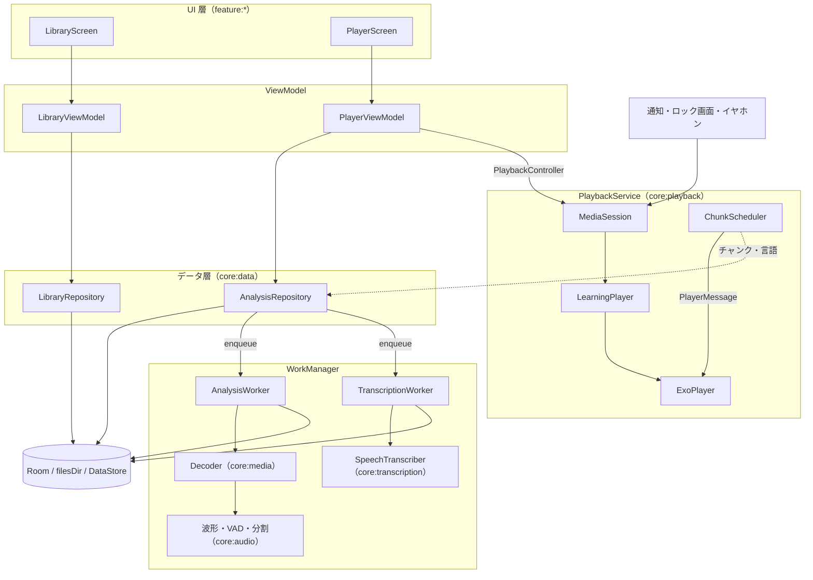
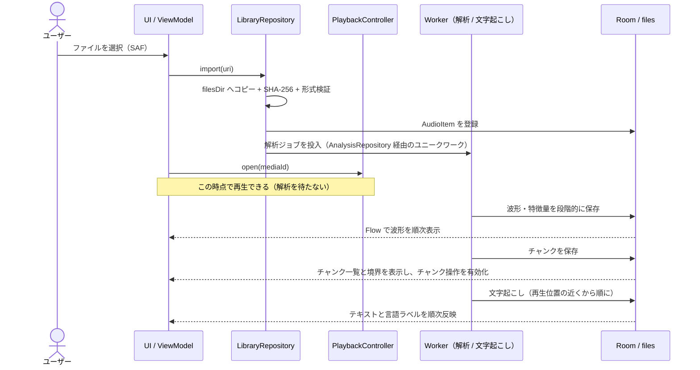

# Design Doc: 語学学習用オーディオプレイヤー（仮称: Gogaku Player）

| 項目 | 内容 |
| --- | --- |
| Status | Draft v0.2（v0.1 をレビューして全面改訂） |
| Last updated | 2026-10-14 |
| Owner | miuraken |
| 対象 | Android 14 以上（minSdk 34）。主な対象端末は Pixel 8 以降 |
| 主要技術 | Kotlin / Jetpack Compose + Material 3 / Media3（ExoPlayer・Session）/ Room / WorkManager / Hilt |

本書は、人間と AI エージェントの双方が参照する設計の単一の情報源です。重要な判断は ADR（`docs/adr/`）に切り出し、本書には結論と理由の要約を残します。v0.1 からの変更点は[付録 A](#付録-a-v01-からの主な変更点) にまとめています。

---

## 0. 主要な設計判断（サマリー）

| # | 論点 | 決定 | 主な理由 | 詳細 |
| --- | --- | --- | --- | --- |
| D1 | 解析と再生の関係 | 取り込み直後から再生できる。解析（波形 → チャンク → 文字起こし）はバックグラウンドで実行し、できた順に画面へ反映する | 解析が終わるまで操作できない画面は体験を大きく損なう（文字起こしは数分かかり得る） | §5.3 |
| D2 | 音声ファイルの保存先 | アプリ専用の内部ストレージ `filesDir/media/`（削除はユーザー操作） | `cacheDir` は OS が随時削除するため、教材ライブラリと高コストな解析結果が失われる | §7.1 |
| D3 | チャンク境界での制御 | `PlaybackService` 内で ExoPlayer の `PlayerMessage` を使い、次の境界を予約して処理する | 100ms ポーリングでは最大 100ms 行き過ぎ、次の単語の頭が聞こえてしまう | §7.2.4 |
| D4 | 前/次ボタン（イヤホン・通知・アプリ内） | `ForwardingSimpleBasePlayer` で「前/次のチャンク」に再割り当てする | 画面オフの「ながら学習」で最も使う操作。標準コマンドに載せれば全経路で動作が一致する | §7.2.3 |
| D5 | 波形データ | 10ms/ビンの固定時間分解能（dB スケール）で保存し、表示時に縮約する | 全体を 1,000 点に固定すると 30 分音声で 1 点 = 1.8 秒になり、0.5 秒の無音すら描けない | §7.3.2 |
| D6 | 無音検出 | 適応閾値 + ヒステリシス + 最短/最長チャンク制約 + 前後パディング。VAD は差し替え可能にする | 固定 dBFS 閾値は BGM や録音レベルの差に弱い。発話端ぎりぎりで切ると子音が欠ける | §7.3.3 |
| D7 | 文字起こしエンジン | `SpeechTranscriber` で抽象化し、Phase 0 の技術検証（スパイク）の結果で選ぶ | 候補ごとに精度・速度・制約が大きく異なり、机上では決められない | §7.4 |
| D8 | 2 言語の判定方法 | 言語識別（LID）を候補の 2 言語に限定して行う。両言語で認識して信頼度を比べる方式はフォールバックに限る | 言語モデル間の信頼度は比較できるように較正されておらず、コストも 2 倍になる | §7.4.3 |
| D9 | UI 状態 | 関心ごとに状態を分け、高頻度で変わる再生位置は UiState に含めず描画フェーズで読む | 位置が変わるたびに画面全体が再コンポーズされるのを防ぐ | §6.2 |
| D10 | モジュール分割 | 機能別（feature）+ 基盤（core）。信号処理は Android に依存しない純 Kotlin モジュールに置く | 並行開発時の衝突を避け、高速な JVM 単体テストを可能にする | §5.2 |
| D11 | プライバシー | 既定ではすべて端末内で処理する。クラウドへの送信は明示的なオプトインのみ | 教材音声は著作物や個人的な内容を含み得る | §8 |

---

## 1. 背景と目的

### 1.1 背景

語学学習のリスニングでは、「特定の短いフレーズの集中リピート」「無音区間での一時停止と発話練習（リピーティング / シャドーイング）」「スクリプトとの照合」が頻繁に行われます。汎用のメディアプレイヤーはシークバーでの手動の位置合わせが前提で、フレーズ単位の操作や、画面を見ずにイヤホン操作だけで同じ文を聞き直すことが困難です。

### 1.2 想定ユーザーと利用シーン

- **主なユーザー**: 日本語を母語とする英語学習者（まずは開発者本人）。言語ペアは設定で変更できる設計にします。
- **想定する教材**
  - ラジオ講座型: 日本語の解説と英語のダイアログが交互に現れる（BGM・効果音あり）
  - 教材付属の音声（MP3 など）: 例文が無音を挟んで並ぶ
  - 瞬間英作文型: 「日本語 →（ポーズ）→ 英語」の繰り返し
  - Podcast、試験対策の音声（TOEIC / 英検など）
- **利用シーン**
  - S1 移動中: 画面オフ、Bluetooth イヤホン。ボタン操作で「もう一度」「次の文」
  - S2 机上: 波形とスクリプトを見ながら精聴・シャドーイング・ディクテーション
  - S3 発話練習: 各チャンクの後で自動的に一時停止し、声に出して繰り返す

### 1.3 Goals

- **G1 即時再生**: ローカルや Google Drive から取り込んだ音声を待たずに再生でき、解析が再生を妨げない。
- **G2 自動チャンク分割**: 無音区間（既定 0.5 秒以上、調整可能）で発話単位に分割し、チャンク単位で移動・リピート・自動ポーズができる。
- **G3 波形表示**: 全体の波形とチャンク境界を表示し、波形上で直接シークや範囲指定ができる。
- **G4 文字起こしと言語判定**: チャンクごとにテキスト化し、学習言語か母語かを判定する。判定結果を使った再生モード（学習言語のみ再生、瞬間英作文モードなど）を提供する。
- **G5 ながら学習**: 画面オフでも、イヤホン・ロック画面・通知から主要な操作（再生 / 停止、前 / 次のチャンク）ができる。
- **G6 標準準拠**: Media3 / Material 3 / Jetpack の標準部品を優先し、保守性と OS との親和性を高める。
- **G7 プライバシー**: 既定は端末内処理。クラウド処理は明示的なオプトインのみ。

MVP は M1 + M2（§11）の「チャンクプレイヤー」とします。G4 は最も不確実性が高いため、技術検証を Phase 0 で先行させ、実装は M3 に置きます。

### 1.4 Non-Goals（当面のスコープ外）

- 音声ファイルの編集・トリミング・再エンコード保存（チャンク境界の手動調整はメタデータの編集なので対象内: M4）
- ストリーミング再生、Podcast の購読（RSS）
- 3 言語以上の同時判定（ただし、データモデルは任意の BCP-47 言語ペアを扱える設計にする）
- アカウント、端末間の同期
- 自分の声の録音・比較（将来の候補。`RECORD_AUDIO` 権限が必要になるため別途検討する）
- 動画の再生（動画ファイルから音声トラックだけを取り込む機能は将来の候補）

### 1.5 設計原則

1. **再生を最優先する**: どの解析処理も、再生の開始や操作をブロックしない。
2. **段階的に情報を付け加える**: 再生 → 波形 → チャンク → 文字起こしの順に、準備できたものから表示する。
3. **解析結果は資産として扱う**: 高コストな結果（特に文字起こし）は永続化して再計算を避ける。アルゴリズムを更新したらバージョンで判別する。
4. **標準を優先し、自作は最小限にする**: 標準 API で実現できるものは自作しない。自作する部分（波形、チャンクスケジューラなど）は境界を明確にする。
5. **テストしやすくする**: 信号処理と分割アルゴリズムは Android に依存しない純 Kotlin で書き、JVM 単体テストで検証する。
6. **最小権限**: ストレージ読み取りなどの危険な権限を要求しない。

---

## 2. 機能要件

優先度: **P0** = MVP（M1〜M2）に必須 / **P1** = 重要。「時期」のマイルストーンで実装するが、遅れる場合は後ろへ回してよい / **P2** = あると良い（時期は目安）

| ID | 機能 | 優先度 | 時期 |
| --- | --- | --- | --- |
| F1.1 | SAF による単一ファイルの取り込み（ローカル / Google Drive） | P0 | M1 |
| F1.2 | 複数ファイルの一括取り込み、他アプリからの共有・「アプリで開く」 | P1 | M2 |
| F1.3 | 字幕・スクリプトファイル（LRC / SRT / WebVTT）の取り込みとチャンク化 | P1 | M3 |
| F2.1 | ライブラリ一覧（タイトル、長さ、進捗、解析状態）と削除 | P0 | M1 |
| F2.2 | 教材ごとのレジューム（再生位置、速度、学習モード） | P0 | M1 |
| F2.3 | フォルダ / コース単位での整理 | P2 | — |
| F3.1 | 再生 / 一時停止 / シーク、バックグラウンド再生、通知・ロック画面からの操作 | P0 | M1 |
| F3.2 | ピッチを保った速度変更（0.5〜2.0 倍、0.05 刻み、プリセットあり） | P0 | M1 |
| F3.3 | 巻き戻し / 早送り（既定 3 秒 / 5 秒、設定で変更可） | P0 | M1 |
| F3.4 | イヤホン・通知・アプリ内の前 / 次ボタン → 前 / 次のチャンク | P0 | M2 |
| F4.1 | 全体波形とチャンク境界の表示、タップ / ドラッグでシーク | P0 | M2 |
| F4.2 | 拡大波形（ピンチズーム、再生位置への追従） | P1 | M2 |
| F5.1 | 無音区間による自動チャンク分割 | P0 | M2 |
| F5.2 | 分割パラメータの調整と即時再分割 | P1 | M2 |
| F5.3 | チャンクの手動編集（分割・結合・境界のドラッグ） | P1 | M4 |
| F6.1 | チャンク移動（前 / 次 / 頭出し）とチャンクリピート（N 回 / 無限） | P0 | M2 |
| F6.2 | A-B リピート（A / B ボタン、または波形上で範囲を選択） | P0 | M2 |
| F6.3 | 自動ポーズ（固定秒数 / チャンク長 × 係数） | P0 | M2 |
| F6.4 | 言語フィルタ再生（学習言語のみ / 母語のみ） | P1 | M3 |
| F6.5 | 瞬間英作文モード（母語チャンクの後にだけ自動ポーズ） | P1 | M3 |
| F6.6 | 無音を短縮して再生 | P2 | — |
| F7.1 | チャンク単位の文字起こしと言語判定（できた順に表示） | P1 | M3 |
| F7.2 | 再生位置に同期したスクリプト表示、ブラインドモード（タップで表示） | P1 | M3 |
| F7.3 | 言語ラベルの手動修正 | P1 | M3 |
| F7.4 | テキストの手動修正 | P2 | M4 |
| F7.5 | 書き出し（SRT / LRC / TXT） | P2 | M4 |
| F8.1 | チャンクのブックマークと、ブックマークしたチャンクだけの連続再生 | P2 | M4 |
| F9.1 | 設定（言語ペア、既定速度、スキップ秒数、自動ポーズ、分割パラメータ、文字起こしエンジン、クラウド送信の同意） | P0〜P1 | M1〜M3 |

---

## 3. 非機能要件

目標値は Phase 0 と M2 で実測して見直します。

| 区分 | 要件 |
| --- | --- |
| 応答性 | 取り込み済みの教材は 1 秒未満で再生を開始する。取り込み（コピー）中は進捗を表示し、キャンセルできる |
| 解析性能 | 30 分の音声の波形とチャンクを 60 秒以内に生成する（Pixel 8 クラス） |
| 描画 | 再生中も波形とリストが 60fps 以上を保つ。再生位置の更新で画面全体を再コンポーズしない |
| メモリ | PCM 全体をメモリに載せない（ストリーミング処理）。解析中の追加ヒープは 64MB 未満を目標とする |
| 時刻精度 | チャンク境界での停止・ループの行き過ぎは 50ms 未満。解析と再生の時間軸のずれは 20ms 未満 |
| 対応形式 | MP3、AAC（M4A / MP4）、Ogg（Vorbis / Opus）、FLAC、WAV |
| 長尺 | 2 時間程度の音声でも上記を満たす（解析は中断・再開できる） |
| 堅牢性 | プロセスが終了しても再生位置と解析の進捗を復元する。破損ファイルでもクラッシュせず、エラーを表示する |
| 電池 | 再生中と自動ポーズ中（タイムアウト付き）以外は WakeLock を保持しない。解析は WorkManager の管理下で実行する |
| プライバシー | クラウド文字起こしを有効にしていない限り、ネットワーク通信を行わない。分析・トラッキング用 SDK は入れない |
| アクセシビリティ | TalkBack 対応、タップ領域 48dp 以上、文字サイズ設定に追従、言語ラベルを色だけで区別しない |
| UI 言語 | 日本語（既定）、英語 |

---

## 4. 技術スタックと対象環境

### 4.1 SDK レベル

- **minSdk 34**: 個人利用と Pixel を前提に、古い OS 向けの分岐を減らす。API 34 で追加された音声認識の言語判定 API も前提にできる。一般公開する場合は見直す（§13）。
- **compileSdk / targetSdk**: 最新の安定 API。Google Play では 2026-08-31 以降、新規アプリとアップデートに API 36 以上が必要。
- targetSdk 35 / 36 の挙動変更に対応する: edge-to-edge の強制、予測型「戻る」、大画面での向き・リサイズ制限の無視（→ アダプティブレイアウトが必須。§7.5.6）。
- **Tensor の NPU を直接使う設計にはしない**。オンデバイス AI は OS / Google 提供の API（`SpeechRecognizer`、ML Kit GenAI）経由で使い、ハードウェアアクセラレーションはそれらに任せる。

### 4.2 ライブラリ

| 領域 | 採用 | 備考 |
| --- | --- | --- |
| 言語 | Kotlin 2.x、Coroutines / Flow | |
| UI | Jetpack Compose（BOM）、Material 3、material3-adaptive | Expressive 系の API は安定版に揃ってから段階的に採用する |
| 画面遷移 | Navigation 3 | |
| 再生 | Media3: `exoplayer`、`session`、`ui-compose`、`ui-compose-material3` | |
| メディア解析 | `MediaCodec` + `MediaExtractor`（または `media3-inspector` の `MediaExtractorCompat`） | スパイク S3 で選ぶ |
| DI | Hilt（KSP） | Worker（`@HiltWorker`）と Service への注入も Hilt で統一する |
| 永続化 | Room（KSP）、DataStore | |
| バックグラウンド処理 | WorkManager | |
| 文字起こし | `SpeechTranscriber` 抽象 + スパイク S1 で選んだエンジン | §7.4 |
| ビルド | Gradle Kotlin DSL、Version Catalog、convention plugins（`build-logic/`） | |
| テスト | JUnit、kotlinx-coroutines-test、Robolectric、`media3-test-utils`、Compose UI Test、（Turbine、Roborazzi） | 括弧内は導入審査の対象 |
| 静的解析 | Android Lint、Spotless + ktlint | |
| CI | GitHub Actions | |

確認時点（2026-10-14）の最新安定版: Media3 1.11.1、Compose Material3 1.4.0、Navigation 3 1.2.0、Material3 Adaptive 1.3.0。実際に使うバージョンは Phase 0 で `gradle/libs.versions.toml` に固定します。

---

## 5. アーキテクチャ

### 5.1 全体構成

Google 推奨のアーキテクチャ（UI 層とデータ層、単方向データフロー、単一の情報源）に従います。



- **UI 層**: Compose の画面。ViewModel の `StateFlow` を `collectAsStateWithLifecycle` で購読し、ユーザー操作はイベントとして ViewModel に渡す。
- **データ層**: Repository が Room・ファイル・DataStore をまとめ、単一の情報源（SSOT）として Flow を公開する。
- **再生**: `PlaybackService`（`MediaSessionService`）が ExoPlayer を所有する。アプリの UI は `PlaybackController`（`MediaController` のラッパー）経由でのみ操作し、通知・ロック画面・イヤホンと同じ経路（MediaSession）を通る。
- **解析**: WorkManager 上の Worker が実行し、結果を Room / ファイルに書き込む。UI は Repository の Flow で結果を受け取り、Worker と UI は直接やり取りしない。

### 5.2 モジュール構成

```text
:app                    Application、MainActivity、Navigation 3、DI の組み立て
:feature:library        ライブラリ画面 + ViewModel
:feature:player         プレイヤー画面（波形、操作部、チャンク / スクリプト一覧）+ ViewModel
:feature:settings       設定画面 + ViewModel
:core:model             ドメインモデル（純 Kotlin、Android 非依存）
:core:audio             波形の縮約・特徴量・VAD・チャンク分割・リサンプラ（純 Kotlin、Android 非依存）
:core:media             デコード（MediaExtractor + MediaCodec）、メタデータ取得、形式検証
:core:playback          PlaybackService、LearningPlayer、ChunkScheduler、PracticeController、PlaybackController
:core:transcription     SpeechTranscriber の抽象 + エンジン実装（エンジンごとにサブモジュール化してよい）
:core:database          Room（Entity / DAO / Migration）
:core:datastore         DataStore（アプリ設定）
:core:data              Repository、取り込み処理、Worker
:core:designsystem      テーマ、共通 Composable（波形 Composable を含む）
:core:testing           Fake 実装、テスト用の音声生成ユーティリティ、フィクスチャ
build-logic/            convention plugins（共通の Gradle 設定）
gradle/libs.versions.toml
```

依存ルール:

- `feature:*` 同士は依存しない。画面遷移は `:app` で組み立てる。
- `core:model` と `core:audio` は Android SDK に依存しない（JVM モジュール）。
- ExoPlayer を直接触るのは `core:playback` だけ。ViewModel は `PlaybackController` インターフェースに依存する。
- エンジン固有の SDK（ML Kit、Firebase、JNI など）は `core:transcription` 配下のエンジン別モジュールに閉じ込める。

v0.1 の `feature/player/ui` と `feature/player/viewmodel` の分離はやめ、feature モジュールに統合します。UI と ViewModel は常に一緒に変更されるため、モジュールを分けても変更コストが増えるだけだからです。

### 5.3 主要フロー: 取り込みから段階的な表示まで



### 5.4 スレッドモデル

- ExoPlayer / MediaSession: メインスレッド（アプリケーションの Looper）
- デコード・特徴量計算: Worker 内の `Dispatchers.Default`。`MediaCodec` は同期モードのループで回す
- DB / ファイル I/O: `Dispatchers.IO`
- Dispatcher は DI で注入し、テストで差し替えられるようにする

---

## 6. データモデルと永続化

### 6.1 ドメインモデル（`core:model`）

Phase 0 で lead が確定させる契約です。確定後の変更は §10.3 の手順に従います（v0.1 の「変更不可」ではなく、「変更を管理する」方針にします）。

```kotlin
package com.example.gogaku.core.model // パッケージ名は仮。Phase 0 で applicationId と合わせて決める

// ---------- 識別子・値型 ----------
@JvmInline value class MediaId(val value: String)    // UUID 文字列
@JvmInline value class ChunkId(val value: Long)
@JvmInline value class EngineId(val value: String)   // 例: "platform", "mlkit-advanced", "gemini", "imported"

/** BCP-47 言語タグ（例: "en-US", "ja-JP"） */
@JvmInline value class LanguageTag(val value: String)

/** 学習言語（target）と、母語・解説の言語（base）の組 */
data class LanguagePair(val target: LanguageTag, val base: LanguageTag)

// ---------- ライブラリ ----------
data class AudioItem(
    val id: MediaId,
    val title: String,              // 表示専用。ファイルパスには使わない
    val durationMs: Long,
    val mimeType: String,
    val sizeBytes: Long,
    val contentSha256: String,      // 重複の検出と、解析結果を再利用するためのキー
    val languagePair: LanguagePair,
    val importedAtEpochMs: Long,
)

// ---------- 解析結果 ----------
/**
 * 固定時間分解能の波形。各ビンの値は dBFS（-60〜0dB）を 0..255 に量子化したもの。
 * 表示時は表示範囲と幅に合わせて max プーリングで縮約する（core:audio の WaveformReducer）。
 */
class Waveform(
    val binMs: Int,                 // 既定 10ms
    val peak: ByteArray,            // ビンごとのピーク
    val rms: ByteArray,             // ビンごとの RMS
) {
    init { require(peak.size == rms.size) }
    val durationMs: Long get() = peak.size.toLong() * binMs
}

/** 無音区間で区切られた発話の単位。startMs / endMs は前後のパディングを含む再生範囲 */
data class Chunk(
    val id: ChunkId,
    val startMs: Long,
    val endMs: Long,
    val origin: ChunkOrigin,
) {
    init { require(startMs < endMs) }
    val durationMs: Long get() = endMs - startMs
}

enum class ChunkOrigin { AUTO, MANUAL, IMPORTED }

data class SegmentationParams(
    val minSilenceMs: Int = 500,      // これ以上続く無音を区切りとみなす
    val minSpeechMs: Int = 250,       // これより短い発話は「短い発話」として扱う（§7.3.3 の手順 5）
    val mergeGapMs: Int = 1_000,      // 短い発話を隣のチャンクへ統合するときの最大の間隔（minSilenceMs 以上）
    val maxChunkMs: Int = 15_000,     // これより長いチャンクは、最もエネルギーの低い谷で再分割する
    val prePaddingMs: Int = 150,      // 発話の前に含める余白（子音の欠けを防ぐ）
    val postPaddingMs: Int = 200,     // 発話の後に含める余白
    val thresholdRatio: Float = 0.3f, // ノイズフロアと発話レベルの間のどこに閾値を置くか（0..1）
)

data class Transcript(
    val chunkId: ChunkId,
    val text: String,
    val language: LanguageTag?,       // null = 判定できなかった
    val languageConfidence: Float?,   // 0..1。エンジンが提供しない場合は null（0 と区別する）
    val engine: EngineId,
    val userEdited: Boolean = false,  // true なら自動処理で上書きしない
)

// ---------- 解析の状態 ----------
enum class AnalysisStage { FEATURES, SEGMENTATION, TRANSCRIPTION }

sealed interface StageStatus {
    data object NotStarted : StageStatus
    data class Running(val progress: Float?) : StageStatus  // null = 進捗不明
    data object Done : StageStatus
    data class Failed(val error: AnalysisError) : StageStatus
}

enum class AnalysisError { UNSUPPORTED_FORMAT, DECODE_FAILED, IO, ENGINE_UNAVAILABLE, NETWORK, QUOTA_EXCEEDED }

// ---------- 学習モード ----------
sealed interface LoopMode {
    data object Off : LoopMode
    data class SingleChunk(val chunkId: ChunkId, val times: Int?) : LoopMode  // times = null は無限
    data class AbRange(val startMs: Long, val endMs: Long) : LoopMode {
        init { require(startMs < endMs) }
    }
}

sealed interface AutoPause {
    data object Off : AutoPause
    data class Fixed(val pauseMs: Long) : AutoPause
    /** ポーズ長 = max(minMs, チャンクの実再生時間 × factor)。実再生時間は再生速度を考慮する */
    data class Proportional(val factor: Float = 1.0f, val minMs: Long = 1_000) : AutoPause
}

enum class AutoPauseScope { ALL_CHUNKS, AFTER_BASE_LANGUAGE }  // 後者が瞬間英作文モード
enum class LanguageFilter { ALL, TARGET_ONLY, BASE_ONLY }

data class PracticeSettings(
    val loop: LoopMode = LoopMode.Off,
    val autoPause: AutoPause = AutoPause.Off,
    val autoPauseScope: AutoPauseScope = AutoPauseScope.ALL_CHUNKS,
    val languageFilter: LanguageFilter = LanguageFilter.ALL,
)
```

### 6.2 UI 状態（`feature:player`）

v0.1 の `PlayerUiState`（Idle / Loading / Ready / Error の排他）には、「解析中は再生できない」「再生位置の更新で画面全体が再コンポーズされる」という問題があるため、次のように変更します。

```kotlin
// feature:player — UI 層専用の型（core:model には置かない）
data class PlayerUiState(
    val title: String = "",
    val isPlaying: Boolean = false,
    val durationMs: Long = 0L,
    val speed: Float = 1.0f,
    val practice: PracticeSettings = PracticeSettings(),
    val autoPauseEndsAtMs: Long? = null,                     // 自動ポーズ中のみ（elapsedRealtime 基準。UI でカウントダウン）
    val waveform: Waveform? = null,                          // null = まだない（生成中かどうかは analysis で表す）
    val chunks: List<ChunkUi> = emptyList(),
    val activeChunkIndex: Int? = null,                       // PlaybackStatus.currentChunkId から求める（チャンク境界でのみ変わる）
    val analysis: Map<AnalysisStage, StageStatus> = emptyMap(),
    val message: UserMessage? = null,                        // Snackbar などの一過性の通知（定義は省略）
)

data class ChunkUi(
    val id: ChunkId,
    val startMs: Long,
    val endMs: Long,
    val text: String?,                  // null = まだ文字起こしされていない
    val language: LanguageTag?,         // null = 未判定、または信頼度が低い（UI では「?」と表示）
    val isBookmarked: Boolean,
)
```

- 解析の段階ごとの状態（`analysis`）と再生の状態（`isPlaying` など）は独立しており、同時に存在できる。
- 高頻度で変わる再生位置は UiState に入れず、`PlaybackController.position`（§6.3）から描画フェーズでのみ読む。
- `Throwable` を UI に持ち込まない。ViewModel でエラー種別（`AnalysisError` など）に変換し、表示する文言は UI 側の文字列リソースで決める。
- `core:model` の型は Compose に依存しないため、Compose コンパイラの安定性設定ファイル（stability configuration）で安定型として扱う。

### 6.3 主要インターフェース

並行開発の境界になるインターフェースです。Phase 0 で Fake 実装（`core:testing`）とセットで用意し、各エージェントは Fake を使って独立に開発します。

```kotlin
// ---------- core:playback ----------
// ViewModel はこのインターフェースだけに依存する（テストでは Fake を注入する）
interface PlaybackController {
    /** Media3 の Compose 部品（PlayPauseButton など）に渡す Player。実体は MediaController */
    val player: StateFlow<Player?>
    val status: StateFlow<PlaybackStatus>        // 低頻度の状態
    val practice: StateFlow<PracticeSettings>
    val position: PositionProvider               // 高頻度の位置（MediaController の推定値を読むだけで IPC は発生しない）

    suspend fun open(mediaId: MediaId)           // 前回の位置・速度で準備する
    fun seekToChunk(chunkId: ChunkId)
    fun setSpeed(speed: Float)
    fun updatePractice(transform: (PracticeSettings) -> PracticeSettings)
    // 再生 / 一時停止 / シーク / 前後のチャンク / スキップは Player の標準 API を使う
    // （seekToPrevious / seekToNext は LearningPlayer がチャンク移動に再割り当てする。§7.2.3）
}

/** 高頻度で変わる再生位置。描画フェーズでのみ読む */
fun interface PositionProvider {
    fun currentPositionMs(): Long
}

// android.media.session.PlaybackState や SimpleBasePlayer.State と紛れないよう、Status と呼ぶ
data class PlaybackStatus(
    val mediaId: MediaId? = null,
    val isPlaying: Boolean = false,
    val durationMs: Long = 0L,
    val speed: Float = 1.0f,
    val currentChunkId: ChunkId? = null,         // ChunkScheduler がチャンク境界で更新する
    val autoPauseEndsAtMs: Long? = null,         // 自動ポーズ中のみ（elapsedRealtime 基準）
    val error: PlaybackError? = null,
)

enum class PlaybackError { SOURCE_MISSING, DECODER, UNKNOWN }

// ---------- core:data ----------
interface LibraryRepository {
    fun observeItems(): Flow<List<AudioItem>>
    fun observeItem(id: MediaId): Flow<AudioItem?>
    fun import(uri: Uri): Flow<ImportProgress>   // uri は SAF の content://
    suspend fun delete(id: MediaId)
}

sealed interface ImportProgress {
    data class Copying(val fraction: Float?) : ImportProgress
    data class Done(val mediaId: MediaId, val wasDuplicate: Boolean) : ImportProgress
    data class Failed(val error: ImportError) : ImportProgress
}

enum class ImportError { UNSUPPORTED_FORMAT, TOO_LARGE, NO_SPACE, IO, CANCELLED }

interface AnalysisRepository {
    fun observeStatus(id: MediaId): Flow<Map<AnalysisStage, StageStatus>>
    fun observeWaveform(id: MediaId): Flow<Waveform?>
    fun observeChunks(id: MediaId): Flow<List<Chunk>>
    fun observeTranscripts(id: MediaId): Flow<Map<ChunkId, Transcript>>
    suspend fun requestAnalysis(id: MediaId, stages: Set<AnalysisStage>)
    suspend fun resegment(id: MediaId, params: SegmentationParams)  // 保存済みの特徴量から再計算（再デコード不要）
}

// ---------- core:transcription ----------
interface SpeechTranscriber {
    val engineId: EngineId
    val location: ProcessingLocation                                     // ON_DEVICE / CLOUD
    suspend fun availability(pair: LanguagePair): EngineAvailability     // AVAILABLE / NEEDS_DOWNLOAD / UNSUPPORTED
    suspend fun transcribe(clip: PcmClip, pair: LanguagePair): TranscriptionResult
}

enum class ProcessingLocation { ON_DEVICE, CLOUD }
enum class EngineAvailability { AVAILABLE, NEEDS_DOWNLOAD, UNSUPPORTED }

/** 16kHz・モノラル・16bit PCM の切り出し */
class PcmClip(val samples: ShortArray, val sampleRateHz: Int = 16_000)

data class TranscriptionResult(
    val text: String,
    val language: LanguageTag?,
    val languageConfidence: Float?,
)
```

### 6.4 永続化

| データ | 保存先 | 備考 |
| --- | --- | --- |
| 音声ファイル | `filesDir/media/<MediaId>.<ext>` | ファイル名は UUID。元の表示名は DB の `title` にのみ保存する |
| 波形・フレーム特徴量 | `filesDir/analysis/<MediaId>/waveform.bin`、`features.bin` | 独自バイナリ（マジック・バージョン・件数のヘッダ付き）。検証に失敗したら破棄して再計算する |
| 文字起こし用の 16kHz PCM | `cacheDir/pcm/<MediaId>.pcm` | 一時ファイル。文字起こしが終わったら削除する。消えても再デコードで復元できる |
| メタデータ・チャンク・文字起こし・ブックマーク・教材ごとの状態 | Room | |
| アプリ設定 | DataStore | |

Room のテーブル（概要。外部キーは ON DELETE CASCADE）:

| テーブル | 主な列 |
| --- | --- |
| `media_item` | `id`（PK）、`title`、`duration_ms`、`mime_type`、`size_bytes`、`sha256`（UNIQUE）、`target_lang`、`base_lang`、`imported_at` |
| `item_state` | `media_id`（PK）、`position_ms`、`speed`、`auto_pause`、`auto_pause_scope`、`language_filter`、`updated_at` |
| `analysis_state` | `media_id` + `stage`（PK）、`status`、`progress`、`error`、`algorithm_version`、`updated_at` |
| `chunk` | `id`（PK）、`media_id`（`start_ms` との複合インデックス）、`start_ms`、`end_ms`、`origin`、`algorithm_version` |
| `transcript` | `chunk_id`（PK）、`text`、`language`、`language_confidence`、`engine`、`user_edited`、`created_at` |
| `bookmark` | `chunk_id`（PK）、`note`、`created_at` |

同じ音声をもう一度取り込んだ場合は SHA-256 で検出して既存の項目を開くため、解析結果は教材（`media_id`）ごとに 1 組だけ持ちます。各結果には生成したアルゴリズムのバージョンを記録し、アルゴリズムを更新したときは自動生成（`AUTO`）の結果だけを再計算します。

---

## 7. 機能仕様

### 7.1 取り込みとストレージ（`core:data` / `core:media`）

- **ピッカー**: `ActivityResultContracts.OpenDocument()`（MIME は `audio/*`。必要に応じて `application/ogg` などを追加）。Google Drive のファイルも SAF の Drive プロバイダ経由で選べるため、Drive API や OAuth は不要。
- **取り込み処理**（`LibraryRepository.import`）
  1. `ContentResolver` で表示名・サイズ・MIME を取得する（表示名は `title` の初期値としてのみ使う）。
  2. サイズの上限（例: 2GB）と空き容量（サイズの 1.2 倍以上）を確認する。
  3. `filesDir/media/<UUID>.tmp` へストリームでコピーしながら SHA-256 を計算し、進捗を通知する（キャンセル可能）。
  4. 同じハッシュの項目が既にあれば、コピーを破棄して既存の項目を開く。
  5. デコーダで音声トラックの有無と形式を検証し、不可なら破棄してエラーにする。
  6. 検証済みの形式から拡張子を決めてリネームし、DB に登録して解析ジョブを投入する。
- 取り込み後は元の URI にアクセスしないため、永続的な URI 権限は取得しない（将来「コピーせずにリンク登録」を加える場合のみ `takePersistableUriPermission` を使う）。
- Drive 上のファイルは選択時にダウンロードされるため時間がかかることがある。進捗表示を必須とし、オフラインで取得できない場合はエラーメッセージで案内する。
- メタデータ（タイトル、アーティスト、長さ。アートワークは P2）は Media3 の inspector または `MediaMetadataRetriever` で取得する。
- 他アプリからの共有・「アプリで開く」（F1.2）も、受け取った `content://` URI を同じ取り込み処理に通す。

### 7.2 再生エンジン（`core:playback`）

#### 7.2.1 構成

```text
PlaybackService : MediaSessionService
 ├─ MediaSession
 │   └─ LearningPlayer : ForwardingSimpleBasePlayer  前 / 次 → チャンク移動、利用可能コマンドの調整
 │       └─ ExoPlayer                                 実際の再生
 ├─ ChunkScheduler                                    PlayerMessage で境界イベントを処理（ループ・自動ポーズ・言語フィルタ）
 └─ PracticeController（@Singleton）                  学習モードの状態を保持（ViewModel と共有）
```

`ChunkScheduler` はチャンクと言語ラベルを `AnalysisRepository` の Flow から直接受け取ります。大きなリストを UI から MediaSession 経由で渡すことはしません。

#### 7.2.2 ExoPlayer の設定

- `AudioAttributes` は `USAGE_MEDIA` + `AUDIO_CONTENT_TYPE_SPEECH`、`handleAudioFocus = true`（通話や他アプリの再生で自動的に止まる）。
- `setHandleAudioBecomingNoisy(true)`（イヤホンが外れたら止める）。
- `setWakeMode(C.WAKE_MODE_LOCAL)`（画面オフでローカルファイルを再生するため）。
- `DefaultExtractorsFactory().setMp3ExtractorFlags(Mp3Extractor.FLAG_ENABLE_INDEX_SEEKING)`: 目次（TOC）のない VBR MP3 でもシーク位置を正確にする。語学教材は MP3 が多く、シーク誤差はチャンクの頭出しの品質を直接損なう（スパイク S2 で検証）。
- 速度は `setPlaybackSpeed()` で変える（Sonic による時間伸縮のため、ピッチは変わらない）。
- スキップ秒数は `setSeekBackIncrementMs()` / `setSeekForwardIncrementMs()` で設定値を反映し、UI・通知とも標準の `seekBack()` / `seekForward()` を使う。

#### 7.2.3 LearningPlayer（前 / 次ボタンの再割り当て）

- `handleSeek()` で `COMMAND_SEEK_TO_PREVIOUS` / `COMMAND_SEEK_TO_NEXT` を受けたとき、チャンクがあればチャンク境界へ移動する。チャンクがまだなければ、巻き戻し / 早送りとして扱う。
- 「前」の意味: 現在のチャンクの開始から 1 秒以上経っていれば現在のチャンクの頭へ、1 秒未満なら前のチャンクへ（音楽プレイヤーの慣習に合わせる）。
- 単一の音声でも通知やイヤホンの前 / 次ボタンが有効になるよう、`getState()` で `COMMAND_SEEK_TO_PREVIOUS` / `COMMAND_SEEK_TO_NEXT` を利用可能として公開する。
- アプリ内の前 / 次ボタン（`media3-ui-compose-material3` の `PreviousButton` / `NextButton`）も同じコマンドを送るため、すべての操作経路で動作が一致する。

#### 7.2.4 ChunkScheduler（境界の処理）

- **方式**: ExoPlayer の `createMessage(...).setPosition(境界のms).setLooper(mainLooper)` で、「次に処理すべき境界」を 1 件だけ予約する。境界に達したら動作を実行し、次の境界を予約し直す。シーク（`onPositionDiscontinuity`）、チャンクの更新、モードの変更のときも予約し直す。
- `PlayerMessage` は再生スレッドで再生位置に基づいて配信されるため、UI 側のポーリングより正確で、画面が非表示でも動作する。

| モード | 境界 | 動作 |
| --- | --- | --- |
| A-B リピート | B に到達 | A へシークする |
| チャンクリピート（N 回 / 無限） | チャンクの終端 | 回数を数えて開始位置へシークする。N 回終えたら次へ進み、モードを解除する |
| 自動ポーズ | チャンクの終端（`AutoPauseScope` に該当するチャンクのみ） | 一時停止し、ポーズ長が過ぎたら再生を再開する。途中でユーザーが操作したらタイマーを取り消す |
| 言語フィルタ | チャンクの終端 | 次の対象言語のチャンクの開始位置へシークする |

- **組み合わせの優先順位**: A-B > チャンクリピート > 言語フィルタ。自動ポーズは各終端での動作の前に適用する（リピートの間にもポーズが入るので、リピーティング練習になる）。
- ユーザーによる手動のシークは常に優先し、言語フィルタは次の境界から適用する。
- チャンクがまだない間は、チャンクを前提とするモードを無効化する（A-B リピートはチャンクがなくても使える）。
- 自動ポーズの再開タイマーは Service 側で持ち、`PlaybackState.autoPauseEndsAtMs` として UI に公開する（カウントダウン表示用）。
- 自動ポーズは `pause()` で実現するため、画面オフ中にタイマーで再開するとき、バックグラウンドからのフォアグラウンドサービス開始の制限に当たらないようにする必要がある。Media3 の `MediaSessionService` は一時停止後も一定時間（`setForegroundServiceTimeoutMs`）フォアグラウンドを維持するので、その時間内に再開すれば問題ない想定。実際の挙動は S2 で確認する。

#### 7.2.5 操作の経路

- **アプリの UI** → `PlaybackController` → 標準操作は `MediaController`（Player API）、学習モードは `PracticeController`（同一プロセスの Singleton で型安全に扱う）。
- **通知・ロック画面・Bluetooth イヤホンなどのシステム経路** → `MediaSession` → `LearningPlayer`（標準コマンド）、またはカスタムボタン（例: 「チャンクリピート切り替え」）→ `MediaSession.Callback.onCustomCommand` → `PracticeController`。Android Auto 対応（`MediaLibraryService` が必要）はスコープ外。
- カスタムコマンドは信頼できるコントローラ（自アプリとシステム UI）からのみ受け付ける（§8）。
- `MediaSession.Callback.onPlaybackResumption` を実装し、システムのメディアコントロールから前回の教材と位置で再開できるようにする。
- 学習モード（自動ポーズ、言語フィルタ）と速度は教材ごとに `item_state` に保存する。ループは再開時に解除する。

#### 7.2.6 フォアグラウンドサービスと通知

- `PlaybackService` は `foregroundServiceType="mediaPlayback"`。権限は `FOREGROUND_SERVICE` と `FOREGROUND_SERVICE_MEDIA_PLAYBACK`。フォアグラウンド化と通知は Media3 が自動で管理する。
- メディアセッションの通知は `POST_NOTIFICATIONS` 権限の対象外（Android 13 以降）。この権限は解析の進捗通知のためだけに求め、拒否されても機能は動作する。
- 通知のボタンは「前のチャンク / 再生・一時停止 / 次のチャンク」。P1 で「チャンクリピート切り替え」のカスタムボタンを追加する。

### 7.3 音声解析パイプライン（`core:media` / `core:audio`）

#### 7.3.1 デコード

- `MediaExtractor`（または `media3-inspector` の `MediaExtractorCompat`。ExoPlayer と同じ抽出器を使えるため時間軸を揃えやすい。スパイク S3 で選ぶ）と `MediaCodec`（同期モード）で PCM にデコードする。
- 1 パスのストリーミング処理にする: デコード → モノラル化 → 16kHz にリサンプル → 次の 3 つへ分配。PCM 全体はメモリに保持しない（60 分・44.1kHz・ステレオの 16bit PCM は約 635MB になる）。
  1. 波形のビン（10ms ごとのピークと RMS）
  2. フレーム特徴量（10ms ホップ、25ms 窓の対数エネルギー。Silero VAD を採用する場合は発話確率）
  3. 文字起こしが有効な場合のみ、16kHz PCM の一時ファイル
- **時間軸**: 出力したサンプル数の累計から時刻を求め、エンコーダ遅延（ギャップレス情報）の扱いを ExoPlayer と一致させる。既知の位置にクリック音を置いたテスト音源で、解析上の時刻と再生位置のずれが 20ms 未満であることを検証する。
- 波形と特徴量は数秒分ごとに途中保存し、UI に段階的に表示する。

#### 7.3.2 波形

- 10ms/ビン（30 分で 18 万ビン。ピークと RMS で約 360KB）。値は dBFS（-60〜0dB）を 0..255 に量子化する。線形の振幅では小さな声がほとんど見えないため、対数スケールで保存・表示する。
- 表示時は表示範囲と幅に合わせて max プーリングで縮約する（`WaveformReducer`、純 Kotlin）。縮約結果は（範囲、幅）をキーにキャッシュする。

#### 7.3.3 チャンク分割のアルゴリズム（`core:audio`、純 Kotlin）

1. フレームエネルギー E[n]（dBFS、10ms ホップ）を 5 フレームのメディアンフィルタで平滑化する。
2. **適応閾値**: ノイズフロア N = E の 10 パーセンタイル、発話レベル S = 90 パーセンタイルとし、閾値 T = N + r × (S − N)（r = `thresholdRatio`、既定 0.3）とする。T は -60〜-25 dBFS に収める。BGM の強さが途中で変わる教材向けに、パーセンタイルを 30 秒程度の移動窓で求めるモードも用意する。
3. **ヒステリシス**: E > T + 3dB で発話の開始、E < T で発話の終了とみなす。
4. `minSilenceMs` 以上続く無音を区切りとして発話区間を抽出する。
5. `minSpeechMs` 未満の発話は、近くに（300ms 未満）別の発話があれば統合し、孤立していればノイズとして捨てる。
6. `maxChunkMs` を超える区間は、内部で最もエネルギーの低い谷（150ms 以上の低エネルギー区間を優先）で再帰的に分割する。
7. 前後にパディング（`prePaddingMs` / `postPaddingMs`）を付ける。ただし、隣のチャンクとの間にある無音の中点を越えない。

- VAD は `VoiceActivityDetector` インターフェースで差し替えられるようにする。既定はエネルギー方式（依存ライブラリなし）。BGM の強い教材向けに Silero VAD（ONNX、約 2MB）を P1 で評価する（依存の追加は審査のうえで決める）。
- **再分割**: パラメータを変えたら、保存済みの特徴量から再計算する（数十 ms で終わる）。スライダーを動かしながら結果を即座にプレビューできる。
- `algorithmVersion` を保存し、アルゴリズムを更新したら自動分割（`AUTO`）のチャンクだけを再計算の対象にする（手動編集や字幕から取り込んだチャンクは保持する）。

#### 7.3.4 実行管理（WorkManager）

- 「特徴量の計算 + 分割」と「文字起こし」は別の Worker にし、ユニークワーク名を `analysis-<MediaId>` と `transcription-<MediaId>` に分ける（同じ名前にすると、`KEEP` で後からの文字起こし要求が捨てられるため）。文字起こしのジョブは、分割が終わった時点で（文字起こしが有効なら）投入する。
- **特徴量の計算と分割**: 30 分の音声で 60 秒以内を目標とする処理。通常 / expedited / 長時間ワーカー（`setForeground()`）のどれで実行するかは、S3 の実測で決める（2 時間の音声でも途中で止まらないことが条件）。
- **文字起こし（一括処理）**: 長時間になり得るため、`setForeground()` を使う長時間ワーカーとして実行する（フォアグラウンドサービスの種類は API 35 以上で `mediaProcessing`、API 34 で `dataSync`）。クラウドエンジンを使う場合はネットワーク制約を付ける。逐次処理（§7.4.2）のエンジンでは Worker を使わず、再生中にアプリ内で処理する。
- 進捗は Room の `analysis_state` に書き込み（0.5 秒に 1 回程度に間引く）、UI は Repository の Flow で購読する。プロセスが終了しても表示を復元できる。
- **中断と再開**: 文字起こしは未処理のチャンクから再開する。デコードは高速なので最初からやり直す。

### 7.4 文字起こしと言語判定（`core:transcription`）

#### 7.4.1 目的

1. 再生位置に同期したスクリプトの表示
2. チャンクごとの言語ラベル → 言語フィルタ再生、瞬間英作文モード
3. 検索やブックマークの手がかり

#### 7.4.2 エンジンの候補（Phase 0 のスパイク S1 で評価する）

| 候補 | 処理場所 | 2 言語の判定 | 長所 | 短所・リスク |
| --- | --- | --- | --- | --- |
| A. Android `SpeechRecognizer`（オンデバイス） | 端末 | `EXTRA_ENABLE_LANGUAGE_DETECTION` + `EXTRA_LANGUAGE_DETECTION_ALLOWED_LANGUAGES`（API 34） | 追加の依存なし、無料、オフライン。`EXTRA_AUDIO_SOURCE`（API 33）でファイル由来の PCM を入力できる | これらの機能は「認識エンジンの実装によっては無効」と明記されており、実機での検証が必須。本来はマイク入力（実時間）向けの API で、同時に 1 セッションのみ。実時間より速く処理できるか、バックグラウンドで動くかも未知 |
| B. ML Kit GenAI Speech Recognition | 端末 | なし（認識器ごとに 1 ロケール）→ LID を別に用意する | Google 公式 SDK。`AudioSource.fromPfd()` で PCM を入力できる。Advanced モードは高精度（対応端末のみ） | 確認時点の公式サンプルは alpha 版（`1.0.0-alpha1`）。言語判定がない。エラーコードに `BACKGROUND_USE_BLOCKED`（バックグラウンドでは使えない）と `AUDIO_BUFFER_OVERFLOW`（入力が速すぎる）があり、Worker での一括処理や実時間より速い処理には向かない可能性が高い。モデルのダウンロードや対応端末にも制約がある |
| C. Whisper 系（whisper.cpp、sherpa-onnx など） | 端末 | 言語トークンの確率を候補の 2 言語に限定して比較する（尤度の比較として理にかなう） | 完全オフライン、端末に依存しない、単語単位のタイムスタンプ、バックグラウンドでの一括処理が可能 | NDK / JNI の保守、数十〜数百 MB のモデルのダウンロード管理、大きいモデルは低速、日本語の精度はモデル次第 |
| D. Gemini（Firebase AI Logic 経由） | クラウド | プロンプトと JSON スキーマで、言語ラベル付きの書き起こしを得る | 日英混在や句読点の整形に強い。一括処理が可能 | 通信と従量課金、送信の同意が必要。App Check が必須。音声中の時刻指定は粗いため、端末で切り出したチャンク単位で送る |

- **処理モード**: 文字起こしには 2 つの使い方がある。
  - **一括処理**: 取り込み後に Worker でファイル全体を処理する（実時間より速く、バックグラウンドで動くことが前提）。
  - **逐次処理**: 再生中のチャンクを、再生と並行してその場で文字起こしする（初回の視聴中にスクリプトが埋まっていく）。実時間の処理で足り、アプリが前面にある間だけ動けばよい。
- **方針**: インターフェースと「字幕ファイルからの取り込み（`IMPORTED`）」を先に実装し、エンジンはスパイクの結果で選ぶ。暫定の推奨は「一括処理 = C（端末内）または D（オプトイン）」「逐次処理 = A / B（無料・端末内）」。A / B が一括処理にも使えることが S1 で確認できれば、既定を A / B に寄せる。
- **評価指標**: 英語の WER / 日本語の CER、チャンク単位の言語判定の正解率（1 秒以上と 1 秒未満で分けて集計）、処理速度（実時間比）、バックグラウンドでの実行可否、モデルのサイズ、電池消費、失敗時の挙動。結果は `docs/adr/` に記録する。

#### 7.4.3 2 言語の判定方式

- LID 機能を持つエンジン（A、C、D）では、判定の候補を `LanguagePair` の 2 言語に限定する。
- LID 機能のないエンジン（B）では、先に軽量な LID で言語を決めてから、その言語のロケールで認識する。
- 両方の言語で認識して信頼度を比べる方式（v0.1 案）は、LID の結果に確信がない場合のフォールバックに限る。言語モデル間の信頼度は較正されておらず、コストも 2 倍になるため。
- 短いチャンク（1 秒未満。「OK」「はい」など）は判定が不安定なため、前後のチャンクの言語と信頼度で平滑化する（教材では同じ言語が続きやすい性質を利用する）。それでも信頼度が低ければ「?」と表示し、手動で修正できるようにする。

#### 7.4.4 実行順序・保存・無効化

- 現在の再生位置に近いチャンクから優先して処理し、1 件ごとにすぐ保存する（できた順に表示される）。
- 再分割や手動編集でチャンクが変わった場合、境界が一致する（±50ms 以内）チャンクの結果は引き継ぎ、それ以外だけを処理し直す。
- ユーザーが修正したテキストや言語（`userEdited = true`）は、自動処理で上書きしない。

#### 7.4.5 クラウドエンジンを採用する場合の条件

- アプリに API キーを埋め込まない。Firebase AI Logic と App Check（Play Integrity）を使う。
- 初回の利用時に「音声が Google のサーバーに送信される」ことを説明して同意を得る。教材ごとにオン / オフを切り替えられる。
- 送信するのは 16kHz モノラルに変換したチャンクの音声だけ（1 リクエストにつき音声 1 件、インラインデータは 20MB 以内）。並列数を制限し、利用量（チャンク数と推定コスト）を設定画面に表示する。
- 応答は JSON スキーマで受け取り、検証に失敗した結果は表示せずに破棄する。

### 7.5 UI / UX（`feature:*`、`core:designsystem`）

#### 7.5.1 画面構成

- ライブラリ / プレイヤー / 設定 /（M4）チャンク編集。
- 画面遷移は Navigation 3。大画面（幅が Expanded）ではライブラリとプレイヤーを 2 ペインで表示する（`material3-adaptive`）。
- ライブラリ画面の下部にミニプレイヤーを表示する（`media3-ui-compose-material3` の `MiniController` を評価する）。

#### 7.5.2 プレイヤー画面（スマートフォン・縦）

```text
┌──────────────────────────────────────────┐
│ TopAppBar: タイトル                  [⋮] │
├──────────────────────────────────────────┤
│ 全体波形（チャンク境界・表示範囲の枠）   │ タップ / ドラッグでシーク
│ 拡大波形（チャンクを言語別に色分け）     │ ピンチでズーム、長押し＋ドラッグで A-B
├──────────────────────────────────────────┤
│ チャンク / スクリプト一覧                │ 現在のチャンクを強調し、自動で追従
│  00:12  [EN] How have you been?          │ タップ = 頭出し
│  00:15  [JA] お元気でしたか？            │ 長押し = メニュー（リピート・ブックマーク・編集）
│                       [現在位置へ戻る]   │
├──────────────────────────────────────────┤
│ 学習モード: [リピート×3] [自動ポーズ] [言語] [1.0x] │
│ ProgressSlider                            │
│  [⏮]  [↺3s]   [ ▶ ]   [↻5s]  [⏭]        │ ⏮ / ⏭ = 前 / 次のチャンク
└──────────────────────────────────────────┘
```

#### 7.5.3 標準部品の利用方針

| 用途 | 部品 |
| --- | --- |
| 再生 / 一時停止、前 / 次、巻き戻し / 早送り | `media3-ui-compose-material3` の `PlayPauseButton`、`PreviousButton`、`NextButton`、`SeekBackButton`、`SeekForwardButton` |
| 進捗バー・時間表示 | `ProgressSlider`、`TimeText` |
| 速度 | `PlaybackSpeedToggleButton` を評価する。細かい指定は `ModalBottomSheet` + `Slider` + プリセットの `FilterChip` |
| 学習モードの切り替え | `FilterChip`、`SegmentedButton` |
| チャンク一覧 | `LazyColumn` + `ListItem` |
| 解析の進捗 | `LinearProgressIndicator`（段階ごとに表示） |
| 確認・同意 | `AlertDialog` |

- Media3 の Compose UI モジュールは比較的新しく、`@UnstableApi` を含む。`core:designsystem` の薄いラッパー経由で使い、API 変更の影響を局所化する。
- Material 3 Expressive 系の API は、安定版に揃った時点で段階的に採用する（当面は安定版 1.4 系の API を使う）。

#### 7.5.4 波形 Composable

- `Modifier.drawWithCache` で、波形のバーの Path を（表示範囲、幅、データ）をキーにキャッシュする。
- 再生ヘッドは別のレイヤーに描く。再生中だけ `withFrameNanos` のループで描画フェーズだけを無効化し、再コンポーズはしない。位置は `PositionProvider` から読む。
- 拡大波形は再生位置を中心に追従する。表示範囲の 3 倍の幅を描画済みにしておき、`graphicsLayer { translationX = ... }` で平行移動して、はみ出すときだけ Path を作り直す。
- ジェスチャー: タップ = シーク、横ドラッグ = スクラブ、ピンチ = ズーム（2 秒〜全体）、長押し＋ドラッグ = A-B の範囲選択。
- アクセシビリティ: `progressBarRangeInfo` と `customActions`（前 / 次のチャンク、巻き戻し）を付ける。

#### 7.5.5 スクリプト一覧

- `LazyColumn` の `key` にチャンク ID を使い、現在のチャンクを強調する（`ListItem` の色と左端のインジケーター）。
- **自動追従**: 現在のチャンクが変わったら `animateScrollToItem` でスクロールする。ユーザーがスクロールしている間と、その後 5 秒間は追従を止め、「現在位置へ戻る」ボタンを表示する。
- 言語のバッジは色とテキスト（EN / JA）の両方で示す（色覚の多様性への配慮）。
- **ブラインドモード**: テキストを伏せておき、タップで一時的に表示する（聞き取りの練習用）。
- 未処理のチャンクは「文字起こし待ち」、言語の信頼度が低いものは「?」と表示する。

#### 7.5.6 アダプティブ対応・テーマ・システム要件

- `enableEdgeToEdge()` と Scaffold の insets 処理（targetSdk 35 以上で強制）。
- 予測型「戻る」: Navigation 3 と `PredictiveBackHandler` で対応する。
- **大画面**: targetSdk 36 では、幅 600dp 以上の画面で向きとリサイズの制限が無視される。横向きと分割表示を前提にレイアウトする（Expanded では「波形 + 操作部」と「スクリプト」の 2 ペイン）。
- **テーマ**: ダイナミックカラー（Material You）と代替の配色、ダークテーマに対応する。

---

## 8. セキュリティとプライバシー

### 8.1 保護対象と脅威（簡易な脅威モデル）

| 資産・入力 | 脅威 | 対策 |
| --- | --- | --- |
| 教材の音声・文字起こし（著作物や個人的な内容を含み得る） | 他アプリからの読み取り、意図しない外部送信、バックアップ経由の流出 | 内部ストレージ（サンドボックス + ファイルベース暗号化）に保存し、外部ストレージには書かない。クラウドはオプトイン。バックアップの対象から外す |
| 取り込むファイル（信頼できない入力） | 不正なコンテナや巨大なファイルによるクラッシュ / DoS、パストラバーサル | 形式の検証、サイズと空き容量の確認、UUID のファイル名、デコード失敗を項目単位で隔離 |
| 字幕・スクリプトファイル（LRC / SRT / VTT） | 巨大な入力や異常な行によるハング | サイズ上限（例: 5MB）と行の長さの上限、線形時間で動くパーサ（破滅的なバックトラックを起こす正規表現を使わない） |
| メタデータ（ID3 タグなど） | 表示の崩れ、パスへの混入 | Compose の `Text` でプレーンテキストとしてのみ表示し（HTML として解釈しない）、パスには使わない |
| MediaSession（エクスポートされたサービス） | 他アプリからの不正な操作 | 標準コマンドは許可する（システム UI と Bluetooth に必要）。カスタムコマンドは `ControllerInfo` を確認し、自アプリと信頼済みのシステムからのみ受け付ける |
| 他アプリから受け取るインテント（共有・「開く」） | 想定外のスキームの URI、巨大なファイル | `content://` のみ受け付け、取り込み処理と同じ検証を通す |
| クラウド API | 鍵の抽出、不正利用、課金攻撃 | 鍵を埋め込まない。Firebase AI Logic + App Check、利用量の上限 |

### 8.2 実装ルール

- **権限**: `READ_EXTERNAL_STORAGE` / `READ_MEDIA_AUDIO` は要求しない（SAF のみを使う）。`INTERNET` はクラウドエンジンを採用した場合にのみ追加する（ビルドフレーバーで分け、通信しない `offline` フレーバーを用意する案も検討する）。
- **ファイル**: 保存名は UUID にする。削除するときは、正規化したパスがアプリの管理ディレクトリ配下にあることを確認する。Java のシリアライズ（`ObjectInputStream`）は使わない。
- **エクスポートするコンポーネント**: `MainActivity`（ランチャー、共有・「開く」の受け口）と `PlaybackService` のみ。
- **通信**: HTTPS のみ（cleartext 通信の禁止は targetSdk 28 以上の既定）。
- **ログ**: リリースビルドでは、ファイル名・URI・文字起こしの本文をログに出さない。
- **バックアップ**: `dataExtractionRules` で `filesDir/media/` と解析ファイルを除外する（大容量かつ著作物のため）。DB と設定の扱いは §13 で決める。
- **依存関係**: 新しい依存を加える前に、ライセンス・保守状況・既知の脆弱性を確認し、バージョンを Version Catalog で固定する。
- **リリース**: R8 による縮小・難読化を有効にする。署名鍵や Firebase の設定などの秘密情報はリポジトリに含めない。
- **意図的に見送る対策**（実装時はコードにも `TODO(security)` を残す）
  - `TODO(security)`: 保存データのアプリ独自の暗号化は行わない。サンドボックスとファイルベース暗号化で十分と判断する（root 化された端末は対象外）。
  - `TODO(security)`: 取り込みファイルのマルウェアスキャンは行わない。実行されないメディアデータであり、デコーダの堅牢性は OS と Media3 に依存する。

---

## 9. テスト戦略と品質ゲート

| レベル | 対象 | 手段 |
| --- | --- | --- |
| 単体（JVM） | `core:audio`（分割・波形の縮約・リサンプラ）、字幕パーサ、Repository、ViewModel | JUnit、kotlinx-coroutines-test、Turbine。合成信号（トーンバースト + 無音 + ノイズ / BGM）で期待する境界との誤差 ±10ms 以内を検証する |
| 再生ロジック | LearningPlayer、ChunkScheduler（ループの行き過ぎ、自動ポーズの長さ、前 / 次の再割り当て） | `media3-test-utils`（`TestExoPlayerBuilder` + `FakeClock`）と Robolectric で、時間を決定的に進めて検証する |
| 結合（実機 / エミュレータ） | 各形式のデコード、解析上の時刻と再生位置の一致、Room のマイグレーション、取り込みから再生まで | AndroidX Test、`MigrationTestHelper` |
| UI | 画面の状態（解析中・完了・エラー、ライト / ダーク、スマートフォン / タブレット） | Compose UI テスト、スクリーンショットテスト（Roborazzi など） |
| 手動（Pixel 実機） | Bluetooth イヤホンでの操作、ロック画面、通話による中断、2 時間の音声、電池消費 | チェックリスト（`docs/manual-test.md`） |

- **テスト用の音源**: ライセンス上問題のない短い音源（合成音声やトーン）をスクリプトで生成し、期待するチャンク境界の JSON と一緒に `core:testing` に置く。実際の教材は手元での評価だけに使い、リポジトリには含めない（著作権のため）。
- **静的解析**: Android Lint（新しい警告はエラー扱い）、Spotless + ktlint。
- **CI**（GitHub Actions）: PR ごとに `spotlessCheck lint testDebugUnitTest assembleDebug` を実行する。
- **セキュリティの検証項目**
  - 表示名に `../` やパス区切りを含むファイルを取り込んでも、`filesDir/media/` の外に書き込まれないこと
  - 破損したファイルや偽装されたファイル（拡張子だけ `.mp3` など）でクラッシュせず、エラーになること
  - 巨大・異常な LRC / SRT でハングしないこと（タイムアウト付きのテスト）
  - 外部アプリ（テスト用のコントローラ）からのカスタムコマンドが拒否されること
  - リリース APK に API キーなどの秘密情報が含まれないこと（シークレットスキャン）、cleartext 通信が拒否されること
  - クラウドを無効にしている間、ネットワーク通信が発生しないこと

---

## 10. 開発プロセスとエージェントの分担

### 10.1 進め方

- **事前準備**: 現在の `gogaku-player/` は親ディレクトリ（別プロジェクト）の Git リポジトリの中にあり、未追跡の状態です。ブランチや worktree で並行作業するため、また親ディレクトリのエージェント用ルールが混ざらないように、独立したリポジトリとして `git init` します。
- **Phase 0** は lead が単独で基盤（ビルド、モジュールの骨格、契約、Fake、CI）を作ります。並行開発はその後に始めます。
- 並行作業はエージェントごとに別のブランチ / worktree で行い、lead が統合します。マイルストーンの最後にまとめるのではなく、機能単位で小さくマージします。
- 設計の判断は ADR（`docs/adr/NNNN-タイトル.md`）に、スパイクの結果は `docs/spikes/` に記録します。
- 全エージェント共通のルール（担当範囲、実行してよいコマンド、DoD、コーディング規約、禁止事項）はリポジトリ直下の `AGENTS.md` に置きます。各担当エージェントは `_agents/agents/<name>.md` で定義し、使えるツールとコマンド実行のポリシーを制限します。

### 10.2 エージェント構成（案）

| エージェント | 担当 | 書き込める範囲 | 実行できるコマンド |
| --- | --- | --- | --- |
| `lead` | 契約・ビルド設定・DI・画面遷移・DB スキーマ・設定・Fake・統合・ADR | `build-logic/`、`gradle/`、すべての `*.gradle.kts`（各モジュールへの依存追加を含む）、`app/`、`core/model/`、`core/database/`、`core/datastore/`、`core/testing/`、`core/data/` の共通部分、`docs/`、`AGENTS.md` | Gradle 全般、git |
| `playback` | 取り込み・ライブラリ・再生・学習モード、スパイク S2 | `core/playback/`、`core/data/` の `library` パッケージ、`spikes/playback/` | 担当モジュールのビルド・テスト |
| `audio-analysis` | デコード・波形・特徴量・分割・解析 Worker、スパイク S3 / S4 | `core/media/`、`core/audio/`、`core/data/` の `analysis` パッケージ、`spikes/audio/` | 同上 |
| `speech` | 文字起こし・言語判定のエンジン、字幕ファイルの取り込み、スパイク S1 | `core/transcription/`、`core/data/` の `transcription` パッケージ、`spikes/stt/` | 同上 |
| `ui` | 画面・波形 Composable・テーマ | `feature/`、`core/designsystem/` | 同上 + スクリーンショットテスト |
| `qa` | レビュー、テストの追加、実機テスト | 各モジュールのテストディレクトリ（新しいテストファイルの追加のみ。既存ファイルの修正は担当者に依頼する）、`docs/manual-test.md` | すべてのチェック、adb |

- 実装を担当するエージェントにも、担当モジュールのビルドとテストの実行を許可します（v0.1 では qa だけがコマンドを実行でき、実装者が自分で検証できませんでした）。コマンドは `./gradlew :<module>:<task>` の形に限定します。
- Gradle ファイルは lead だけが変更します。依存の追加が必要になったら、理由（ライセンス・サイズ・代替案）を添えて lead に依頼します。
- 人数は変えてかまいません（例: `playback` と `audio-analysis` を統合する）。ただし、作成者と検証者を分けるため、`lead` と `qa` は独立させます。

### 10.3 契約（インターフェース）の変更手順

- **対象**: `core:model`、§6.3 のインターフェース、Room のスキーマ、モジュール間の依存関係。
- **手順**: 変更の要望（理由と影響範囲）を lead に出す → lead が変更し、全モジュールのビルドを通す → ADR と本書を更新する → 各エージェントは最新を取り込んでから作業を続ける。破壊的な変更は人間の承認を得る。

### 10.4 完了の定義（DoD）

- 担当モジュールのビルド・単体テスト・Lint が通る。
- 新しく公開する API に KDoc があり、主要なロジックにテストがある。
- 新しい依存は lead の承認済み（ライセンスと脆弱性を確認済み）。
- UI を変更した場合は、スクリーンショット（またはプレビュー）を更新している。
- 秘密情報や実際の教材の音声をコミットしていない。

---

## 11. ロードマップ

```text
Phase 0  基盤と技術検証（基盤は lead、スパイクは各担当）
  ├─ リポジトリの初期化、Gradle マルチモジュールの骨格、Version Catalog、convention plugins、CI
  ├─ core:model と主要インターフェースの確定、Fake 実装、DI、画面遷移の骨格、AGENTS.md
  └─ スパイク: S1 文字起こし / 言語判定エンジンの比較（speech）
               S2 PlayerMessage によるループの精度と MP3 のシーク精度（playback）
               S3 デコード速度と、解析・再生の時間軸の一致（audio-analysis）
               S4（任意）BGM のある教材での VAD の比較（audio-analysis）
M1  使えるプレイヤー（playback + ui が Fake を使って並行開発 → 統合）
  └─ 取り込み、ライブラリ、バックグラウンド再生と通知、速度、スキップ、レジューム
M2  チャンクプレイヤー = MVP（audio-analysis + playback + ui）
  └─ 解析 Worker、波形、自動分割、チャンク一覧、チャンク移動・リピート・A-B・自動ポーズ、イヤホン操作
M3  文字起こしと言語（speech + ui）
  └─ ADR で選んだエンジン、字幕ファイルの取り込み、言語判定、スクリプト表示、言語フィルタ、瞬間英作文モード
M4  編集と仕上げ
  └─ チャンクの手動編集、ブックマーク、書き出し、2 ペイン表示、Baseline Profile
```

各マイルストーンの最後に、qa によるレビューと Pixel 実機での手動テストを品質ゲートとして行います（v0.1 のように最終フェーズでまとめて行うのではなく、毎回行います）。

| マイルストーン | 完了条件 |
| --- | --- |
| Phase 0 | `./gradlew build` が通り、空の画面の間を遷移できる。スパイクの報告と ADR がそろっている |
| M1 | Pixel 実機で Drive / ローカルの教材を取り込み、画面オフで 1 時間再生できる。プロセスが終了しても再生位置を復元できる |
| M2 | 30 分の教材を 60 秒以内に解析できる。イヤホンの前 / 次ボタンでチャンクを移動できる。ループの行き過ぎが 50ms 未満。テスト音源で境界の誤差 ±50ms 以内のチャンクが 90% 以上 |
| M3 | 評価用の教材で、1 秒以上のチャンクの言語判定の正解率が 95% 以上。再生位置の近くから文字起こしが表示される |
| M4 | 手動で編集した後も文字起こしが正しく引き継がれる。アクセシビリティのチェックを通過する |

---

## 12. リスクと対策

| リスク | 影響 | 対策 |
| --- | --- | --- |
| オンデバイスの音声認識（A / B）が、ファイル入力・言語判定・一括処理（実時間より速い処理、バックグラウンド実行）に対応していない、または不安定 | M3 の遅れ。文字起こしが視聴中にしか進まない | S1 で早期に検証する。エンジンを抽象化し、一括処理は C / D、A / B は逐次処理に限って使う |
| 短いチャンクの言語判定の精度が足りない | 言語フィルタの誤動作 | 前後のチャンクでの平滑化、信頼度の表示、手動での修正 |
| VBR MP3 のシーク誤差 | 頭出しがずれる | インデックスシークを使い、S2 で検証する |
| BGM の強い教材で無音検出が破綻する | 不自然なチャンク | 適応閾値と移動窓、Silero VAD、パラメータ調整の UI、手動編集 |
| 長尺ファイルでの処理時間とメモリ | 解析の失敗 | ストリーミング処理、途中保存、再開できる Worker |
| Media3 の Compose UI モジュールの API 変更 | 改修のコスト | バージョンを固定し、`core:designsystem` でラップする |
| エージェント間の衝突、契約の揺れ | 手戻り | Phase 0 で契約を確定させ、パス単位で担当を分け、変更手順を守る |
| クラウドのコストとプライバシー | 想定外の課金や送信 | オプトイン、利用量の表示と上限、App Check |

---

## 13. 未決事項

1. **配布形態**: 個人利用（サイドロード / 内部テスト）か、Google Play での一般公開か。minSdk、プライバシーポリシー、クラウドの構成に影響する。
2. **言語ペア**: 当面は「学習言語 = 英語 / 母語 = 日本語」に固定してよいか。
3. **クラウド文字起こし**: 利用してよいか。使う場合の月額予算の目安。
4. **主に使う教材**: 種類、BGM の有無、1 ファイルの長さ、形式。評価用データとパラメータの既定値を決めるのに使う。
5. **アプリ名と applicationId**。
6. **バックアップ**: DB と設定をクラウドバックアップの対象にするか。
7. **自分の声の録音と比較**（シャドーイングの評価）の優先度。

---

## 付録 A: v0.1 からの主な変更点

| # | 項目 | v0.1 | v0.2 | 理由 |
| --- | --- | --- | --- | --- |
| 1 | 画面の状態 | `PlayerUiState` で Loading と Ready を排他的に表現 | 再生・解析の段階・データを独立した状態として組み合わせる | 解析中も再生したい。文字起こしを待つ間、操作できなくなる |
| 2 | 再生位置 | `Ready.currentPositionMs` に保持 | UiState から分離し、描画フェーズで読む | 位置の更新ごとに画面全体が再コンポーズされるのを避ける |
| 3 | A-B リピート | `onPositionDiscontinuity` または 100ms の Tick | `PlayerMessage` で境界を予約（Service 内） | `onPositionDiscontinuity` は通常の再生で位置に達しても呼ばれない。Tick は最大 100ms 行き過ぎる |
| 4 | 保存先 | `cacheDir` + LRU で上限 500MB | `filesDir`（ユーザーが管理） | `cacheDir` は OS が削除し得る。解析結果も孤立する |
| 5 | 波形 | 全体を 1,000 スライスに正規化 | 10ms の固定分解能 + 表示時に縮約、dB スケール | 長尺では解像度が足りず、拡大表示もできない |
| 6 | PCM の抽出 | 「全量またはチャンク単位でデコード」 | 1 パスのストリーミング処理 | 60 分のステレオ 44.1kHz は約 635MB になり、メモリ不足の危険がある |
| 7 | 無音検出 | 固定閾値（-40〜-50dBFS） | 適応閾値 + ヒステリシス + 最短 / 最長の制約 + パディング、VAD は差し替え可能 | BGM や音量差への耐性、子音の欠けの防止 |
| 8 | 言語判定 | 2 言語で認識して信頼度を比較 | LID を候補の 2 言語に限定。比較方式はフォールバック | 信頼度は較正されておらず、コストも 2 倍 |
| 9 | データモデル | `AudioChunk` に分割結果と文字起こし結果が同居 | `Chunk` と `Transcript` を分け、出どころ・エンジン・手動修正の有無を持つ | 生成のタイミングと担当が異なる。再生成と手動修正に対応する |
| 10 | 再生速度 | 0.8 / 1.0 / 1.2 / 1.5 倍 | 0.5〜2.0 倍（0.05 刻み）+ プリセット | 学習では 0.5〜0.75 倍がよく使われる |
| 11 | イヤホン操作 | 記載なし | 前 / 次 → チャンク移動 | 画面オフでの学習の中心となる操作 |
| 12 | モジュール | ui と viewmodel を別モジュールに | feature 単位に統合し、純 Kotlin の `core:audio` を新設 | 変更の単位に合わせる。テストしやすくする |
| 13 | 永続化 | 記載なし | Room / DataStore / ファイルの役割を定義 | ライブラリ、レジューム、解析結果を保持するため |
| 14 | エージェントの権限 | 実装者は `run_command` を使えない | 担当モジュールのビルドとテストは実行できる | 実装者が自分で検証できない |
| 15 | QA | 最終フェーズのみ | 各マイルストーンに品質ゲートを置く | 不具合を早く見つける |
| 16 | 対象端末の記述 | Tensor の NPU が前提 | NPU を直接使わず、OS / Google の API を経由する | NPU の直接利用は API と端末への依存が大きく、本アプリの要件には不要 |
| 17 | セキュリティ | 記載なし | 簡易な脅威モデルと実装ルールを追加 | 外部からの入力、エクスポートされたサービス、クラウド送信があるため |

## 付録 B: 用語集

| 用語 | 意味 |
| --- | --- |
| チャンク | 無音区間で区切られた発話の単位。前後のパディングを含む再生範囲 |
| VAD | Voice Activity Detection。発話区間の検出 |
| LID | Language Identification。音声の言語の識別 |
| STT | Speech-to-Text。音声認識、文字起こし |
| 学習言語（target）/ 母語（base） | 学習の対象の言語 / 解説や訳に使われる言語 |
| 自動ポーズ | チャンクの終わりで自動的に一時停止し、発話練習の時間を作る機能 |
| 瞬間英作文モード | 母語のチャンクの後にだけ自動ポーズを入れ、学習言語で言ってみてから正解を聞くモード |
| SSOT / UDF | Single Source of Truth（単一の情報源）/ Unidirectional Data Flow（単方向データフロー） |
| ADR | Architecture Decision Record。設計判断の記録 |
| スパイク | 実装方針を決めるための、使い捨て前提の短期間の技術検証 |
