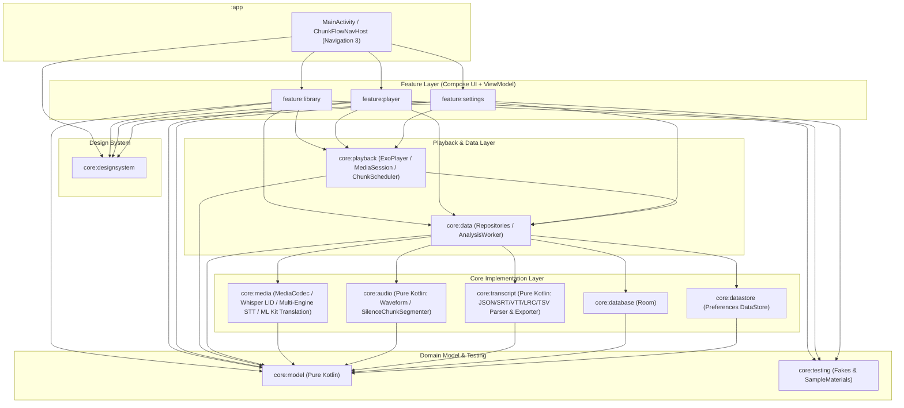

# Chunk Flow 設計書

- **文書バージョン**: 2.0（オンデバイス完結アーキテクチャ・全機能実装反映版）
- **最終更新日**: 2026-10-20
- **対象パッケージ**: `com.miuraken.chunkflow`
- **開発段階**: Phase 0 およびマイルストーン M1〜M4 の主要機能すべて実装完了・運用段階

---

## 0. 主要な設計判断（Design Decisions）

本プロジェクトの根幹をなす設計判断の一覧である。背景や検証データの詳細は `docs/adr/` および `docs/spikes/` を参照のこと。

| ID | 領域 | 決定事項 | 関連 ADR |
| --- | --- | --- | --- |
| **D1** | 再生優先 | **取り込み直後の即時再生**: 波形生成・チャンク分割・文字起こしがバックグラウンドで進行中でも、再生・シーク・速度変更を一切ブロックしない。 | — |
| **D2** | 状態管理 | **再生位置を `UiState` に入れない**: 再生位置（ミリ秒）は `PositionProvider` 経由で描画フェーズ（Canvas / アクティブ行内部）でのみ読み取り、再生中の画面全体の再コンポーズを 0 に保つ。 | — |
| **D3** | 再生エンジン | **Media3 `ExoPlayer` + `MediaSessionService`**: 音声再生は `core:playback` に閉じ込め、システムのメディア通知・ロック画面・Bluetooth イヤホン操作を `LearningPlayer`（`ForwardingSimpleBasePlayer`）で統合する。 | 0006, 0007 |
| **D4** | MP3 シーク精度 | **Xing / VBRI ヘッダを隠して `IndexSeeker` を強制**: VBR MP3 の TOC（100 点）による最大数百 ms のシーク誤差を防ぐため、独自 `DataSource` で先頭ヘッダフレームをマスクし、`FLAG_ENABLE_INDEX_SEEKING` による正確なフレームインデックスシークを行わせる。 | 0006 |
| **D5** | 境界制御 | **`PlayerMessage` + `dynamicScheduling = false`**: チャンク終端でのリピート・自動ポーズ・言語フィルタ・無音スキップはポーリングではなく `ExoPlayer.createMessage` でサンプル精度に近い位置に予約し、デコード先行による行き過ぎを防ぐため動的スケジューリングを無効化する。 | 0007 |
| **D6** | 音声解析 | **プラットフォーム `MediaExtractor` + `MediaCodec` 同期モード**: PCM 全量をメモリに載せず、ストリーミングで 10ms ビンの波形（ピーク・RMS）とフレーム特徴量を計算する。チャンク分割パラメータ変更時はキャッシュ済み特徴量から再デコードなしで即時再計算する。 | 0005, 0008 |
| **D7** | 言語判定（LID） | **量子化 Whisper Tiny（ONNX Runtime）+ 書記体系・語彙ヒューリスティックの 2 段階判定**: アセット同梱の `whisper_tiny_lid` モデルで教材の 2 言語（母語 `base` / 学習言語 `target`）のロジットを比較し、さらに認識テキストの書記体系・簡繁語彙プロファイルと組み合わせてチャンク言語を決定する。 | 0010 |
| **D8** | 音声認識（STT） | **端末内マルチエンジン構成（ML Kit / Android `SpeechRecognizer` / `sherpa-onnx` SenseVoice）**: PC での事前書き起こしを不要とし、端末内で完結する 3 種類のオンデバイス STT エンジンを言語ごと・ファイルごと・チャンク試行ごとに選択可能とする。対応言語では ML Kit GenAI Speech Recognition を既定とする。 | 0010, 0011 |
| **D9** | 先読みと優先制御 | **再生位置からの先読み文字起こしとユーザー操作の優先割り込み**: 再生中チャンクから前方へ順次バックグラウンド文字起こしを進めつつ、言語バッジのタップ（1 秒デバウンス）や手動の「再度、文字起こしする」「より詳しく文字起こし…」は優先スロット（`PriorityRecognitionSlotGate`）で割り込み実行する。 | 0010 |
| **D10** | 翻訳と読み | **ML Kit オンデバイス翻訳 + ICU4J / 純 Kotlin 読み方ガイド**: 学習言語チャンクから母語への機械翻訳（ML Kit Translation）と、ピンイン・粤拼（Jyutping）・ローマ字・デーヴァナーガリー（IAST）・ハングル音写を端末内で生成・表示する。 | 0011 |
| **D11** | ライブラリ管理 | **実フォルダ（SAF 参照）と仮想フォルダのハイブリッド管理**: 端末内の実ディレクトリ構造（`LOCAL_DIRECTORY` / `LOCAL_REFERENCE`）をコピーせず直接参照する運用と、単発インポートや再生リストによるアプリ内管理（`LOCAL_COPY` / `VIRTUAL_DIRECTORY`）の両方を統一 UI で扱う。 | — |
| **D12** | 文字起こし永続化 | **`chunkflow-transcript` v1（`.chunkflow.json`）による自動保存と互換入出力**: 端末内で生成・編集した文字起こしは、音声と同じフォルダ（または `transcription/` サブフォルダ）およびアプリ内部領域へ `.chunkflow.json` として自動保存し、SRT / WebVTT / LRC / TSV との相互入出力も備える。 | — |

---

## 1. 概要・目的・スコープ

### 1.1 アプリの目的
**Chunk Flow** は、語学学習者（主に個人利用）が市販教材やポッドキャスト等の音声ファイルを効率よく反復練習するための Android 専用オーディオプレイヤーである。
従来のオーディオプレイヤーでは「1 文だけ何度も聞き返す」「母語の解説を飛ばして学習言語の発話だけを連続で聞く」「母語を聞いた直後に自動で一時停止して瞬間作文する」「スクリプトのない音声にその場で文字起こし・読み仮名・翻訳を付ける」といった操作に多くの手間がかかっていた。Chunk Flow はこれらを**発話単位の「チャンク」**を軸として統合的に解決する。

### 1.2 主な特徴
1. **音声を入れるだけですぐ使える**: 音声ファイルやフォルダを選択すると即座に再生でき、並行して波形生成・無音検出によるチャンク分割・2 言語識別・文字起こし・翻訳がすべて Android 端末内で自動的に進む。
2. **母語と学習言語の混在教材に強い**: 「日本語の解説＋韓国語の例文」「英語の解説＋中国語・広東語の会話」のような 2 言語混在教材に対し、チャンク単位で母語（青系）と学習言語（ピンク系）を自動識別して色分けし、言語別フィルタ再生や言語別自動ポーズを行える。
3. **高度な波形操作とチャンク編集**: 全体波形と拡大波形の 2 段表示により、視覚的に発話区間を確認しながらタップ頭出し、ピンチズーム、長押しドラッグによるチャンク複数選択や A-B 区間選択、チャンクの分割・連結・境界調整・スキップが行える。
4. **学習進捗とブックマークの体系的管理**: フォルダ階層、検索・ソート付きファイル一覧、スマート＆カスタム再生リスト、そしてブックマークしたチャンクだけを横断的に連続再生できるブックマーク専用プレイヤーをライブラリ画面に備える。

### 1.3 スコープ外（Non-Goals）
- クラウドサーバーへの音声送信やアカウント同期機能（モデルデータのダウンロードを除き、音声・文字起こしはすべて端末内で処理する）。
- PC 側の専用書き起こしツール連携（文字起こしはすべて Android アプリ内のオンデバイス処理および標準字幕ファイルのインポート・エクスポートで完結する）。
- 動画再生、DRM 付きストリーミング配信サービスの再生。

---

## 2. 機能一覧

すべての機能（F1〜F10）は実装済みである。

| 分類 | ID | 機能名 | 概要 |
| --- | --- | --- | --- |
| **取り込み・入出力** | F1.1 | ファイル取り込み | SAF ピッカーから複数音声ファイルを一括取り込み。現在のフォルダに応じた初期位置指定、完了バナーのファイル名リンクから直接プレイヤー起動。 |
| | F1.2 | フォルダ取り込み | SAF `OpenDocumentTree` でフォルダ階層ごと参照登録（コピーせず直接再生）、同フォルダまたは `transcription/` 内の `.chunkflow.json` を自動連携。 |
| | F1.3 | 文字起こし取り込み | `.chunkflow.json` / `.srt` / `.vtt` / `.lrc` の単体・一括取り込み、およびローカルの `.chunkflow.json` 自動検出・自動保存。 |
| | F1.4 | 文字起こしエクスポート | 単一または複数教材の文字起こしを `SRT` / `LRC` / `TSV` / `JSON (.chunkflow.json)` 形式でプレビュー付き書き出し。 |
| **ライブラリ管理** | F2.1 | 4 タブ構成ライブラリ | 「フォルダ」「ファイル」「再生リスト」「ブックマーク」の 4 タブと複数選択アクションバー。 |
| | F2.2 | 実フォルダ・仮想フォルダ管理 | 実フォルダと仮想フォルダ（「インポート済」等）の区別表示、パンくずナビゲーション、フォルダ単位の言語ペア一括変更（文字起こしリセット確認付き）、ドラッグ並び替え。 |
| | F2.3 | 進捗・サムネイル・自動スクロール | 埋め込みカバーアート表示、最大到達進捗バー（95% 超または聴取完了で緑色化）、フォルダを開いた際の既聴ファイル位置への自動スクロール。 |
| | F2.4 | 再生リスト（スマート＆カスタム） | 「最近開いたファイル（最大 10 件）」「よくアクセスするファイル（最大 10 件）」「お気に入り」のスマートリストとユーザー作成リスト、ドラッグによるリスト順・項目順の並び替え。 |
| | F2.5 | ブックマーク横断再生 | ブックマーク付きチャンクを教材別アコーディオンで一覧し、下部専用コントローラーでブックマークチャンクだけを連続再生・リピート。 |
| **基本再生** | F3.1 | バックグラウンド再生・メディア通知 | Media3 `PlaybackService` による画面オフ再生、システム通知・ロック画面連携、イヤホン抜け・着信時の自動一時停止。 |
| | F3.2 | 再生速度コントロール | `1x` とカスタム速度（`0.5x〜3.0x`、`0.05x` 刻み）のワンタップ切り替え、長押しによる速度調整ボトムシート。全体設定で「ベース言語のみ別の速度で再生する」をオンにすると、ベース言語のチャンクだけは選んだ速度によらず指定の速度（`0.5x〜3.0x`）で再生する（§7.5.6）。 |
| | F3.3 | 秒数スキップ（巻き戻し/早送り） | タップで指定秒数スキップ、長押しポップアップで秒数プリセット（戻し `1/2/3/5/10s`、送り `3/5/10/15/30s`）を即座に変更。 |
| | F3.4 | チャンク移動と長押しジャンプ | 前/次ボタンのタップでチャンク頭出し移動、長押しポップアップで「ファイルの先頭へ」「前/次のチェック項目へ」「次のファイルへ」ジャンプ。Bluetooth イヤホンの前/次ボタンもチャンク移動に連動。 |
| | F3.5 | フローティング操作バー | 再生ボタン長押しまたは画面下部バー長押しで、画面上の任意の位置にドラッグ移動できるフローティング操作バーを表示。 |
| **波形表示** | F4.1 | 全体波形（Overview Waveform） | ファイル全体のピーク・RMS 波形を言語ロール別に色分け表示。チャンク境界目盛り（LID 確定前は表示、確定後は非表示）、A-B 範囲、拡大表示枠、再生ヘッドを描画。 |
| | F4.2 | 拡大波形（Zoomed Waveform） | 現在位置周辺の拡大波形（表示幅 `2 秒〜ファイル全長`、ピンチズーム対応、多段階ビットマップキャッシュ）を 60fps で滑らかにスクロール描画。左から右へのプログレッシブ描画アニメーション付き。 |
| | F4.3 | 波形ジェスチャー操作 | タップでチャンク頭出し/シーク、横ドラッグでスクラブ、ピンチでズーム、チャンク上長押し＋ドラッグで複数チャンク選択、非チャンク領域長押し＋ドラッグで A-B 区間選択。 |
| **チャンク分割・編集** | F5.1 | 無音検出による自動分割 | ヒステリシス付き RMS 無音検出（最小無音長・前後パディング・最小/最大チャンク長）による自動チャンク生成。 |
| | F5.2 | 分割パラメータの即時再計算 | グローバル設定またはファイル別設定シートから無音長・前後パディングを変更し、再デコードなしで即座に再分割。 |
| | F5.3 | チャンクの手動編集 | 再生位置でのチャンク分割（無音自動トリミング付き）、選択チャンクの連結（確認ダイアログ付き）、A-B 範囲からのチャンク追加・チャンク解除、境界の `±100ms` 微調整、チャンク削除、チャンク単位/一括スキップ設定。 |
| | F5.4 | チャンク出どころ切り替え | 自動分割（`AUTO`）・文字起こし由来（`IMPORTED`）・手動編集（`MANUAL`）の管理と切り替え。 |
| **学習モード** | F6.1 | チャンクリピート・ファイルリピート | チェックした複数チャンクの連続リピート、未チェック時のアクティブチャンク一時リピート、リピートボタン長押しによるファイル全体リピート（`🔁リピート`）。 |
| | F6.2 | A-B 区間リピート・範囲リピート | 波形ドラッグによる任意区間リピート（`LoopMode.AbRange`）およびチャンク範囲指定リピート（`LoopMode.ChunkRange`）。 |
| | F6.3 | 自動ポーズ（固定・比例） | チャンク終端で固定秒数（`0.0〜4.0 秒`）またはチャンク長比例（`0.5〜3.0 倍`）のポーズを挿入。画面オフ時は期限付き `PARTIAL_WAKE_LOCK` で再開遅延を防止。 |
| | F6.4 | 言語フィルタ再生 | 「両方再生」「母語のみ」「学習言語のみ」「☑（チェック済み）のみ」を切り替え。すべてのチェックを外した際は自動で「両方再生」に戻しチップを 3 秒間ハイライト通知。 |
| | F6.5 | 瞬間作文・シャドーイング対象指定 | 自動ポーズの対象を「すべてのチャンク」「学習言語の後のみ」「母語の後のみ」から選択。 |
| | F6.6 | 元音声の無音スキップ | チャンク間の非チャンク（無音）区間を再生時に自動スキップ（`skipOriginalSilence`）。 |
| **スクリプト・AI** | F7.1 | 同期スクリプト一覧と自動追従 | アクティブチャンクの強調と自動スクロール追従。手動スクロール時は追従を一時停止し「現在位置へ戻る」ボタンを表示、再生/シーク操作で自動追従を再開。 |
| | F7.2 | ブラインドモード・読み・翻訳 | 「隠す」チップで学習言語の本文をマスク（タップで一時表示）。「隠す」と「読み」または「翻訳」を併用した際はマスクバナーを出さず読み/翻訳のみをすっきり表示。 |
| | F7.3 | 言語バッジ切り替え（デバウンス付き） | チャンクの言語バッジ（`?` / 学習言語 / 母語）をタップして即時切り替え。連続タップを考慮し 1 秒デバウンス後に優先キューで音声認識を実行。未判定チャンクの一括言語設定バナーも提供。 |
| | F7.4 | テキスト編集・コピー・再文字起こし | 長押しメニューからテキスト手動編集（`userEdited = true` として再分割時も保護）、クリップボードコピー、キャッシュ破棄による強制再文字起こし。 |
| | F7.5 | より詳しく文字起こし（試行ダイアログ） | チャンク単位で認識言語・STT エンジン（ML Kit / SpeechRecognizer / sherpa-onnx）・入力音声速度（`0.5x/0.75x/1.0x/1.5x`）を指定し、チャンク波形プレビュー再生と実行前チェック（権限・モデル状態）を行いながら文字起こしを試行・適用。 |
| | F7.6 | 時間軸の自動・手動ずれ補正 | MP3 エンコーダ遅延等の初期補正、音響エネルギーと文字起こし区間の相互相関による自動オフセット推定（`±500ms`）、および `10ms` 単位の手動微調整。 |
| | F7.7 | 単語単位カラオケ強調 | `words` タイムスタンプがある場合、アクティブチャンク内の発話中の単語をリアルタイムにハイライト表示。 |

---

## 3. 非機能要件（Non-Functional Requirements）

| 項目 | 目標値・仕様 | 実現方式 |
| --- | --- | --- |
| **再生開始レイテンシ** | タップから **1 秒未満**で音声再生を開始 | 解析・文字起こしと独立して ExoPlayer が直接ファイルをストリーム再生（D1）。 |
| **UI フレームレート** | 波形スクロール・再生中も **60fps** を維持 | 再生位置を `UiState` に入れず描画フェーズで `PositionProvider` を参照。拡大波形は `30s / 15s / 7.5s` の多段階 `ImageBitmap` タイルキャッシュを使用（D2）。 |
| **チャンク境界精度** | リピート終端の行き過ぎ **50ms 未満** | `PlayerMessage` による境界予約＋`experimentalSetDynamicSchedulingEnabled(false)`（ADR 0007）。 |
| **音声解析速度・メモリ** | 30 分の音声の波形＋チャンク生成を実機で **60 秒以内**、ヒープ増加 **50MB 以下** | `MediaCodec` 同期モードによるストリーミング処理。PCM 全量をメモリに保持しない（ADR 0005）。 |
| **画面オフ・省電力耐性** | 画面オフで **1 時間以上**の連続再生および自動ポーズが正確に動作 | `PlaybackService`（`foregroundServiceType="mediaPlayback"`）と自動ポーズ中の期限付き `PARTIAL_WAKE_LOCK`。 |
| **アクセシビリティ** | TalkBack 完全対応、文字サイズ **2.0 倍**で崩れない、タップ領域 **48dp 以上** | 波形 Canvas への `progressBarRangeInfo` / `customActions` 付与、言語バッジの文字＋色併用、FlowRow / 適応型レイアウト。 |

---

## 4. 対象言語と文字・音声処理仕様

### 4.1 言語カタログ（`SupportedLanguageCatalog`）
設定画面の「言語」タブで有効・無効を切り替えられる言語一覧は以下のとおり（初期状態では主要言語が有効、最低 1 言語は常に有効を維持）。

| 言語コード | 表示名 | 書記体系・特徴 | 読み方ガイド（`showTargetRomanization`） |
| --- | --- | --- | --- |
| `ja` | 日本語 | 漢字・ひらがな・カタカナ | ローマ字（かな→Latin 音訳） |
| `en` | 英語 | ラテン文字 | — |
| `zh` | 中国語（普通話） | 簡体字（`Hans`）/ 繁体字（`Hant`）切替対応 | ピンイン（声調記号付き、`Han-Latin`） |
| `yue` | 広東語 | 繁体字（香港口語 `Hant`）/ 簡体字（`Hans`）切替対応 | 粤拼（Jyutping、内蔵辞書＋フォールバック） |
| `ko` | 韓国語 | ハングル | ハングル音写（改訂ローマ字表記 `Hangul-Latin`） |
| `es` | スペイン語 | ラテン文字 | — |
| `fr` | フランス語 | ラテン文字 | — |
| `de` | ドイツ語 | ラテン文字 | — |
| `it` | イタリア語 | ラテン文字 | — |
| `pt` | ポルトガル語 | ラテン文字 | — |
| `ru` | ロシア語 | キリル文字 | ラテン文字音写（`Cyrillic-Latin`） |
| `vi` | ベトナム語 | ラテン文字＋声調記号（NFC 正規化必須） | — |
| `hi` | ヒンディー語 | デーヴァナーガリー | IAST ローマ字音写（`Devanagari-Latin`） |
| `el` | ギリシャ語 | ギリシャ文字 | ラテン文字音写（`Greek-Latin`） |
| `id` / `th` / `ar` / `tr` / `nl` / `pl` / `sv` / `uk` | その他対応言語 | 各言語固有の書記体系 | ICU `Any-Latin` 対応言語はラテン音写 |

### 4.2 言語役割別カラーパレット（`ChunkFlowLanguagePalette`）
アプリ全体（ライブラリ画面の言語バッジ、プレイヤー画面の全体波形・拡大波形・スクリプト行背景・言語バッジ、設定画面）で、言語そのものではなく**教材における役割（母語 `base` か学習言語 `target` か）**に応じた一貫した配色を用いる。

- **母語（`base`）**: 青系（Blue 系コンテナ・アクセント。落ち着いて参照できる解説色）
- **学習言語（`target`）**: ピンク / マゼンタ系（Pink / Rose 系コンテナ・アクセント。集中すべき発話色）
- **未判定（`null` / `"und"`）**: ニュートラルグレー系（バッジ表示は `"?"`）

### 4.3 中国語・広東語の字体切り替え（`ChineseScript`）
- `ChineseScript.SIMPLIFIED`（簡体字）と `ChineseScript.TRADITIONAL`（繁体字）を中国語（`zh`）用・広東語（`yue`）用に独立して保持する。
- チャンクが `textVariants["Hans"]` / `textVariants["Hant"]` を持つ場合はそれを優先表示し、持たない場合は ICU4J `Transliterator`（`Simplified-Traditional` / `Traditional-Simplified`）で動的に変換して表示する。
- `Compose` の `TextStyle` には `LocaleList(Locale("zh-Hans"))` / `Locale("zh-Hant")` / `Locale("yue-Hant")` 等を明示し、CJK 統合漢字の字形（グリフ）が言語と字体に正しく合致するようにする。

---

## 5. アーキテクチャとモジュール構成

### 5.1 レイヤ構成と単方向データフロー（UDF）
UI レイヤ（`feature:*`）→ データ・再生レイヤ（`core:data`, `core:playback`）→ 基盤・ドメインレイヤ（`core:media`, `core:audio`, `core:transcript`, `core:database`, `core:datastore`, `core:model`）の厳密な単方向依存とする。

### 5.2 モジュール一覧と責務の境界

| モジュール | プラットフォーム | 責務と制約 |
| --- | --- | --- |
| `:app` | Android App | アプリエントリポイント、Hilt アプリケーション、Navigation 3 の `NavDisplay` と 2 ペイン Scene 構成。 |
| `:feature:library` | Android Library (Compose) | ライブラリ画面（4 タブ）、フォルダ/ファイル取り込み、再生リスト管理、ブックマーク連続再生、エクスポート画面。 |
| `:feature:player` | Android Library (Compose) | プレイヤー画面、全体/拡大波形描画、チャンク選択・編集、同期スクリプト表示、詳細文字起こし試行ダイアログ、ファイル別設定シート。 |
| `:feature:settings` | Android Library (Compose) | 設定画面（再生設定、チャンク分割、文字起こしエンジン・モデル管理、対象言語選択）。 |
| `:core:designsystem` | Android Library (Compose) | `ChunkFlowTheme`、`ChunkFlowLanguagePalette`、`ChunkFlowIcons`、共通 UI コンポーネント、`@ChunkFlowPreviews`。 |
| `:core:playback` | Android Library | **ExoPlayer に触れる唯一のモジュール**。`PlaybackService`、`LearningPlayer`、`ChunkScheduler`、`PlaybackControllerImpl`、`PositionProvider`。 |
| `:core:data` | Android Library | `LibraryRepository`、`AnalysisRepository`、`TranscriptRepository`、`UserPreferencesRepository` の実装と `AnalysisWorker`。 |
| `:core:media` | Android Library | **ネットワーク（モデル取得）と Android メディア/AI API に触れるモジュール**。`MediaCodecAudioDecoder`、MP3 `HeaderMaskingDataSource`、ONNX `WhisperTinyLanguageDetector`、`OnDeviceSpeechTranscriber`（ML Kit / `SpeechRecognizer` / `sherpa-onnx`）、`MlKitTextTranslator`。 |
| `:core:audio` | **純 Kotlin (JVM)** | `android.*` / `androidx.*` 依存禁止。波形ビン集計、ヒステリシス付き無音検出（`SilenceChunkSegmenter`）、相互相関による時刻ずれ推定。 |
| `:core:transcript` | **純 Kotlin (JVM)** | `android.*` / `androidx.*` 依存禁止。`chunkflow-transcript` v1 JSON / SRT / WebVTT / LRC パーサ・バリデータ・エクスポータ、チャンク対応付けロジック。 |
| `:core:database` | Android Library (Room) | `ChunkFlowDatabase`、エンティティ、DAO、マイグレーション。 |
| `:core:datastore` | Android Library | Preferences DataStore による設定の永続化。 |
| `:core:model` | **純 Kotlin (JVM)** | 全モジュールで共有する不変データクラス・識別子・エラー型。 |
| `:core:testing` | Android Library | 単体テスト・Compose Preview・Screenshot Test 用の Fake リポジトリ・Fake コントローラー・サンプルデータ。 |

### 5.3 DI と Coroutine Dispatcher
- Hilt を用いて依存性を注入する。
- `Dispatchers.IO` や `Dispatchers.Default` を直接ハードコードせず、`@Dispatcher(ChunkFlowDispatchers.IO)` / `@Dispatcher(ChunkFlowDispatchers.Default)` 修飾子で注入し、単体テストでは `StandardTestDispatcher` / `UnconfinedTestDispatcher` に差し替える。

---

## 6. データモデル・インターフェース・データベース設計

### 6.1 コアドメインモデル（`core:model`）

#### 識別子と基本型
- `MediaId(val value: String)`: 音声ファイルの SHA-256（小文字 16 進 64 文字）または安定した一意識別子。
- `ChunkId(val value: Long)`: Room 自動採番または決定論的チャンク ID。
- `LanguageTag(val value: String)`: BCP-47 言語タグ（`"ja"`, `"ko"`, `"zh"`, `"yue"`, `"en"` 等）。
- `LanguagePair(val target: LanguageTag, val base: LanguageTag?)`: 学習言語 `target` と母語（解説言語）`base` のペア。単一言語教材では `base = null`。

#### 教材とソース種別（`MediaItem`, `SourceType`）
- `MediaItem`:
  - `id: MediaId`, `title: String`, `course: String?`（`/` 区切りのフォルダ階層パス）
  - `durationMs: Long`, `localUri: String?`, `sourceType: SourceType`, `audioSha256: String`
  - `languagePair: LanguagePair?`
  - `lastPositionMs: Long`, `maxPositionMs: Long`（最大到達位置）, `isListened: Boolean`（95% 超到達または最後まで再生済みフラグ）
  - `playbackSpeed: Float`
  - `transcriptStatus: TranscriptStatus`（`NONE`, `PARTIAL`, `COMPLETED`）, `transcriptOffsetMs: Int`
  - `segmentationParamsOverride: SegmentationParams?`（ファイル固有の分割設定）
  - `transcriptionEngineOverride: OnDeviceTranscriptionEngine?`（ファイル固有の STT エンジン設定）
  - `isFavorite: Boolean`, `accessCount: Int`, `fileSortOrder: Int`
  - `addedAtEpochMs: Long`, `lastAccessedAtEpochMs: Long?`
- `SourceType`:
  - `LOCAL_COPY`: SAF 単発インポート等でアプリ内ストレージ（`filesDir/media/`）にコピーされたファイル。
  - `LOCAL_REFERENCE`: SAF フォルダ取り込み等で元の端末内 URI を直接参照するファイル。
  - `LOCAL_DIRECTORY`: SAF `OpenDocumentTree` で登録された実フォルダ。
  - `VIRTUAL_DIRECTORY`: アプリ内で作られた仮想フォルダ（「インポート済」など）。

#### チャンク・波形・文字起こし（`Chunk`, `Waveform`, `Transcript`）
- `Chunk`:
  - `id: ChunkId`, `mediaId: MediaId`, `index: Int`, `startMs: Long`, `endMs: Long`
  - `source: ChunkSource`（`AUTO` / `IMPORTED` / `MANUAL`）
  - `language: LanguageTag?`, `languageConfidence: Float?`
  - `isBookmarked: Boolean`, `isRepeatChecked: Boolean`, `isSkipped: Boolean`
- `Waveform`:
  - `mediaId: MediaId`, `binDurationMs: Int = 10`（1 ビン = 10ms）
  - `peaksDb: ByteArray`, `rmsDb: ByteArray`（`-60dB〜0dB` を量子化して保持）
- `Transcript`:
  - `chunkId: ChunkId`, `text: String`, `textVariants: Map<String, String>`（`"Hans"`, `"Hant"`）
  - `translatedText: String?`（オンデバイス翻訳キャッシュ）
  - `words: List<WordTiming>`（`text`, `startMs`, `endMs`）
  - `userEdited: Boolean`（手動編集保護フラグ）

#### 学習モードと制御型（`LoopMode`, `AutoPauseMode`, `AutoPauseScope`, `LanguageFilter`）
- `LoopMode`:
  - `Off`: リピートなし
  - `SingleChunk(chunkId: ChunkId, times: Int?)`: 単一チャンクリピート（`times = null` で無限）
  - `ChunkRange(firstChunkId: ChunkId, lastChunkId: ChunkId, times: Int?)`: 連続チャンク範囲リピート
  - `AbRange(startMs: Long, endMs: Long, times: Int?)`: 任意時刻 A-B リピート
- `AutoPauseMode`:
  - `Off`: 自動ポーズなし
  - `Fixed(durationMs: Int)`: 固定時間ポーズ（`0〜4000ms`）
  - `Proportional(multiplier: Float, minMs: Int = 500, maxMs: Int = 15_000)`: チャンク長 × 倍率（`0.5x〜3.0x`）
  - `OriginalSilence(factor: Float = 1.0f)`: 元の無音区間 × 倍率（`0.25x〜2.0x`、0.25 刻み）
- `AutoPauseScope`:
  - `ALL_CHUNKS`（すべてのチャンクの後）
  - `TARGET_ONLY`（学習言語のチャンクの後のみ：シャドーイング・リピーティング用）
  - `BASE_ONLY`（母語のチャンクの後のみ：瞬間作文用）
- `LanguageFilter`:
  - `ALL`（両方再生）
  - `BASE_ONLY`（母語のみ再生）
  - `TARGET_ONLY`（学習言語のみ再生）
  - `CHECKED_ONLY`（`isRepeatChecked == true` のチャンクのみ再生）

### 6.2 Compose 安定性と `PositionProvider`
- `compose_compiler_config.conf` により `com.miuraken.chunkflow.core.model.*` をすべて Stable として扱う。
- `fun interface PositionProvider { fun currentPositionMs(): Long }` を `PlaybackController` が提供し、`WaveformSection` の `Canvas` 描画ラムダおよび `TranscriptChunkRow`（アクティブ行のみ）が `withFrameNanos` ループ内で直接呼び出すことで、60fps の描画更新中も `PlayerScreen` 全体の再コンポーズを発生させない。

### 6.3 Room データベーススキーマ（`core:database`）
`ChunkFlowDatabase` は以下のテーブルを持つ：
1. `media_items`: 教材メタデータ、進捗（`lastPositionMs`, `maxPositionMs`, `isListened`）、言語ペア、ファイル別分割設定・エンジン設定、お気に入り、アクセス回数、並び順。
2. `chunks`: `mediaId` 外部キー（CASCADE 削除）、`startMs`, `endMs`, `source`, `language`, `languageConfidence`, `isBookmarked`, `isRepeatChecked`, `isSkipped`。
3. `transcripts`: `chunkId` 外部キー（CASCADE 削除）、`text`, `textVariantsJson`, `translatedText`, `wordsJson`, `userEdited`。
4. `user_edits`: チャンクの再分割・再生成をまたいで保持すべきユーザーの編集履歴（ブックマーク時刻範囲、手動編集済みテキスト区間）。
5. `playlists` / `playlist_items`: ユーザー作成再生リストおよびスマート再生リストの手動並び替え順序。
6. `directory_configs`: フォルダパス（`course`）ごとの種別（実フォルダ / 仮想フォルダ）、SAF `treeUri`、言語ペア設定、ルートフォルダ並び順。

---

## 7. 詳細設計（コア機能と画面仕様）

### 7.1 ファイル・フォルダの取り込みと管理（`core:data/library`）

#### 7.1.1 単発・複数ファイルの取り込み（`importLocalFiles`）
1. SAF `OpenMultipleDocuments` で選択された URI リストを受け取る。ピッカー起動時は現在開いている実フォルダの URI（なければ端末の内部ストレージルート `primary:`）を `DocumentsContract.EXTRA_INITIAL_URI` に設定する。
2. 拡張子と MIME タイプから音声ファイル（MP3, M4A/AAC, Ogg Opus, FLAC, WAV）と文字起こしファイル（`.chunkflow.json`, `.srt`, `.vtt`, `.lrc`）に振り分ける。
3. 音声ファイルはサイズ上限（500MB）を確認しながらストリーム読み込みして SHA-256 を計算する。
   - 端末の共有ストレージ上の実パス・実フォルダが特定できる場合は `LOCAL_REFERENCE` として元 URI を参照登録し、それ以外は `filesDir/media/<sha256>.<ext>` にコピーして `LOCAL_COPY` として登録する。
   - フォルダ階層（`course`）が特定できない単発インポートファイルは、仮想フォルダ **`「インポート済」`** に配置する。
4. 同じフォルダ（または `transcription/` サブフォルダ）に `<音声ファイル名ステム>.chunkflow.json` が存在する場合は自動的に検出し、チャンクと文字起こしを即座に復元する。

#### 7.1.2 フォルダ一括取り込み（`importLocalDirectory`）
1. SAF `OpenDocumentTree` で選択されたツリー URI に対し `takePersistableUriPermission`（読み取り＋書き込み権限）を取得する。
2. ツリー内のサブディレクトリを再帰的に走査し、フォルダ階層を `/` 区切りの `course` パスとして登録する（`SourceType.LOCAL_DIRECTORY`）。
3. 各音声ファイルをコピーせず `LOCAL_REFERENCE` として登録し、対応する `.chunkflow.json` があれば自動で紐付ける。

#### 7.1.3 削除の仕様
- **ファイルの削除**: DB から `media_items`（および CASCADE で `chunks`, `transcripts`）を削除し、`LOCAL_COPY` の場合は `filesDir/media/` 内の実ファイルと波形キャッシュも削除する。
- **フォルダの削除**: 削除確認ダイアログでユーザーの承認を得た上で、指定フォルダ（およびサブフォルダ）の設定レコード（`directory_configs`）と、**そのフォルダ配下に属するすべての教材アイテム（DB レコード・波形キャッシュ・コピー済み音声ファイル）を一括削除**する。

---

### 7.2 再生エンジンとチャンク境界制御（`core:playback`）

#### 7.2.1 `ExoPlayer` と MP3 `IndexSeeker`
- `ExoPlayer` は `PlaybackService`（`MediaSessionService`）内で生成・保持する。
- `experimentalSetDynamicSchedulingEnabled(false)` を適用し、チャンク境界付近でデコーダが過度に先行して `PlayerMessage` の発火が遅れる現象を防ぐ（ADR 0007）。
- MP3 再生時は `HeaderMaskingDataSource` で先頭の Xing / Info / VBRI フレームを無音フレームにマスクし、`DefaultExtractorsFactory().setMp3ExtractorFlags(Mp3Extractor.FLAG_ENABLE_INDEX_SEEKING)` と組み合わせることで、VBR/CBR を問わずサンプル精度の `IndexSeeker` を強制する（ADR 0006）。

#### 7.2.2 `LearningPlayer`（メディア通知・イヤホン操作の統合）
`ExoPlayer` を `ForwardingSimpleBasePlayer` でラップした `LearningPlayer` を `MediaSession` に公開する：
- `COMMAND_SEEK_TO_NEXT` / `COMMAND_SEEK_TO_NEXT_MEDIA_ITEM`（Bluetooth イヤホンやロック画面の「次へ」）を**次のチャンクへの移動**に割り当てる。
- `COMMAND_SEEK_TO_PREVIOUS` / `COMMAND_SEEK_TO_PREVIOUS_MEDIA_ITEM`（「前へ」）を**チャンク先頭または前のチャンクへの移動**（現在チャンク開始から `1,000ms` 以上経過していれば現在チャンクの先頭、`1,000ms` 未満なら前のチャンクの先頭）に割り当てる。
- `COMMAND_SEEK_BACK` / `COMMAND_SEEK_FORWARD` はユーザー設定の巻き戻し秒数（`seekBackMs`）・早送り秒数（`seekForwardMs`）で動作する。

#### 7.2.3 `ChunkScheduler`（チャンク境界でのリピート・自動ポーズ・言語フィルタ・無音スキップ）
再生中のチャンク終端や A-B 終端に対する制御は、ポーリングではなく `ExoPlayer.createMessage` によって境界時刻に予約する。境界到達時の優先順位と遷移規則は以下のとおり：

1. **A-B 区間リピート（`LoopMode.AbRange(startMs, endMs, times)`）**:
   - `endMs` 到達時、残り回数があれば `startMs` にシークして再生継続。回数満了なら `LoopMode.Off` に戻す。
2. **単一チャンクリピート / 範囲リピート（`LoopMode.SingleChunk`, `LoopMode.ChunkRange`）**:
   - 対象チャンク終端到達時、**自動ポーズ条件**（`AutoPauseMode != Off` かつ `AutoPauseScope` が当該チャンクの言語に一致）を満たす場合は、まず `player.pause()` してポーズタイマー（期限付き `PARTIAL_WAKE_LOCK` 付き）を開始し、ポーズ満了後にリピート先頭へシークして再開する。
3. **選択チャンクリピート（`LanguageFilter.CHECKED_ONLY` またはリピート ON）**:
   - `isRepeatChecked == true`（かつ `!isSkipped`）のチャンク集合を開始時刻順に巡回する。最後のチェック済みチャンクの終端に到達した際、リピートが有効であれば先頭のチェック済みチャンクへループし、リピートが無効であれば一時停止する。
4. **言語フィルタ再生（`LanguageFilter.BASE_ONLY` / `TARGET_ONLY`）**:
   - 現在チャンクの終端到達時（自動ポーズがあればポーズ満了後）、フィルタ条件に合致し、かつ `!isSkipped` である次のチャンクの `startMs` へ直接シークする。該当する後続チャンクが存在しない場合はファイル終端扱いとする。
5. **元音声の無音スキップ（`skipOriginalSilence == true`）**:
   - 次の再生対象チャンクの `startMs` が現在チャンクの `endMs` より離れている場合（チャンク間の非チャンク無音区間）、現在チャンクの終端（または自動ポーズ満了後）に次のチャンクの `startMs` へ即座にシークして無音区間を飛び越える。
6. **ファイル全体リピート（`isWholeFileRepeat == true`）**:
   - 最後の対象チャンクの終端またはファイル終端（`STATE_ENDED`）に到達した際、最初の再生対象チャンク（または `0ms`）へシークして再生を継続する。

---

### 7.3 音声解析・波形生成・自動チャンク分割（`core:media`, `core:audio`, `core:data/analysis`）

#### 7.3.1 ストリーミングデコードと波形生成
1. `MediaExtractor` と `MediaCodec`（同期モード）で音声トラックを PCM にストリーミングデコードする。
2. 10ms ごとのビン（`binDurationMs = 10`）についてピーク振幅（dBFS）と RMS（dBFS）を計算し、`Waveform` として `filesDir/waveforms/<mediaId>.waveform` に保存する。
3. 解析中も一定間隔で中間波形を Flow に流し、プレイヤー画面の波形が左から右へプログレッシブに描画されるようにする。

#### 7.3.2 ヒステリシス付き無音検出（`SilenceChunkSegmenter`）
10ms フレームごとの RMS 配列を入力とし、以下のパラメータ（`SegmentationParams`）で発話区間を切り出す：
- `silenceThresholdDb`: 無音判定しきい値（既定 `-38.0 dB`、開始しきい値と終了しきい値にヒステリシスを持たせてチャタリングを防止）
- `minSilenceMs`: 分割に必要な最小無音長（既定 `400 ms`、設定範囲 `150〜1000 ms`）
- `prePaddingMs`: 発話開始前の余白（既定 `120 ms`、設定範囲 `0〜400 ms`）
- `postPaddingMs`: 発話終了後の余白（既定 `180 ms`、設定範囲 `0〜400 ms`）
- `minChunkMs`: 最小チャンク長（既定 `600 ms`）
- `maxChunkMs`: 最大チャンク長（既定 `15,000 ms`、長すぎる発話は内部の最も深い谷で分割）

フレーム特徴量はメモリ・ディスクにキャッシュされるため、ユーザーが設定画面やファイル別設定シートで `minSilenceMs` / `prePaddingMs` / `postPaddingMs` を変更した際は、**再デコードを行うことなく数ミリ秒でチャンク境界を再計算**する。

#### 7.3.3 チャンク再生成時のトランザクション保護（§6.4）
チャンクを再分割・再生成する際は、必ず Room の単一トランザクション内で以下の順序で更新する：
1. 新しいチャンク群を挿入する。
2. 既存の文字起こし（特に `userEdited = true` の手動編集テキスト）およびブックマーク・チェック状態を、時間軸の重なり（IoU / 最大重複区間）に基づいて新チャンクへ引き継ぐ。
3. 古いチャンク群を削除する。

---

### 7.4 オンデバイス言語判定・文字起こし・翻訳・外部ファイル入出力（`core:media`, `core:transcript`）

#### 7.4.1 量子化 Whisper Tiny による 2 段階言語判定（LID）
1. **第 1 段階（音響 LID）**:
   - チャンク区間の 16kHz モノラル PCM から 80 チャネルのログメルスペクトログラムを計算し、ONNX Runtime（CPU）上で量子化 Whisper Tiny エンコーダ＋1 ステップデコーダを実行する。
   - 全 99 言語ではなく、教材に設定された **2 言語（`languagePair.target` と `languagePair.base`）の言語トークンロジットのみをソフトマックス比較**する（`zh` と `yue` がペアの片方にのみある場合は両ロジットを合算）。
   - デコード済みのチャンク先頭から順次 2 言語判定のみを先行一括実行できるため、文字起こし完了前でも全体波形・拡大波形・言語バッジに母語（青）/ 学習言語（ピンク）の色分けが即座に反映される。
2. **第 2 段階（書記体系・語彙ヒューリスティック補正）**:
   - STT エンジンから認識テキストが得られた後、`LanguageHeuristics` によりテキスト内の文字体系（ひらがな・カタカナ、ハングル、キリル文字、ギリシャ文字、デーヴァナーガリー、ベトナム語声調記号、簡体字/繁体字の固有字・語彙プロファイル）を検査する。
   - 音響 LID の結果と認識テキストの文字体系が矛盾する場合や、片方の言語で認識結果が空だった場合は、もう一方の言語で再認識を試み、自然な発話テキストが得られた側の言語を採用する。

#### 7.4.2 マルチエンジン音声認識（STT）アーキテクチャ
`OnDeviceTranscriptionEngine` として以下の 4 モードを提供する（ADR 0011）：
1. **`AUTO`（自動・既定）**: 対象言語が ML Kit GenAI Speech Recognition に対応していれば `ML_KIT` を使い、非対応であれば `ANDROID_SPEECH_RECOGNIZER`（またはダウンロード済みの `SHERPA_ONNX`）に自動フォールバックする。
2. **`ML_KIT`（ML Kit GenAI Speech Recognition）**: Google Play 開発者サービス / AICore 経由のオンデバイス高精度音声認識。PCM データを直接入力し、`RECORD_AUDIO` 権限を必要としない。
3. **`ANDROID_SPEECH_RECOGNIZER`（OS 標準のオンデバイス音声認識）**: `SpeechRecognizer.createOnDeviceSpeechRecognizer` に対し、`ParcelFileDescriptor.createPipe()` を使って `RecognizerIntent.EXTRA_AUDIO_SOURCE` からチャンクの 16kHz PCM を直接流し込む（OS API の仕様上 `RECORD_AUDIO` 権限が必要）。
4. **`SHERPA_ONNX`（SenseVoice オフライン音声認識）**: `zh` / `yue` / `en` / `ja` / `ko` に対応した SenseVoice 量子化 ONNX モデルをアプリ内にダウンロードして実行する完全スタンドアロンエンジン。

エンジン優先順位は以下の 3 階層で解決する：
- **チャンク詳細文字起こし試行ダイアログでの指定** ＞ **ファイル別設定シートでの上書き（`transcriptionEngineOverride`）** ＞ **設定画面の言語別エンジン設定（`perLanguageTranscriptionEngines`）**。

#### 7.4.3 先読み文字起こしキューと優先割り込み（Preemption）
- **先読み文字起こし（Lookahead Transcription）**:
  - 再生画面を開いたとき（設定 `autoStartTranscriptionOnOpen == true` の場合、または上部の文字起こしバッジをタップして ON にしたとき）、現在のアクティブチャンクから後方へ、末尾に達したら未文字起こしの先頭チャンクから順次文字起こしを実行する。
  - 各チャンクの進行状況は `TranscriptionStep`（`PREPARING_AUDIO` 12% → `DETECTING_LANGUAGE` 32% → `RECOGNIZING_PRIMARY` 64% → `RECOGNIZING_FALLBACK` 82% → `SAVING` 95%）としてリアルタイムに通知する。
  - 1 チャンクの処理が **8 秒以上（`TRANSCRIPTION_STALL_WARNING_MS = 8_000L`）** 停滞した場合は、拡大波形ヘッダーおよび下部進捗カードに停滞警告を表示する。
- **優先割り込み（`PriorityRecognitionSlotGate`）**:
  - ユーザーがチャンクの言語バッジをタップして言語を切り替えた場合（**連続タップをまとめるため 1 秒間のデバウンス後に発火**）、または長押しメニューから「再度、文字起こしする」「より詳しく文字起こし…」を実行した場合は、進行中の先読みワーカーを即座に中断・待機させ、ユーザーの指定チャンクを最優先で認識する。
  - チャンク ID × 言語ごとの認識結果はメモリキャッシュ（`chunkLanguageTextCache`）に保持されるため、一度認識したチャンクの言語バッジを再度トグルした際は再認識なしで即座にテキストが切り替わる。「再度、文字起こしする」はキャッシュを破棄して強制再認識する。

#### 7.4.4 オンデバイス翻訳（ML Kit Translation）と読み方ガイド
- **オンデバイス翻訳**:
  - プレイヤー画面で「翻訳」チップ（`showTargetTranslation`）を ON にすると、学習言語（`target`）と判定されたチャンクのテキストを母語（`base`）へ `MlKitTextTranslator`（ML Kit On-Device Translation）で順次翻訳し、DB の `transcripts.translatedText` にキャッシュして本文の下に表示する。
- **読み方ガイド（Phonetic Reading）**:
  - プレイヤー画面で「読み」チップ（`showTargetRomanization`）を ON にすると、学習言語チャンクの本文の下（翻訳がある場合は本文と翻訳の間）に、§4.1 の規則に従った発音表記（ピンイン、粤拼 Jyutping、ローマ字、IAST、ハングル音写等）を表示する。

#### 7.4.5 文字起こしの自動保存（`.chunkflow.json`）と外部ファイル入出力
- オンデバイス文字起こしや手動編集・チャンク編集が行われると、デバウンス後に `chunkflow-transcript` v1 形式（`docs/format/chunkflow-transcript-v1.schema.json` 準拠）の JSON を生成し、アプリの内部保存領域および（書き込み可能な実フォルダの場合は）音声ファイルと同じフォルダまたは `transcription/` サブフォルダに `<stem>.chunkflow.json` として自動保存する。
- エクスポート機能（`TranscriptExporter`）は以下の 4 形式をサポートする：
  1. **`SRT`（`.srt`）**: SubRip 字幕形式（連番、`HH:MM:SS,mmm --> HH:MM:SS,mmm`、本文）。
  2. **`LRC`（`.lrc`）**: 歌詞タイムタグ形式（`[MM:SS.xx]本文`）。
  3. **`TSV`（`.tsv`）**: タブ区切り形式（開始時刻、終了時刻、言語タグ、本文）。
  4. **`JSON`（`.chunkflow.json`）**: `chunkflow-transcript` v1 完全形式（言語ペア、チャンク境界、言語確率、字体バリエーション、単語タイムスタンプを含む）。

---

### 7.5 画面仕様と UI ロジック（再実装可能な完全仕様）

#### 7.5.1 画面遷移とアダプティブ 2 ペイン構成（`:app`）
- Jetpack Navigation 3（`NavDisplay`）を使用し、ルートキーとして `LibraryKey`、`PlayerKey(mediaId, initialChunkId?)`、`SettingsKey(initialTab)`、`TranscriptExportKey(mediaIds)` を持つ（`:app` の `ChunkFlowNavDisplay`）。予測型「戻る」は `NavDisplay` が扱う。
- アプリ単位の List-detail 2 ペイン構成（`material3-adaptive-navigation3` の `ListDetailSceneStrategy`）を採用し、大画面（Expanded 以上）では左ペインにライブラリ（`listPane`、未選択時は詳細プレースホルダー表示）、右ペインにプレイヤー（`detailPane`、2 ペイン時は戻る矢印を非表示）を並べて表示する（ADR 0012）。
- プレイヤー画面単体でも、ペイン幅 `600.dp` 以上（タブレット・折りたたみ展開時・横向き大画面）で「左ペイン：波形セクション＋再生コントロール」「右ペイン：チャンク表示設定ストリップ＋スクリプト一覧」の 2 ペインレイアウトに自動適応する（`BoxWithConstraints` による判定）。

---

#### 7.5.2 ライブラリ画面（`feature:library`）の完全仕様

##### A. 初回起動時の言語オンボーディング
- アプリ初回起動時（`hasCompletedLanguageOnboarding == false`）は、モーダルダイアログ `LanguageSettingsModalDialog` を表示し、ユーザーが学習対象とする言語を選択してから利用を開始する。

##### B. TopAppBar（通常モードと選択モード）
`MediumTopAppBar` + `exitUntilCollapsedScrollBehavior` を使用し、一覧スクロール時に折りたたみ・色変化を行う。通常モードと選択モードのタイトル・操作群は `AnimatedContent` で滑らかに切り替える。
1. **通常モード（選択件数 0 件）**:
   - タイトル: `ライブラリ`
   - 右側アクションアイコン（左から順）:
     1. **フォルダ取り込み（`CreateNewFolder` アイコン）**: SAF `OpenDocumentTree` を起動し、選択したフォルダ配下の音声・文字起こしを一括登録。
     2. **ファイル取り込み（`NoteAdd` アイコン）**: SAF `OpenMultipleDocuments` を起動。初期ディレクトリ URI（`EXTRA_INITIAL_URI`）は、現在フォルダタブで開いている実フォルダの URI（なければ端末の内部ストレージルート）を設定。
     3. **設定（`Settings` アイコン）**: 設定画面へ遷移。
2. **選択モード（`selectedDirectoryPaths` または `selectedItemIds` が 1 件以上）**:
   - 左側ナビゲーションアイコン: `Close`（`×`）ボタン（タップで全選択解除 `ClearSelection`）。
   - タイトル: `{選択合計件数} 件選択中`
   - 右側アクションボタン（条件に応じて表示）:
     1. **ファイルのみ選択時（`selectedItemIds.isNotEmpty() && selectedDirectoryPaths.isEmpty()`）**:
        - **`+リスト`**: 再生リスト追加ダイアログ（`AddToPlaylistDialog`）を開く。既存ユーザーリストへの一括追加、またはその場で新規再生リストを作成して追加可能。
        - **`お気に入り`（星アイコン）**: 選択中の全ファイルが既にお気に入りなら全解除、1 件でも未お気に入りがあれば全件お気に入り登録（`ToggleFavoriteSelected`）。
     2. **対象ファイルが 1 件以上存在する場合（選択フォルダ内のファイルを含む）**:
        - **`エクスポート`**: 選択ファイル（および選択フォルダ配下の全ファイル）の ID リストを渡して文字起こしエクスポート画面（`TranscriptExportRoute`）へ遷移。
     3. **常時表示**:
        - **`削除`（ゴミ箱アイコン、エラー色）**: 削除確認ダイアログを表示し、承認時に選択されたファイルおよび選択されたフォルダ（フォルダ設定と中の全教材ファイル）を一括削除。

##### C. 取り込みステータスバナー（`ImportStatusBanner`）と結果 Snackbar
- **取り込み中（`Copying(fraction)`）**: 持続的なバナーとして `ChunkFlowWavyLinearProgress` と進捗メッセージを `AnimatedVisibility` で表示。
- **取り込み完了（`Done`）/ エラー（`Error`）**: `ChunkFlowSnackbarHost`（`Snackbar`）で一時通知として表示し、単発/複数ファイル取り込み時は `開く` アクションから該当教材のプレイヤーまたは追加先フォルダへ直接移動できる。

##### D. 4 つのセクションナビゲーション（`NavigationSuiteScaffold` と `LibraryViewTab`）
`NavigationSuiteScaffold`（`material3-adaptive-navigation-suite`：Compact 幅では下部 `NavigationBar`、Medium 幅以上では左端 `NavigationRail`）で **「フォルダ (`FOLDERS`、`Folder` アイコン)」「ファイル (`FILES`、`AudioFile` アイコン)」「再生リスト (`PLAYLISTS`、`QueueMusic` アイコン)」「ブックマーク (`BOOKMARKS`、`Bookmark` アイコン)」** の 4 行き先を切り替える。セクションを切り替えると複数選択状態はクリアされる。

1. **セクション 1: フォルダ（`FOLDERS`）**
   - **パンくず・現在フォルダヘッダー**:
     - ルート階層では `Home >` を表示。
     - サブフォルダ内では `Home >` の下に現在のフォルダ行（フォルダアイコン、フォルダ名、仮想フォルダなら **`仮想`** バッジ、アイテム件数）を表示。タップで 1 つ上の親階層へ戻り、長押しでそのフォルダ自体を選択モードにする。
   - **フォルダ行（`LibraryDirectoryRow`）**:
     - `surfaceContainer` 上に配置し、**実フォルダ（`LOCAL_DIRECTORY`）**はプライマリ色アイコン、**仮想フォルダ（`VIRTUAL_DIRECTORY`）**はターシャリ色アイコン＋`仮想` バッジで視覚的に区別する（選択時は `animateColorAsState` で `secondaryContainer` に遷移）。
     - タップでフォルダを開く（選択モード中は選択トグル）。長押しでフォルダを選択モードにする。
     - 右端に **`Edit`（鉛筆）ボタン**を持ち、タップするとフォルダ設定ボトムシート（`EditDirectoryMetadataDialog`、`ModalBottomSheet`）を開く：
       - 仮想フォルダの場合はフォルダ名の変更が可能（実フォルダは名前変更不可の旨を表示）。
       - フォルダ配下の全ファイルに対する**学習言語・母語の一括設定**が可能。学習言語を変更して保存しようとした場合は確認ダイアログ（「既存の文字起こしをリセットして新しい言語で再判定しますか？」）を表示し、承認時に配下全ファイルの文字起こしをクリアして LID を再実行する。
     - ルート階層のフォルダを選択モードにした際は、左端にドラッグハンドル（`ReorderDragHandle`）を表示し、ドラッグ＆ドロップでルートフォルダの表示順（`MoveRootDirectory`）を並び替えられる。
   - **ファイル行（`LibraryItemRow`、M3 `ListItem` 構造）**:
     - **先頭（Leading）**: 選択モード時は `Checkbox`（ファイル/再生リストタブの通常時は `ReorderDragHandle`）＋ **40dp 角丸カバーアートサムネイル（`AudioItemThumbnail`）**（`MediaMetadataRetriever` で音声ファイル埋め込みアートワークを非同期取得し 64 件 `LruCache` でキャッシュ。埋め込みがない場合は音符アイコン）。
     - **見出し（Headline）**: 教材タイトル（最大 2 行）。
     - **補足（Supporting）**:
       - 1 行目: 言語ペアバッジ（`[母語]` 青系ピル ＋ `[学習言語]` ピンク系ピル、ダイナミックカラー調和済み）、**文字起こしステータスインジケーター**（`COMPLETED`＝緑丸 `transcriptCompleted` に `SpeechToText` アイコン、`PARTIAL` または文字起こし実行中＝アイコン＋スピナー＋`{N}%`、`NONE`＝薄いアイコン）、解析中ラベル、音声未取り込みバッジ。
       - 2 行目: 高さ 3dp の**最大到達進捗バー（`LinearProgressIndicator`）**（`maxProgressFraction = maxPositionMs / durationMs`。`maxProgressPercent > 95%` または `isListened == true` のときは完了色 `completedProgressIndicator` で描画）。
       - 3 行目: `{現在位置} / {総時間} ({最大到達%}%) · {再生速度}x` ＋ `• 🕒 yyyy/MM/dd HH:mm`（最終アクセス日時）。
     - **末尾（Trailing）**: M3 のリスト行原則に従い、末尾には**お気に入りトグルボタン**（ON 時は `favorite` 色の塗りつぶし星、OFF 時は枠線星）と **`⋮`（`MoreVert` / `MoreHoriz`）オーバーフローメニューボタン**を配置する。オーバーフローメニュー内に「メタデータを編集」（`EditItemMetadataDialog` ボトムシートを開く）およびユーザー再生リスト内では「プレイリストから外す」を収める。
   - **フォルダを開いた際の自動スクロール**:
     - フォルダ内に聴取済み（`isListened == true`）のファイルがある場合、最も新しくアクセスした聴取済みファイルの 1〜2 件上（`max(0, lastAccessedListenedIndex - 1)`）が画面上部に残る位置へ自動スクロールし、次に聞くべき未聴ファイルがすぐ目に入るようにする。
   - ※旧「最近開いたファイル」下部セクションは廃止し、再生リストタブの組み込みスマート再生リスト「最近開いたファイル」に一本化する（ADR 0012）。

2. **セクション 2: ファイル（`FILES`）**
   - 上部に**検索バー**（タイトル・コース名の部分一致フィルタ）、**ソートドロップダウン**（`ファイル名順` / `アクセス日時順` / `追加日時順` / `完了度順` × 昇順/降順）、および**学習言語フィルタチップ**（「すべて」＋存在する学習言語コード一覧）を表示。
   - 各ファイル行の左端にドラッグハンドル（`ReorderDragHandle`）を表示し、ドラッグ＆ドロップで並び替えると自動的にソート順が `NAME`（手動順序 `fileSortOrder` 優先）に切り替わり順序が永続化される。

3. **セクション 3: 再生リスト（`PLAYLISTS`）**
   - トップレベルでは、3 つの**組み込みスマート再生リスト**（「最近開いたファイル（最大 10 件）」「よくアクセスするファイル（アクセス回数上位 10 件）」「お気に入り」）と、**ユーザー作成再生リスト**を一覧表示する。
   - 各再生リスト行は左端にドラッグハンドル（`MovePlaylist` でリスト自体の並び順を変更・永続化）、アイコン、タイトル、曲数、削除ボタン（ユーザー作成リストのみ、確認ダイアログ付き）を持つ。
   - 右下の FAB（`+`）から新規再生リストを作成できる。
   - 再生リストをタップして開くと、戻るボタン付きヘッダーの下に所属ファイル一覧を表示し、スマートリスト・ユーザーリストのどちらでもドラッグ＆ドロップ（`MovePlaylistItem`）で曲順を自在に並び替えられる。

4. **セクション 4: ブックマーク（`BOOKMARKS`）**
   - ブックマークされたチャンクを 1 件以上持つ教材ファイルを、ファイル名の自然順で**折りたたみアコーディオンカード（`LibraryBookmarkedFileAccordionCard`、初期状態は折りたたみ）**として一覧表示する。
   - **アコーディオンヘッダー**: ファイルタイトル、フォルダ名、ブックマーク件数ピル（`Bookmark` アイコン + `N`）、ファイル内の全ブックマーク一括削除ボタン（ゴミ箱アイコン → 確認ダイアログ）、開閉シェブロン。
   - **展開時のチャンク行（`LibraryBookmarkedChunkRow`）**:
     - 開始時刻（`MM:SS`）、言語バッジ（母語/学習言語）、文字起こしテキスト（未文字起こしなら `チャンク #N`）。
     - **行タップ**: ライブラリ画面に留まったまま、そのブックマークチャンクから直接再生を開始（`PlayBookmarkedChunk`）。
     - **右端の `ArrowOutward`（↗）ボタンタップ**: 再生を止めてプレイヤー画面を開き、該当チャンクの先頭にシークして一時停止状態で表示（`OpenBookmarkedChunkInPlayer`）。

##### E. 下部ミニプレイヤーとブックマーク再生コントローラーの展開統合
- `NavigationSuiteScaffold` のメインコンテンツ下端（Compact 幅では下部 `NavigationBar` の直上）にミニプレイヤー領域を固定配置し、セクション切替で下部バーが別コンポーネントに入れ替わらない構造にする（ADR 0012）。
- **コンパクト状態（`MiniPlayerBar`）**:
  - 再生中または最後にアクセスした教材のサムネイル、タイトル、`{現在位置} / {総時間}`、再生/一時停止ボタンを表示（バータップでプレイヤー画面へ遷移）。ブックマークが存在する場合またはブックマークタブ表示時は、展開/折りたたみトグルボタンからブックマーク再生コントローラーを展開できる。
- **展開状態（`LibraryBookmarkPlaybackController`、`AnimatedContent` / `AnimatedVisibility` による展開）**:
  - `BOOKMARKS` セクション選択時は既定で展開状態になり、折りたたみボタンでコンパクトなミニプレイヤーに畳むこともできる。
  - 展開時は以下を表示する：
    1. 現在選択中・再生中のブックマークチャンクのファイル名とチャンク番号ラベル（タップでプレイヤー画面へ遷移）＋折りたたみボタン。
    2. **`PlaybackControlStrip`（M3 Expressive `ButtonGroup` + `SplitButton`）**: `[1x | カスタム速度]` 連結トグル（▼または長押しで速度変更ボトムシートを開く）、`リピート` SplitButton（主ボタンで単一リピート切替、▼または長押しで全体リピート切替）、`無音スキップ` トグル、`⚙️`（グローバル再生設定を開く）ボタン。
    3. **5 つのトランスポートボタン（`ChunkFlowTransportButton` ×4 + 中央 `ChunkFlowPlayPauseButton` shape morphing）**: 巻き戻し、**前のブックマークチャンクへ**（教材をまたいで移動）、再生/一時停止（再生↔一時停止で角丸がモーフィング）、**次のブックマークチャンクへ**（教材をまたいで移動）、早送り。

---

#### 7.5.3 プレイヤー画面（`feature:player`）の完全仕様

##### A. TopAppBar
- `TopAppBar` + `pinnedScrollBehavior` を使用。
- **左**: 戻るボタン（ライブラリ画面へ戻る。アプリ単位の List-detail 2 ペイン表示時は非表示）。
- **中央**: 教材タイトル（1 行省略）＋ コース名サブタイトル（存在する場合）。
- **右**:
  1. **文字起こしステータスバッジ（`PlayerTranscriptionStatusBadge`）**:
     - 全チャンクの文字起こしが 100% 完了している場合：緑丸（`transcriptCompleted`）に `SpeechToText` アイコンを表示。
     - 未完了または実行中の場合：ピル型チップ内に `SpeechToText` アイコン＋（実行中は回転スピナー）＋`{完了率}%` を表示。**タップするとそのファイルの文字起こし（先読み実行）の ON / OFF をトグル**する。
  2. **ファイル設定ボタン（`Tune` アイコン）**:
     - タップするとファイル別設定ボトムシート（`ResegmentSheetContent`）を開く。

##### B. チャンク表示設定ストリップ（`ChunkDisplaySettingsStrip`）
スクリプト一覧の上部に横並びで配置される設定ストリップ（`言語` 選択チップ ＋ M3 Expressive `ChunkFlowToggleButtonGroup`）：
1. **`言語` ドロップダウンチップ**:
   - 選択肢:
     - `[母語][学習言語] 両方再生`（`LanguageFilter.ALL`）
     - `[母語] のみ再生`（`LanguageFilter.BASE_ONLY`）
     - `[学習言語] のみ再生`（`LanguageFilter.TARGET_ONLY`）
     - `☑ のみ再生`（`LanguageFilter.CHECKED_ONLY`、`checkedChunkCount > 0` のとき選択可能）
   - **自動フォールバックと 3 秒ハイライト**: `CHECKED_ONLY` が選択されている状態で、ユーザーが最後のチェック済みチャンクのチェックを外してチェック数が 0 件になった瞬間、自動的に `LanguageFilter.ALL` に戻し、`言語` チップの枠線と背景を **3 秒間（`LANGUAGE_FILTER_FALLBACK_HIGHLIGHT_MS = 3_000L`）強調ハイライト**してフィルタが解除されたことを視覚的に知らせる。
2. **表示トグルボタングループ（`ChunkFlowToggleButtonGroup`）**:
   - **`隠す` トグル**: タップで `BlindMode.HIDE_TARGET_ONLY`（学習言語のチャンクを隠す）と `BlindMode.OFF` をトグルする。
   - **`読み` トグル**: タップで学習言語チャンクの読み方ガイド表示（`showTargetRomanization`）の ON / OFF をトグルする。
   - **`翻訳` トグル**: 教材の言語ペアが ML Kit 翻訳に対応している場合（`isTranslationSupported == true`）に表示。タップで学習言語チャンクの母語翻訳表示（`showTargetTranslation`）の ON / OFF をトグルする。
   - **`🔖`（ブックマークのみ表示）トグル**: ブックマーク済みチャンクが 1 件以上ある場合に表示。ON にするとスクリプト一覧をブックマーク済みチャンクだけに絞り込む。

##### C. 再生コントロールストリップとトランスポート 5 ボタン
1. **再生コントロールストリップ（`PlaybackControlStrip`）**:
   - M3 Expressive の `ChunkFlowToggleButtonGroup` と `ChunkFlowSplitButton` で構成し、長押し操作に加えて `▼` トレーリングボタンによる可視経路を提供する：
   - **`1x` / `{カスタム速度}x` 連結トグル + `▼`**:
     - **タップ**: 等倍速（`1.0x`）または保存されているカスタム速度に即座に切り替え。
     - **`▼` タップまたは長押し**: **再生速度変更ボトムシート（`SpeedSheetContent`）**を開く（現在速度の大型表示、`-0.05x` / `+0.05x` 微調整ボタン、`0.5x〜3.0x` スライダー、`0.5x / 0.75x / 1.25x / 1.5x / 2.0x / 2.5x / 3.0x` プリセット）。
   - **`リピート` SplitButton**:
     - **主ボタンタップ**:
       - 既にチェック済みチャンクがある場合：`LanguageFilter.CHECKED_ONLY` と単一/範囲リピートの ON/OFF を切り替え。
       - チェック済みチャンクが 0 件の場合：現在のアクティブチャンクに一時的なチェック（`temporaryRepeatChunkId`）を自動で付けて `CHECKED_ONLY` リピートを開始する。もう一度タップするとその一時チェックを外してリピートを解除する。
     - **`▼` タップまたは長押し**: ファイル全体リピートの確認・切り替えを行う。
   - **`無音スキップ` トグルボタン**:
     - タップでチャンク間の元音声の無音スキップ（`skipOriginalSilence`）の ON / OFF をトグル。
   - **`⚙️`（再生設定）IconButton**:
     - タップで設定画面の「再生」タブを開く（ポーズ設定・スキップ秒数等のグローバル設定）。

2. **トランスポート 5 ボタン（`PlayerTransportControls`）**:
   - `ChunkFlowTransportButton`（`FilledTonalIconButton` + `TooltipBox`）×4 と中央の大型 `ChunkFlowPlayPauseButton`（再生↔一時停止で角丸が変化する shape morphing `FilledIconButton`）で構成する：
   - **① 巻き戻し（`-Ns`）**:
     - **タップ**: `seekBackMs`（既定 3 秒）巻き戻す。
     - **長押し**: 秒数プリセット選択ポップアップ（`1s / 2s / 3s / 5s / 10s`）を表示し、選択すると設定値を更新して即座にその秒数で巻き戻す。
   - **② 前へ（`SkipPrevious`）**:
     - **タップ**: チャンク開始から 1 秒以上経過していれば現在チャンクの先頭へ、1 秒未満なら前のチャンクの先頭へ移動。
     - **長押し**: ジャンプメニューポップアップを表示：
       - `ファイルの先頭へ`（`0ms` へシーク）
       - `前のチェック項目へ`（現在位置より前にある直近の `isRepeatChecked` チャンクの先頭へジャンプ。存在する場合のみ有効）
   - **③ 再生 / 一時停止（中央の大型 `ChunkFlowPlayPauseButton`）**:
     - **タップ**: 再生 / 一時停止をトグル（自動ポーズ待機中の場合はポーズを即解除して再生再開）。
     - **長押し（または下部バー余白の長押し）**: **フローティング操作バー（`showFloatingControls`）**の表示 / 非表示をトグル。
   - **④ 次へ（`SkipNext`）**:
     - **タップ**: 次のチャンクの先頭へ移動。
     - **長押し**: ジャンプメニューポップアップを表示：
       - `次のチェック項目へ`（現在位置より後ろにある直近の `isRepeatChecked` チャンクの先頭へジャンプ。存在する場合のみ有効）
       - `次のファイルへ`（同じフォルダ `course` 内の次の教材ファイル `nextMediaId` をプレイヤーで開く。存在する場合のみ有効）
   - **⑤ 早送り（`+Ns`）**:
     - **タップ**: `seekForwardMs`（既定 5 秒）早送りする。
     - **長押し**: 秒数プリセット選択ポップアップ（`3s / 5s / 10s / 15s / 30s`）を表示し、選択すると設定値を更新して即座にその秒数で早送りする。

3. **フローティング操作バー（`ChunkFlowFloatingToolbar`）**:
   - M3 Expressive の `HorizontalFloatingToolbar` をラップし、画面上にドラッグして自由な位置へ移動できるフローティングツールバー。
   - 巻き戻し・前のチャンク・再生/一時停止・次のチャンク・早送り・閉じる（`×`）ボタンを備え、スクリプトを全画面スクロールしながら片手で再生操作を行える。

##### D. ファイル別設定ボトムシート（`ResegmentSheetContent`）
TopAppBar 右上の `Tune` アイコンから開く `ModalBottomSheet` で、以下の設定・操作をこのファイルに対して行う：
1. **言語ペア設定（`ItemLanguageSettingsSection`）**:
   - このファイルの**学習言語（`target`）**と**母語（`base`、または「なし（単一言語）」）**をチップで変更。
   - 中国語（`zh`）または広東語（`yue`）が含まれる場合のみ、**簡体字 / 繁体字の表示切り替えチップ**を表示。
   - 学習言語を変更した場合は確認ダイアログを表示し、承認時に既存文字起こしをリセットして新しい言語ペアで 2 言語判定と文字起こしを再実行する。
2. **このファイルの文字起こしエンジン選択**:
   - `グローバル設定に従う` / `自動` / `ML Kit` / `SpeechRecognizer` / `sherpa-onnx` から選択。モデル未ダウンロードの場合はその場でダウンロードボタンを表示。
3. **文字起こしの再実行・クリア・外部ファイル取り込み・書き出し**:
   - `すべてのチャンクを再文字起こし`、`文字起こしをすべて消去`、`文字起こしファイル（JSON/SRT/VTT/LRC）を取り込む`、`文字起こしをエクスポート`。
   - 文字起こし時刻のずれ補正（`-50ms` / `-10ms` / `自動補正` / `+10ms` / `+50ms`）。
4. **このファイルのチャンク分割パラメータ（`SegmentationParams`）**:
   - `無音の長さ (minSilenceMs)`、`前の余白 (prePaddingMs)`、`後ろの余白 (postPaddingMs)` のスライダーを調整して即時再分割、またはグローバル既定値へリセット。

---

#### 7.5.4 波形表示・キャッシュ・ジェスチャー仕様（`WaveformSection.kt`）

##### A. 全体波形（`OverviewWaveform`）と拡大波形（`ZoomedWaveform`）の 2 段構成
1. **全体波形（上部）**:
   - 上部ラベル行に現在再生時刻（`MM:SS.d`）と総時間（`MM:SS`）を表示。
   - ファイル全体の波形バー（ピークを薄い色、RMS を濃い色で重ね描き）を描画する。各ビンが属するチャンクの言語に応じて、**学習言語＝ピンク系、母語＝青系、言語未確定/非チャンク＝ニュートラル色**で色分けする。
   - **チャンク境界目盛り線**: チャンク分割直後〜言語判定（LID）進行中はチャンク境界に縦の目盛り線を表示し、全チャンクの LID が確定した後は目盛り線を消して言語色による塗りのみで見やすく表示する。
   - A-B リピート範囲のハイライト、拡大波形の現在の表示範囲を示すビューポート枠、現在位置の再生ヘッド縦線を描画する。
   - タップまたは横ドラッグでファイル全体の任意位置へ即座にシークする。

2. **拡大波形（下部）**:
   - **ヘッダー行（進行状況バー兼用）**:
     - 通常時は左に `拡大波形`、右に `表示幅: MM:SS` を表示。
     - 波形解析中または文字起こし実行中は、ヘッダー自体がプログレスバー背景となり、左側に現在の処理内容（例: **`#3: 音声認識中 [ko] (1.4s) 3/20`**、または 8 秒以上停滞時は `Warning` アイコンとエラー色で停滞警告）、右側に全体の完了率（`N%`）をリアルタイム表示する。
   - **多段階ビットマップタイルキャッシュ（`30s / 15s / 7.5s`）**:
     - 毎フレーム全ビンを計算・描画する負荷を避けるため、ファイル全体の `30 秒` 単位ストリップに加え、現在位置（`cachedAnchorCenterMs`）周辺の `15 秒`・`7.5 秒` の高解像度ストリップを `ImageBitmap` としてキャッシュし、再生ヘッドの移動に合わせて `drawImage` で高速転送する。
   - **プログレッシブ左→右アニメーションと完成フラグ**:
     - 波形解析・言語判定の進行中、または画面再表示時に `isOverviewWaveformRenderComplete` / `isZoomedWaveformRenderComplete` がまだ `false` の場合は、既存のベース波形（`baseWaveformChunks`）を背景に保ったまま、左端から右端へ **320ms（`PROGRESSIVE_REVEAL_ANIMATION_MS`）** かけて新しい言語色波形を滑らかに上書き描画し、100% 到達時に完成フラグを `true` に記録する（以降の再表示ではちらつきなく即座に完成波形を描画）。
   - **チャンク領域の表現**:
     - 隣接するチャンクが視覚的に区別できるよう交互に背景シェーディングを変え、アクティブチャンクは強調枠線、リピートチェック済みチャンク（`isRepeatChecked`）は左上にチェックバッジを描画する。
   - **ジェスチャー操作**:
     - **タップ**:
       - A-B 範囲選択中（`LoopMode.AbRange`）にタップすると、A-B 範囲を解除してタップ位置へシーク。
       - 通常時にチャンク内をタップすると、そのチャンクの先頭（`chunk.startMs`）へシークして再生開始。チャンク外（無音区間）をタップするとその時刻へシーク。
     - **横ドラッグ（1 本指）**: 時間を前後にスクラブしてシーク（システム端の戻るジェスチャーと競合しないよう `systemGestureExclusion` を設定）。
     - **ピンチイン / ピンチアウト（2 本指）**: 拡大波形の表示時間幅（`zoomWindowMs`、`2,000ms` 〜 ファイル全長、初期値 `12,000ms`）を連続的に拡大・縮小。
     - **チャンク上の長押し＋横ドラッグ**: チャンクを複数選択（`isRepeatChecked` を連続設定）する。
     - **非チャンク領域（無音区間）の長押し＋横ドラッグ**: 自由な **A-B 区間（`LoopMode.AbRange`）** をドラッグ選択する。

##### B. チャンク選択アクションストリップ（`ChunkSelectionActionStrip`）
拡大波形とスクリプト一覧の間に配置され、現在の選択状態に応じて以下のボタンを表示する：
1. **通常時（A-B 範囲選択なし）**:
   - **`全選択解除`**: すべてのチャンクのリピートチェック（`isRepeatChecked`）と一時リピートを解除（1 件以上チェックがあるとき有効）。
   - **`連結`**: チェックされている先頭チャンクから末尾チャンクまでを 1 つのチャンクに結合する（2 件以上チェックがあるとき有効。タップすると確認ダイアログを表示し、承認時にテキストも連結して 1 チャンクに統合）。
   - **`再生位置で分割`**: 現在の再生ヘッド（または一時停止位置）が含まれるチャンクを、その位置で前後 2 つのチャンクに分割する（前後の破片がともに `MIN_SPLIT_PIECE_MS = 200ms` 以上確保できる位置にあるとき有効。分割時は境界前後の無音区間を自動トリミングする）。
2. **波形上で A-B 区間（`LoopMode.AbRange`）を選択中**:
   - **`選択解除`**: A-B 区間リピートを解除し、選択していた区間の中央時刻へシークする。
   - **A-B 区間内に既存チャンクが 1 つも重なっていない場合**:
     - **`チャンク追加`**: 選択した A-B 区間を新しい手動チャンク（`ChunkSource.MANUAL`）として追加する。
   - **A-B 区間内に既存チャンクが 2 つ以上重なっている場合**:
     - **`連結`**: 重なっているチャンク群を 1 つに結合する（確認ダイアログ付き）。
     - **`チャンク解除`**: 重なっているチャンク群を削除して非チャンク（無音）区間に戻す。

---

#### 7.5.5 スクリプト一覧・チャンク編集・詳細文字起こし仕様（`TranscriptList.kt`, `TranscriptDialogsAndOverlays.kt`）

##### A. スクリプト一覧上部の各種案内・警告バナー
一時的な完了通知（文字起こし取り込み結果・エクスポート結果）は `ChunkFlowSnackbarHost`（`Snackbar`）で表示し、持続的な警告・操作バナーはリスト上部に `AnimatedVisibility` で表示する：
1. **音声認識モデル未準備バナー（`RecognitionModelIssueBanner`）**: 対象言語の音声認識モデルが未インストール・ダウンロード中・失敗・非対応の場合に表示。「ダウンロード」ボタンまたは「ファイル設定を開く」ボタンを提供。
2. **学習言語と母語が同一の警告バナー（`SameTargetAndBaseLanguageBanner`）**: `target` と `base` に同じ言語が設定されている場合にファイル設定への導線を表示。
3. **全チャンク認識結果が空の警告バナー（`AllTranscriptionEmptyWarningBanner`）**: 全チャンクの文字起こし試行が完了したにもかかわらず認識テキストが 0 件だった場合に言語設定やエンジンの見直しを案内。
4. **未判定言語の一括設定バナー（`UnknownLanguageBanner`）**: テキストがあるのに言語が未判定（`"?"`）のチャンクが存在する場合、「未判定をすべて `{target}` に設定」「未判定をすべて `{base}` に設定」チップを表示。
5. **チャンク範囲ループ選択中バナー（`RangeSelectionBanner`）**: 長押しメニューで「ここから範囲リピートを選択」を開始した際、終了チャンクのタップを促す案内とキャンセルボタンを表示。

##### B. 自動追従スクロールと手動スクロール一時停止
- 再生進行に伴いアクティブチャンク（`activeChunkIndex`）が変わると、アクティブ行が画面の上から 1〜2 行目付近の見やすい位置に来るよう `animateScrollToItem` で自動追従する。
- ユーザーがスクリプト一覧を指でドラッグ・スクロールすると、即座に自動追従を一時停止（`isAutoFollowPaused = true`）し、右下に **`「↓ 現在位置へ戻る」`（`AssistChip`）** を表示する。
- 「↓ 現在位置へ戻る」をタップするか、プレイヤーの再生/一時停止・前後チャンク移動・波形タップ/スクラブ操作（`autoFollowResetToken` の更新）を行うと、自動追従が再開される。

##### C. チャンク行（`TranscriptChunkRow`）の構成と操作
各チャンク行は左から右へ以下の要素を配置し、背景色は `animateColorAsState` で滑らかに遷移する：
1. **左端インジケーターバー（幅 4dp）**:
   - アクティブチャンクはプライマリ色、ループ範囲内・強制再文字起こし中はターシャリ色、それ以外は透明。
2. **リピート選択チェックボックス（`RepeatChunkCheckbox`）**:
   - タップでそのチャンクの `isRepeatChecked` をトグル（拡大波形のチェックバッジおよび選択リピート対象と完全連動）。
3. **開始タイムスタンプ（`MM:SS`）**:
   - タップすると（ブラインドモードで本文がマスクされていても）そのチャンクの先頭へシークして再生。
4. **言語バッジ（`ChunkLanguageBadge`）**:
   - 学習言語はピンク系ピルに言語コード（例: `KO`）、母語は青系ピルに言語コード（例: `JA`）、未判定はグレー系ピルに **`?`** を表示。
   - **タップ操作**: `未判定 (?) → 学習言語 (target) → 母語 (base) → 学習言語 (target)` の順で言語をトグルする。タップした瞬間にバッジ表示と行の背景色が即座に切り替わり、**1 秒間のデバウンス（`LANGUAGE_TOGGLE_RECOGNITION_DEBOUNCE_MS = 1_000L`）** の後に切り替え先の言語で優先音声認識（キャッシュがあれば即時反映）を実行する。
5. **本文・読み・翻訳・文字起こし進捗エリア**:
   - **文字起こしテキストがある場合**:
     - **通常表示**:
       - 1 段目: 本文テキスト（アクティブチャンクかつ `words` タイムスタンプがある場合は、発話中の単語に背景色＋太字＋下線をリアルタイム付与する**カラオケ強調**）。
       - 2 段目（「読み」ON かつ学習言語チャンクの場合）: 読み方ガイド（ピンイン / 粤拼 / ローマ字 / IAST / ハングル音写）。
       - 3 段目（「翻訳」ON かつ学習言語チャンクの場合）: 母語への翻訳テキスト。
     - **ブラインドモード（「隠す」ON かつ学習言語チャンクかつ未一時表示）の特別規則**:
       - 「読み」も「翻訳」も OFF（またはデータなし）のとき：`「🙈 タップして表示」` のマスクバナーを表示し、行をタップするとそのチャンクだけ一時的に本文を表示（`revealedChunkIds` に追加）する。
       - **「読み」または「翻訳」が ON で表示可能なテキストがあるとき**: マスクバナーや本文は一切出さず、**「読み」と「翻訳」のテキストだけを行内に直接表示**する（耳で聞きながら発音記号や母語訳だけを確認できる学習スタイル）。
   - **文字起こしテキストがまだない（または強制再文字起こし中）場合**:
     - **M3 Expressive ローディングと進行表示（`ChunkTranscriptionSpinner` / `ChunkFlowLoadingIndicator` / `ChunkFlowWavyLinearProgress`）**:
       - `WAITING`（順番待ち）: 破線リングがゆっくり回転。
       - `TRANSCRIBING`（実行中）: ローディングインジケーターとステップ別 `ChunkFlowWavyLinearProgress`、経過秒数（`0.5s` 以上で表示）を描画。
       - `MODEL_UNAVAILABLE`: モデル未準備の案内を表示。
       - `IDLE`: `チャンク #N` と時刻範囲（`MM:SS - MM:SS`）を表示。
   - スキップ設定済み（`chunk.isSkipped == true`）のチャンクはテキスト全体の不透明度を `0.38f` に落として表示する。
6. **右端：ブックマークトグルボタン（`Bookmark` / `BookmarkBorder` アイコン）**:
   - タップでそのチャンクの `isBookmarked` を ON / OFF する。

##### D. チャンク行の長押しコンテキストメニュー（`DropdownMenu`）
チャンク行を長押しすると以下のメニュー項目を表示する：
1. **`テキストを編集`**: `EditChunkTextDialog` を開き、本文を手動編集して保存（`userEdited = true`）。
2. **`テキストをコピー`**: 表示中の本文をクリップボードへコピー。
3. **`このチャンクをスキップする` / `スキップを解除する`**: 単一チャンクの `isSkipped` をトグル。
4. **`選択中の N 件をすべてスキップ` / `選択中の N 件のスキップを解除`**（2 件以上チェック選択されている場合に表示）: 複数チャンクの `isSkipped` を一括変更。
5. **`再度、文字起こしする`**: メモリキャッシュを破棄し、先読みキューに優先割り込みしてこのチャンクを強制再認識する。
6. **`より詳しく文字起こし…`**: 詳細文字起こし試行ボトムシート（`DetailedChunkTranscriptionDialog`、`ModalBottomSheet`）を開く。
7. **`ここから範囲リピートを選択`**: タップ後、もう 1 つのチャンクをタップするとその 2 チャンク間の連続範囲リピート（`LoopMode.ChunkRange`）を開始する。
8. **チャンク境界の 100ms 微調整**:
   - `開始位置を 0.1秒 前にする`（`startMs - 100ms`）
   - `開始位置を 0.1秒 後ろにする`（`startMs + 100ms`、チャンク長が 100ms 超のとき表示）
   - `終了位置を 0.1秒 前にする`（`endMs - 100ms`、チャンク長が 100ms 超のとき表示）
   - `終了位置を 0.1秒 後ろにする`（`endMs + 100ms`）
   - ※前後の隣接チャンクと重なる場合は、単一トランザクション内で隣接チャンクの境界も連動して押し縮める。
9. **`このチャンクを削除`**: 当該チャンクを削除して非チャンク（無音）区間に戻す。

##### E. 「より詳しく文字起こし…」試行ボトムシート（`DetailedChunkTranscriptionDialog`）
特定のチャンクがうまく認識されない場合に、条件を変えて試行錯誤できる `ModalBottomSheet`：
1. **認識言語の選択**: 学習言語（`target`）または母語（`base`）を FilterChip で明示選択（自動判定なし）。
2. **文字起こしエンジンの選択**: `ML Kit` / `SpeechRecognizer` / `sherpa-onnx` を FilterChip で明示選択（モデルダウンロード中はチップ内に小スピナー表示）。
3. **音声の入力速度の選択**: `0.5x` / `0.75x` / `1.0x`（既定）/ `1.5x` を FilterChip で選択。早口すぎて認識できない音声を `0.75x` や `0.5x` にタイムストレッチして STT エンジンに入力できる。
4. **チャンク波形プレビューと試聴ボタン**: 当該チャンク区間のミニ波形と再生ヘッドを表示し、選択した入力速度でチャンク音声をその場で試聴・停止できる。
5. **実行前チェック警告カード（`DetailedPrecheckWarningCard`）**:
   - `SpeechRecognizer` 選択時にマイク権限（`RECORD_AUDIO`）がない場合：「マイク権限を許可する」ボタン付きエラーカードを表示。
   - 選択した言語×エンジンのモデルが未ダウンロードの場合：「モデルをダウンロード」ボタン付きエラーカードを表示。
   - モデルダウンロード中の場合：進捗案内カードを表示。
   - 選択エンジンがその言語に非対応の場合：エラー案内カードを表示。
6. **`「この条件で文字起こしを試す」` ボタン**: 指定した言語・エンジン・入力速度で文字起こしを実行。
7. **認識結果テキストボックス（手動編集可）と適用**: 使用されたエンジン ID・言語コードと認識結果を表示し（空結果だった場合は理由メッセージを表示）、必要に応じてテキストを手直しした上で **`「適用」`**（Filled `Button`）を押すとチャンクの本文と言語が確定保存される。

---

#### 7.5.6 設定画面（`feature:settings`）の完全仕様

上部のタブバー（`PrimaryTabRow`、1 語ラベル：`再生 / 分割 / 認識 / 言語`）で以下の **4 タブ** を切り替える。セクションはカード囲みではなく `ChunkFlowSectionHeader` + `HorizontalDivider` で区切り、二値設定には `ChunkFlowSwitchRow`（`ListItem` + `Switch`）を使用する：

1. **タブ 1: `再生`（`SettingsTab.PLAYBACK`）**
   - **巻き戻し秒数**: `1s / 2s / 3s / 5s / 10s` の `ChunkFlowToggleButtonGroup`。
   - **早送り秒数**: `3s / 5s / 10s / 15s / 30s` の `ChunkFlowToggleButtonGroup`。
   - **ベース言語のみ別の速度で再生する**: チェックボックス（`baseLanguageSpeedEnabled`）と `0.5x〜3.0x`（`0.05x` 刻み）のスライダー（`baseLanguageSpeed`、既定 `1.0x`）。チェックしたときだけスライダーを操作できる。オンのあいだ、ベース言語（言語ペアの `base`）と判定されたチャンクは、再生画面で選んだ速度（`1x` / カスタム速度）によらず必ずこの速度で再生する（`ChunkScheduler` がチャンクの境界で ExoPlayer の速度を切り替える。再生画面の速度表示と保存する速度は、利用者が選んだ速度のまま）。言語が未判定のチャンク、学習言語とベース言語が同じ教材では使わない。プリセットのボタンは置かない。
   - **既定のカスタム再生速度**: `0.5x〜3.0x` のスライダーと数値表示。
   - **元音声の無音区間をスキップ**: `ChunkFlowSwitchRow`（`skipOriginalSilence`）。
   - **自動ポーズ設定**:
     - **ポーズを入れる対象（`AutoPauseScope`）**: `すべてのチャンク` / `学習言語の後のみ` / `母語の後のみ`（`SingleChoiceSegmentedButtonRow`）。
     - **ポーズの長さ（`AutoPauseMode`）**: `オフ` / `固定秒数（0.0〜4.0 秒スライダー）` / `チャンク長に比例（0.5〜3.0 倍スライダー）` / `元の無音部分を x 倍する（0.25〜2.0 倍スライダー、0.25 刻み）`。

2. **タブ 2: `分割`（`SettingsTab.SEGMENTATION`）**
   - グローバル既定のチャンク分割パラメータ（`SegmentationParams`）を調整：
     - **無音の最小長（`minSilenceMs`）**: `150〜1000 ms` スライダー。
     - **発話前の余白（`prePaddingMs`）**: `0〜400 ms` スライダー。
     - **発話後の余白（`postPaddingMs`）**: `0〜400 ms` スライダー。
   - **`初期値に戻す`** ボタン。

3. **タブ 3: `認識`（`SettingsTab.TRANSCRIPTION`）**
   - **ファイルを開いたら文字起こしを自動で始める**（`autoStartTranscriptionOnOpen`）`ChunkFlowSwitchRow`。
   - **バックグラウンドでの文字起こしを有効にする**（`backgroundTranscriptionEnabled`）`ChunkFlowSwitchRow`。
   - **言語ごとの文字起こしエンジン設定（アコーディオン一覧）**:
     - 「言語」タブで有効化されている各言語について折りたたみカードを表示。
     - エンジン選択肢: `自動（推奨）` / `ML Kit GenAI Speech` / `Android SpeechRecognizer` / `sherpa-onnx`。
     - 各エンジンのモデル状態（`利用可能` / `未ダウンロード` / `ダウンロード中`（`ChunkFlowLoadingIndicator`）/ `非対応`）を表示し、`sherpa-onnx` 等のモデルダウンロード時は確認モーダルダイアログを経てダウンロードを実行、導入済みモデルの削除ボタンも提供する。

4. **タブ 4: `言語`（`SettingsTab.LANGUAGE`）**
   - アプリ内の言語選択UI（フォルダ設定、ファイル設定、フィルタ等）に表示する対象言語のチェックボックス一覧（最低 1 言語は常に ON）。

---

## 8. セキュリティとプライバシー

### 8.1 信頼できない入力の検証（Untrusted Input Validation）
取り込むすべてのファイル（音声・JSON・SRT・WebVTT・LRC）は信頼できない外部入力として扱う：
- **サイズ上限**: 音声ファイルは 500MB、文字起こしファイルは 20MB、セグメント数は 50,000 件、1 セグメントの本文は 2,000 コードポイント以下を読み込みながら検証し、超過時はメモリに展開せず即座に拒否する。
- **JSON ネスト上限**: `chunkflow-transcript` パーサは入れ子の深さ 64 を超える JSON を `TOO_LARGE` として拒否する。
- **マークアップ無害化**: SRT / WebVTT 取り込み時は HTML タグやスタイルブロックを除去してプレーンテキスト化し、NFC 正規化を適用する。
- **パストラバーサル防止**: ファイル名に `/` や `\` や制御文字を含む入力を拒否し、内部保存先はハッシュ値ベースの 안전한ファイル名に限定する。

### 8.2 権限とマニフェストの最小化（ADR 0004）
`app/src/main/AndroidManifest.xml` で宣言する権限は以下に限定し、CI の `.github/scripts/check_manifest.py` でマージ後のマニフェストを自動検査する：
- `INTERNET` / `ACCESS_NETWORK_STATE`: オンデバイス音声認識・翻訳モデルのダウンロード（`core:media`）にのみ使用。教材の音声や文字起こしテキストは一切外部送信しない。
- `FOREGROUND_SERVICE` / `FOREGROUND_SERVICE_MEDIA_PLAYBACK` / `FOREGROUND_SERVICE_DATA_SYNC`: バックグラウンド再生および長尺音声のバックグラウンド解析・文字起こし継続に使用。
- `WAKE_LOCK`: 自動ポーズ待機中の再開遅延防止（期限付き `PARTIAL_WAKE_LOCK`）および Media3 再生に使用。
- `RECORD_AUDIO`: Android OS の `SpeechRecognizer`（`EXTRA_AUDIO_SOURCE` パイプ入力）の API 要件としてのみ宣言。マイクからの録音は一切行わない。

### 8.3 ログ出力とバックアップ
- リリースビルドでは、教材のファイル名・URI・文字起こし本文をログに出力しない。
- Android Auto Backup（`data_extraction_rules.xml` / `backup_rules.xml`）では、大容量の音声ファイル（`filesDir/media/`）と波形キャッシュ（`filesDir/waveforms/`）を除外し、Room DB と DataStore 設定のみをバックアップ対象とする。復元後に同じ音声ファイルを再取り込みすると SHA-256 で自動的に既存のチャンク・手動編集・ブックマークと再結合される。

---

## 9. テスト戦略と CI

### 9.1 自動テストの階層
1. **純 Kotlin 単体テスト（`:core:audio:test`, `:core:transcript:test`, `:core:model:test`）**:
   - 無音検出（`SilenceChunkSegmenter`）、波形集計、`chunkflow-transcript` JSON Schema の全正常・異常サンプル（`docs/format/examples/`）の検証、SRT/VTT/LRC パーサとエクスポータ、時間軸アライメントを JVM 上で高速に検証。
2. **Android ユニットテスト（`testDebugUnitTest`）**:
   - `ChunkScheduler` の境界予約と状態遷移、`LibraryViewModel` / `PlayerViewModel` / `SettingsViewModel` の全 UI アクションと状態遷移、2 段階 LID・マルチエンジン STT のフォールバックと優先割り込み制御を `kotlinx-coroutines-test` と Fake 実装で検証。
3. **Compose Preview スクリーンショットテスト（`validateDebugScreenshotTest`）**:
   - `@ChunkFlowPreviews`（ライト / ダーク、文字サイズ 2.0 倍、タブレット横向き）を用いた基準画像とのピクセル比較（ADR 0002）。
4. **マニフェスト・フォーマット CI 検査（`.github/workflows/ci.yml`）**:
   - `spotlessCheck`、`lint`（`warningsAsErrors = true`）、`testDebugUnitTest`、`assembleDebug`、`check_manifest.py`、`validate_transcript_examples.py` を GitHub Actions で自動実行。

---

## 10. 開発プロセスと担当範囲

### 10.1 担当範囲（Ownership）
リポジトリ内のディレクトリごとの担当範囲は [`AGENTS.md` §3](AGENTS.md) で定義する。契約（`core:model`、リポジトリインターフェース、Room スキーマ、`docs/format/`）の変更や外部依存ライブラリの追加（`gradle/libs.versions.toml`）は `lead` が統括する。

### 10.2 完了の定義（Definition of Done）
1. 担当モジュールのビルド・単体テスト・`spotlessCheck`・`lint` がすべて通る。
2. 公開 API に日本語の KDoc があり、主要なロジックとエッジケースに単体テストがある。
3. UI を変更した場合は、ステートレス Composable に `@ChunkFlowPreviews` を用意し、ライト/ダーク・文字 2.0 倍・大画面での表示崩れがないことを確認する。
4. 秘密情報や実際の著作権教材をコミットしていない。

---

## 11. 開発フェーズと実装状況

すべてのフェーズ（Phase 0 および M1〜M4）は実装・統合を完了している。

| フェーズ | テーマ | 主な実装内容 | 状態 |
| --- | --- | --- | --- |
| **Phase 0** | 基盤構築と技術検証 | Gradle マルチモジュール、Version Catalog、Convention Plugins、Navigation 3、スパイク S2/S3/S4、ADR 策定、`chunkflow-transcript` v1 スキーマ定義。 | **完了** |
| **M1** | 基本オーディオプレイヤー | SAF ファイル/フォルダ取り込み、Media3 `PlaybackService`、VBR MP3 `IndexSeeker`、速度変更、秒数スキップ、メディア通知・ロック画面連携、レジューム。 | **完了** |
| **M2** | チャンクプレイヤー（MVP） | `MediaCodec` ストリーミング波形生成、`SilenceChunkSegmenter` 自動分割、全体波形＋拡大波形 60fps 描画、`ChunkScheduler`（リピート・A-B・自動ポーズ・無音スキップ）、Bluetooth イヤホン前/次チャンク移動。 | **完了** |
| **M3** | 多言語学習とオンデバイス AI | 量子化 Whisper Tiny（ONNX）2 言語判定、マルチエンジン STT（ML Kit / `SpeechRecognizer` / `sherpa-onnx`）、先読み文字起こしと優先割り込み、言語フィルタ再生、瞬間作文モード、読み方ガイド、ML Kit オンデバイス翻訳、簡繁切替。 | **完了** |
| **M4** | 高度な編集・ライブラリ強化・大画面対応 | 4 タブライブラリ（実/仮想フォルダ階層、検索/ソート付きファイル一覧、スマート＆カスタム再生リスト、ブックマーク横断再生）、波形上でのチャンク分割・連結・追加/解除・境界微調整、「より詳しく文字起こし…」試行ダイアログ、SRT/LRC/TSV/JSON エクスポート、フローティング操作バー、2 ペイン対応。 | **完了** |

---

## 12. 将来の拡張候補

今後さらなる改善を行う場合の候補：
1. **ピッチシフト・イコライザープリセット**: こもった教材音声の子音を聞き取りやすくするスピーチ強調フィルタ。
2. **発音練習（自分の声の録音と聞き比べ）**: 自動ポーズ中（シャドーイング時）に自分の発話を一時バッファに録音し、お手本チャンクの直後に聞き比べられるモード（オプション機能）。
3. **学習統計ダッシュボード**: 言語別・フォルダ別の累計聴取時間やリピート回数の可視化。

---

## 13. 既知の制約と技術的知見のまとめ

- **MP3 のフレームインデックスシーク（ADR 0006, 0008）**:
  - VBR MP3 の先頭 Xing/VBRI フレームをマスクして `IndexSeeker` を使うことで、シーク後の時刻と波形解析の時刻がサンプル単位で一致する。ただし未再生の遠い後半位置へ初めてシークする際は、その位置までのフレームヘッダ走査（30〜60 分のファイルで数十〜数百 ms）が発生する。
- **Android `SpeechRecognizer` の直列制約とマイク権限（ADR 0010, 0011）**:
  - OS の `SpeechRecognizer` はメインスレッドでのバインドと単一セッション直列実行を要求し、`EXTRA_AUDIO_SOURCE` によるパイプ入力であっても `RECORD_AUDIO` 権限の付与が必須となる。そのため、対応言語ではマイク権限不要で動作する `ML Kit GenAI Speech Recognition` を既定エンジンとし、`SpeechRecognizer` や `sherpa-onnx` と柔軟に切り替えられる構成としている。
- **Gradle 実行環境（ADR 0001）**:
  - macOS 環境では Android Studio 同梱の署名済み JBR（`/Applications/Android Studio.app/Contents/jbr/Contents/Home`）を使用してビルド・テストを実行する。
