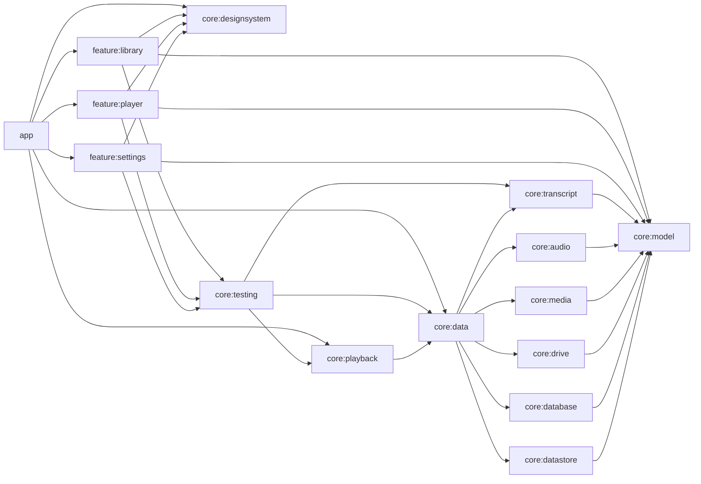

# 0001. モジュール構成とバージョンの方針（JDK を含む）

- 状態: 承認済み
- 日付: 2026-10-14
- 決めた人: lead

## 背景

Phase 0（設計書 §11）で、Gradle マルチモジュールの骨格・Version Catalog・convention plugins を作る。
並行開発の前に、モジュールの境界、依存の向き、ライブラリのバージョン、ビルドに使う JDK を決めておく必要がある。

## 決定

### モジュール構成

設計書 §5.2 のとおり。`settings.gradle.kts` にすべてのモジュールを登録した。

| 種類 | モジュール | convention plugin |
| --- | --- | --- |
| アプリ | `:app` | `chunkflow.android.application.compose` + `chunkflow.hilt` |
| 画面 | `:feature:library` / `:player` / `:settings` | `chunkflow.android.feature`（library + compose + hilt、core:model / designsystem / testing への依存） |
| 純 Kotlin | `:core:model` / `:core:audio` / `:core:transcript` | `chunkflow.jvm.library`（Kotlin JVM + Android Lint） |
| Android ライブラリ | `:core:media` / `:drive` / `:playback` / `:datastore` / `:testing` | `chunkflow.android.library` |
| Android ライブラリ | `:core:database` | `chunkflow.android.library` + `chunkflow.room` |
| Android ライブラリ | `:core:data` | `chunkflow.android.library` + `chunkflow.hilt` |
| Compose ライブラリ | `:core:designsystem` | `chunkflow.android.library.compose` |

依存の向き（§5.2 の依存ルールに沿う。矢印は「依存する」）:

- feature 同士は依存しない。画面遷移のキー（`NavKey`）と組み立ては `:app` に置く。
- `core:playback` → `core:data`: ChunkScheduler がチャンクと言語を `AnalysisRepository` から直接受け取るため（§7.2.1）。
- feature は、プレビュー用のフィクスチャのために `core:testing` に `implementation` で依存する。`core:testing` には
  Fake とフィクスチャだけを置き、JUnit などのテストの枠組みは入れない（リリースでは R8 が未使用のコードを取り除く）。
- `core:testing` は Android ライブラリ（`PlaybackController` が Media3 の `Player` を、`LibraryRepository` が `android.net.Uri` を使うため）。
  **そのため、純 Kotlin のモジュール（core:audio、core:transcript）のテストからは `core:testing` を使えない**。
  合成音源の生成などを純 Kotlin のテストで共有する必要が出たら、JVM のテスト用モジュール（例: `core:testing-jvm`）を加える
  （モジュールの追加は契約の変更なので、その時点で ADR と設計書 §5.2 を更新する）。
- Dispatcher の修飾子と提供（`@Dispatcher(ChunkFlowDispatchers.IO)`）は `core:data` の共通部分（`di` パッケージ）に置いた（§5.4）。

### convention plugins（`build-logic/convention`）

- `compileSdk` は 37、`targetSdk` は 36、`minSdk` は 34（Version Catalog の `[versions]` から読む）。
- AGP 9 の組み込みの Kotlin を使う（`org.jetbrains.kotlin.android` は適用しない）。
- Android Lint は全モジュールで `warningsAsErrors = true`（§9）。設定はルートの `lint.xml`。ネットワークや日付で結果が変わる検査
  （`GradleDependency`、`NewerVersionAvailable`、`AndroidGradlePluginVersion`、`OldTargetApi`）は無効にする（バージョンの更新は lead が管理する）。
- 整形はルートの Spotless + ktlint（`android_studio` スタイル。`.editorconfig`）。
- Compose のモジュールは、`compose_compiler_config.conf` で `core:model` の型を安定型として扱う（§6.2）。
- 単体テストは JUnit 4 + kotlin-test-junit。テストの JVM のロケールとタイムゾーンを固定する（`ja_JP`、`UTC`）。

### バージョン

確認日 2026-10-14。各リポジトリ（dl.google.com、repo.maven.apache.org、plugins.gradle.org、services.gradle.org）の
メタデータで、プレリリース（alpha / beta / rc）を除く最新を選んだ。例外はスクリーンショットテストのプラグイン（alpha しかない。ADR 0002）。

| 対象 | バージョン | ライセンス |
| --- | --- | --- |
| Gradle | 9.8.1 | Apache-2.0 |
| Android Gradle Plugin | 9.4.1 | Apache-2.0 |
| Kotlin（Compose コンパイラ、serialization のプラグインを含む） | 2.4.21 | Apache-2.0 |
| KSP | 2.3.12 | Apache-2.0 |
| Compose BOM | 2026.09.00（material3 1.4.0、ui 1.12.1） | Apache-2.0 |
| material3-adaptive | 1.3.0 | Apache-2.0 |
| Navigation 3 | 1.2.0 | Apache-2.0 |
| Media3 | 1.11.1 | Apache-2.0 |
| Hilt（Dagger） | 2.60.1 | Apache-2.0 |
| Room | 2.8.5 | Apache-2.0 |
| DataStore | 1.2.1 | Apache-2.0 |
| WorkManager | 2.12.0 | Apache-2.0 |
| kotlinx-coroutines | 1.11.0 | Apache-2.0 |
| kotlinx-serialization | 1.11.0 | Apache-2.0 |
| AndroidX core-ktx / activity-compose / lifecycle | 1.19.1 / 1.13.0 / 2.11.0 | Apache-2.0 |
| Spotless | 8.10.4 | Apache-2.0 |
| ktlint | 1.8.0 | MIT |
| JUnit 4 | 4.13.2 | EPL-1.0（テストのみ） |
| Compose Preview Screenshot Testing | 0.0.1-alpha16 | Apache-2.0 |

#### compileSdk 37 への切り替え（2026-10-14 に切り替え済み）

最新の安定版のうち次のものは、AAR のメタデータで compileSdk 37 以上を要求する（compileSdk 36 では `checkDebugAarMetadata` が失敗する）。
当初は依頼どおり compileSdk 36 を守るため一時的に下げていたが、人間が android-37 の SDK（`platforms/android-37.0`）を入れたため、
**compileSdk を 37 に上げ（targetSdk は 36 のまま、minSdk は 34 のまま）、下の版に上げた**。

| ライブラリ | 一時的に下げていた版（compileSdk 36） | いまの版（compileSdk 37。切り替え済み） |
| --- | --- | --- |
| Compose BOM | 2026.06.01（ui 1.11.4） | **2026.09.00（ui 1.12.1）** |
| androidx.core（core-ktx） | 1.18.0 | **1.19.1** |
| androidx.lifecycle | 2.10.0 | **2.11.0** |
| Navigation 3 | 1.1.7 | **1.2.0** |

- 切り替え後に `./gradlew build validateDebugScreenshotTest` が通り、スクリーンショットの基準画像（17 枚）に差は出なかった。
- compileSdk と targetSdk を分けるのは、API 37 の新しい API をコンパイルに使えるようにしつつ、実行時の挙動の変更（targetSdk 37 の
  オプトイン）はまだ受け入れないため。targetSdk を 37 に上げるときは、挙動の変更を確かめてから別の ADR で決める。
- material3（1.4.0）、activity（1.13.0）、Media3（1.11.1）は compileSdk 36 でも使える版。
- material3-adaptive（1.3.0）と WorkManager（2.12.0）は、まだモジュールに加えていないため compileSdk の要件は未確認（加えるときに `checkDebugAarMetadata` で確かめる）。

- Version Catalog に置いても、モジュールで使っていないもの（material3-adaptive、Media3 の exoplayer / session、WorkManager）は
  まだどのモジュールにも加えていない。使う時点で lead がモジュールに加える。OkHttp、play-services-auth などは Catalog にも入れていない。
- 更新は lead が行う（AGENTS.md §8）。自動更新のボット（Renovate / Dependabot）は当面使わない。

### JDK

- **Gradle を動かす JDK**: JDK 17 以上。ローカル（開発用の Mac）は **Android Studio の JBR（25.0.3）**、CI は **Temurin 25**（同じメジャーバージョン）。
  - 当初は Homebrew の OpenJDK 17 を使う予定だったが、開発用の Mac の実行許可の仕組み（Santa）が Homebrew の JDK の
    `jspawnhelper` をブロックするため、Gradle のデーモンを起動できなかった。署名済みの Android Studio の JBR は動く。
  - ターミナルからは `JAVA_HOME="/Applications/Android Studio.app/Contents/jbr/Contents/Home" ./gradlew build` のように実行する。
- **Java ツールチェーン（`jvmToolchain`）は使わない**。出力するバイトコードを Java 17 に揃える:
  Android のモジュールは `compileOptions`（17）と Kotlin の `jvmTarget`（17）、純 Kotlin のモジュールはさらに
  `javac --release 17` と `-Xjdk-release=17` で Java 17 にない API の使用も防ぐ。
- 理由: ツールチェーンは「Gradle を動かす JDK とは別の JDK を自動検出・自動ダウンロードする」仕組みで、
  (1) 自動ダウンロードには許可していない通信先（foojay など）が必要、(2) 開発用の Mac では Homebrew の JDK が使えない、
  (3) Android のコンパイルは android.jar に対して行うため、ツールチェーンで得られる利点が小さい。
  `--release` / `-Xjdk-release` により、どの JDK（17〜25）で動かしても同じ互換性の出力になる。

## 影響

- 他の担当が依存を加えたいときは、AGENTS.md §8 の手順で lead に依頼する。
- Gradle / AGP を上げるときは、この ADR を置き換える新しい ADR を書く。
- 既知の脆弱性: 公式の脆弱性データベース（OSV など）での照会は、許可された通信先の外なので**未確認**。
  依存の安全性を確認するツールが使えるようになったら、照会して結果をこの ADR に追記する。
