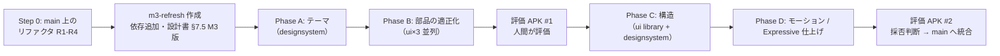

# Material Design 3（Expressive）移行計画

- 作成日: 2026-10-20
- 作成者: lead
- 状態: **承認済みの方針に基づく実行計画**（ADR 0012）。調査は [m3-compliance-review.md](m3-compliance-review.md)。
- 進捗はこの文書の §6 に追記する。

---

## 1. 決まっていること（ADR 0012 の要約）

| 論点 | 決定 |
| --- | --- |
| ライブラリの構造 | 下部ナビゲーション（Compact: Navigation bar、Medium 以上: Navigation rail）。**最下部のミニプレイヤー（直近ファイルの概要 + 再生ボタン）は残す**。フォルダタブ下部の「最近開いたファイル」は廃止。 |
| 言語の色（母語 / 学習言語） | ダイナミックカラーに調和させる。アプリ全体の統一感を優先しつつ、2 色が見分けられる色相差を保つ。 |
| M3 Expressive | 積極的に採用（`ButtonGroup` / `ToggleButton` / `SplitButton` / `FloatingToolbar` / `LoadingIndicator` / `MotionScheme`）。Experimental API はラッパーに閉じ込める。 |
| 書体 | 既定のまま。同梱しない。 |
| 評価用 APK | 既存アプリを上書き。**Room スキーマと DataStore キーは変更しない**。 |
| ブランチ | `main` と分けた統合ブランチ `m3-refresh`。採用が決まるまで `main` に入れない。 |
| 事前作業 | `main` 上で振る舞いを変えないリファクタリングを先に行う（§2）。 |
| 担当 | `designsystem` エージェントを新設。ui は `feature/` の画面に専念（§5）。 |

---

## 2. Step 0: `main` 上の事前リファクタリング（振る舞いを変えない）

目的: (a) 並列開発で同じファイルを触らないようにする、(b) 重複した再生操作 UI を 1 箇所にして、M3 化の置換点を減らす、(c) 置換の前後で「ピクセルが変わっていない」ことをスクリーンショットテストで保証できる状態にする。

**完了条件（全タスク共通）**: `validateDebugScreenshotTest` が**基準画像を更新せずに**通る（= 見た目の変化ゼロ）、`spotlessCheck lint testDebugUnitTest` が通る、公開 API（`XxxRoute` / `XxxScreen` のシグネチャ）は変えない。

| ID | 作業 | 担当 | 並列性 |
| --- | --- | --- | --- |
| R1 | **`LibraryScreen.kt`（4,274 行）の分割**。移動のみで、関数の中身は変えない。目安の構成: `LibraryScreen.kt`（Route / Screen / Scaffold / TopAppBar / タブ切替）、`LibraryFoldersTab.kt`、`LibraryFilesTab.kt`、`LibraryPlaylistsTab.kt`（+ `CreatePlaylistDialog` / `AddToPlaylistDialog`）、`LibraryBookmarksTab.kt`（アコーディオン、チャンク行）、`LibraryBookmarkPlaybackController.kt`（下部コントローラー、速度シート）、`LibraryItemRow.kt`（行、`TranscriptStatusIndicator`、`AudioItemThumbnail`、`LanguagePairBadge`、`ReorderDragHandle`）、`LibraryBanners.kt`（`ImportStatusBanner` / `StatusBannerCard` / `LibraryEmptyContent`）、`MiniPlayerBar.kt`、`LibraryPreviews.kt`（プレビュー）。`private` は `internal` に緩める。 | ui（library） | R2 と並列可 |
| R2 | **`PlayerScreen.kt`（3,118 行）の分割**。同様に移動のみ。目安: `PlayerScreen.kt`（Route / Screen / 2 ペイン / TopAppBar / `PlayerTranscriptionStatusBadge`）、`ChunkDisplaySettingsStrip.kt`、`ChunkSelectionActionStrip.kt`（既存 `ChunkSelection.kt` と統合してよい）、`PlaybackControls.kt`（`PlaybackControlStrip` / `PlayerTransportControls` / `TransportTonalButton` / フローティング操作バー）、`PlayerSpeedSheet.kt`、`ResegmentSheet.kt`（`ResegmentSheetContent` と関連ダイアログ）、`PlayerBanners.kt`（`AutoPauseCountdownBanner` / `PlayerErrorBanner`）、`PlayerPreviews.kt`。 | ui（player） | R1 と並列可 |
| R3 | **重複する再生操作 UI の共通化**（R1・R2 の統合後）。`feature:library` の `BookmarkPlaybackControlStrip` / `BookmarkSpeedControlSheetContent` / `BookmarkSeekStepButton` と、`feature:player` の `PlaybackControlStrip` / `PlayerSpeedSheetContent` / `TransportTonalButton` を、`core:designsystem` の `component/playback/` に **状態を受け取るだけの Composable** として 1 つにまとめ、両 feature から使う。`brightnessToggleChipColors`、`CompletedTranscriptBadgeColor`、言語バッジ（`LanguagePairBadge` / `ChunkLanguageBadge` / `LanguageCodePill`）も同様に 1 箇所へ。引数は `speed: Float`、`customSpeed: Float`、`repeatState`、`skipSilence: Boolean`、`onXxx` のラムダなど、`core:model` の型までに限る（ViewModel や UiState を渡さない）。 | ui（1 つの worktree で両 feature と designsystem を触る。R3 の間は他の ui を動かさない） | R1・R2 の後 |
| R4 | `:app` の `ChunkFlowNavDisplay` のコメント（「2 ペインは M4 で加える」）と設計書 §7.5.1 の食い違いを、設計書側を実装に合わせて修正（アプリ単位の 2 ペインは**未実装**）。 | lead | いつでも |

> [!IMPORTANT]
> R1〜R3 では**色・寸法・文言・順序を一切変えない**。M3 化（Phase A 以降）と混ぜると、基準画像の差分から「意図した変更かどうか」を判断できなくなる。

---

## 3. 移行の設計方針（ブランチ上で行うこと）

### 3.1 テーマ（Phase A）
- `Typography`: M3 既定の書体で 15 スタイルを明示し、Expressive の Emphasized スタイルも `MaterialExpressiveTheme` 経由で使えるようにする。
- `Shapes`: M3 の Shape scale を定義し、`RoundedCornerShape(n.dp)` の直書き（59 箇所）を `MaterialTheme.shapes.*` に置換。
- 拡張色: `ChunkFlowExtendedColors`（`favorite`、`success`、`wholeFileRepeat`、`transcriptCompleted` など）を `CompositionLocal` で提供し、ハードコード色（13 箇所）を吸収する。
- `MaterialExpressiveTheme` + `MotionScheme.expressive()` に切り替える。プレビュー / スクリーンショットでは代替配色を全ロール定義（Material Theme Builder で生成）。

### 3.2 言語色の調和（Phase A、designsystem）
- 方式: HCT 色空間で、母語 / 学習言語の**基準色相**（青 ≈ 250°、ピンク ≈ 350°）を `primary` の色相へ**部分的に**寄せる（`Blend.harmonize` 相当。寄せる割合は 0.5 以下で調整）。トーンは `ColorScheme` のコンテナ（ライト: T90 前後、ダーク: T30 前後）に合わせて生成し、行背景 / バッジ / 波形 / チャンク面の各トーンを 1 つの色相から派生させる。
- 制約（テストで固定する）: 調和後の 2 色相の差 ≥ 60°、バッジのコンテナと文字のコントラスト比 ≥ 4.5:1、`primary` と学習言語の色相差 ≥ 30°（`primary` と見分けるため）。
- 実装（**決定 2026-10-20**）: 依存を追加せず、`material-color-utilities`（Apache-2.0）の `Hct` / `Cam16` / `ViewingConditions` / `Blend.harmonize` 相当を**純 Kotlin で `core:designsystem` に移植**する（`theme/colorutil/` パッケージ。出典とライセンス表記をファイル先頭の KDoc に残す）。移植の正しさは、既知の入力に対する HCT 変換と調和結果の数値テストで固定する。

### 3.3 ライブラリの構造（Phase C）
- `NavigationSuiteScaffold`（`material3-adaptive-navigation-suite`）で 4 行き先。アイコン: フォルダ / 一覧 / 再生リスト / ブックマーク。選択状態の TopAppBar（N 件選択中）は維持。
- **ミニプレイヤー**は `NavigationSuiteScaffold` の `content` の下端（Navigation bar の直上）に固定。内容は現状どおり「サムネイル / タイトル / 位置 / 再生ボタン」。タップで全画面プレイヤー。
- **ブックマークの連続再生**: 現状のブックマークタブ専用コントローラー（§7.5.2 E）は、ミニプレイヤーを**展開**した状態（`BottomSheetScaffold` 相当、または `AnimatedContent` で高さを変える）として統合する。展開時に `HorizontalFloatingToolbar` / `ButtonGroup` で速度・リピート・無音スキップ・前後ブックマークを出す。これにより「タブによって下部の部品が入れ替わる」状態をなくす。
- 行は `ListItem` に寄せ、末尾の操作は 1 つ（お気に入り）＋オーバーフロー（編集 / リストから除外）。進捗バーは `supportingContent` に残す。
- フォルダ行の全面着色をやめ、先頭アイコンの色 + `AssistChip`（仮想）で区別。
- 「最近開いたファイル」セクションは削除（再生リストタブのスマートリストが代替）。

### 3.4 プレイヤーの操作部（Phase B）
- 再生操作ストリップ → `ButtonGroup`（連結トグル）: `[1x | 1.5x]`（速度、排他）、`[リピート]`、`[無音スキップ]`、`[設定]`。速度とリピートの長押し機能は `SplitButton`（主 + ▼）に移し、長押しも残す。
- トランスポート → `FilledIconButton`（再生、大サイズ、shape morphing）+ `FilledTonalIconButton` ×4。秒数は `TooltipBox` と `contentDescription` に。長押しメニューは残す。
- フローティング操作バー → `HorizontalFloatingToolbar`（ドラッグ移動は既存実装を再利用）。
- 文字起こし進捗 → `LinearWavyProgressIndicator` / `LoadingIndicator`。

### 3.5 設定（Phase B）
- `ListItem` + `Switch` 中心。排他選択は `SegmentedButton` / `ButtonGroup`。カードの囲みをやめ、見出しと区切りで節を示す。

---

## 4. フェーズと順序

| フェーズ | 内容 | 担当 | 完了条件 | 目安 |
| --- | --- | --- | --- | --- |
| Step 0 | §2 の R1〜R4 | ui ×2 → ui ×1、lead | 基準画像の差分ゼロで全チェック通過 | 2〜3 日 |
| 準備 | `m3-refresh` 作成。依存追加（`material3-adaptive-navigation-suite`、`material3-adaptive-layout`、必要なら色の調和）。設計書 §7.5 の M3 版（ブランチ上）。`core:testing` に新部品用のプレビュー状態を追加 | lead | ビルドが通る。設計書 M3 版に人間の合意 | 1 日 |
| Phase A | §3.1、§3.2。`MaterialExpressiveTheme`、Typography / Shapes、拡張色、言語色の調和、ハードコード色・絵文字の除去、`brightnessToggleChipColors` 廃止 | designsystem（テーマ）、ui ×3（各 feature の置換） | 基準画像の差分が「色・角丸のみ」であることを人間が確認 | 3〜4 日 |
| Phase B | §3.4、§3.5、Snackbar 導入、TopAppBar の scrollBehavior、複雑なダイアログのシート化、Filled Button の昇格 | designsystem（`ButtonGroup` / `SplitButton` / `FloatingToolbar` のラッパー）、ui ×3 | qa のゲート通過。**評価 APK #1** を人間に渡す | 8〜10 日 |
| Phase C | §3.3（下部ナビ、ミニプレイヤー統合、`ListItem` 化）、アプリ単位の List-detail 2 ペイン | ui（library）、lead（`:app` の Scene）、designsystem | 手動テスト §2〜§5 の再実施。qa のゲート通過 | 10〜12 日 |
| Phase D | `MotionScheme`、`AnimatedVisibility` / `animateItem`、shape morphing、Shared element、アイコンの Material Symbols 化 | designsystem、ui ×3 | **評価 APK #2**。人間の採否判断 | 5〜6 日 |
| 統合 | `m3-refresh` → `main`。設計書 §7.5 を差し替え、ADR 0012 の状態を更新 | lead | `main` で全チェック通過 | 1 日 |

評価 APK の作り方: `JAVA_HOME=... ./gradlew :app:installDebug < /dev/null`（上書きインストール）。人間に渡すときは `app/build/outputs/apk/debug/app-debug.apk` を共有し、`osascript` の通知で知らせる（AGENTS.md §4）。

---

## 5. ブランチ運用と担当

### 5.1 ブランチ
- 統合ブランチ: **`m3-refresh`**（`main` の Step 0 完了コミットから lead が作る）。
- 作業ブランチ: `agent/<担当>/m3-<フェーズ>-<画面>`（例: `agent/ui/m3-b-player`、`agent/designsystem/m3-a-theme`）。`m3-refresh` から切り、`m3-refresh` へ lead が統合する。
- `main` の変更（不具合修正など）は、フェーズの区切りで lead が `m3-refresh` に取り込む（`git merge main`）。
- `m3-refresh` では **Room スキーマと DataStore のキーを変更しない**（上書きインストールで `main` に戻せるようにする）。

### 5.2 担当（AGENTS.md §3 を更新済み）
| エージェント | 範囲 | この移行での役割 |
| --- | --- | --- |
| `designsystem`（新設） | `core/designsystem/` | テーマのトークン（Typography / Shapes / 拡張色 / 言語色の調和）、共通部品（再生操作、バッジ、`ListItem` ラッパー）、Expressive API のラッパー、デザインシステムのプレビューと基準画像 |
| `ui` | `feature/` | 画面ごとに別 worktree で並列（library / player / settings）。共通部品が必要なら designsystem に依頼する（自分で `core/designsystem/` を触らない） |
| `lead` | 依存、`:app`、設計書、ADR、統合 | ブランチ作成、依存追加、Navigation 3 の Scene / 2 ペイン、設計書 §7.5 M3 版、フェーズごとの統合 |
| `qa` | テスト追加、`docs/qa/` | 各フェーズのゲート（基準画像差分の分類、手動テスト、アクセシビリティ） |

### 5.3 並列化の単位と衝突回避
- 同じフェーズで ui を 3 つ動かすときは **feature 単位**（`feature/library`、`feature/player`、`feature/settings`）で分ける。`core/designsystem/` は designsystem だけが書く。
- designsystem の部品は、ui が使う前に `m3-refresh` に入っている必要がある。各フェーズの最初の 1〜2 日は designsystem が先行し、ui は設計書 M3 版の読み込みとプレビュー状態の準備をする。
- 1 画面の中でさらに分けたい場合（例: プレイヤーの波形と操作部）は、Step 0 で分割したファイル単位で分ける。

### 5.4 レビューと承認
- 基準画像の更新を含むコミットは、`build/reports/screenshotTest/` の差分画像を報告に添える。人間は「意図した変更か」を確認して承認する（AGENTS.md §9）。
- フェーズの終わりに qa が `docs/qa/m3-<phase>.md` に結果を残す。

---

## 6. 進捗

| 日付 | 内容 |
| --- | --- |
| 2026-10-20 | 調査（m3-compliance-review.md）、ADR 0012、この計画、`designsystem` エージェント新設。Step 0（R1 / R2）を ui に依頼。 |
